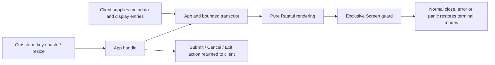

# Component: terminal presentation

## Technical specification

- **Purpose:** Presentation-only Rust library for an interactive client. It owns screen drawing,
  input editing, theme preview and a bounded transcript projection. Execution stays in the caller.
- **Current milestone:** P1 UI foundation. The production `cluaiz` agent is not connected to this
  package yet. No model responses, approvals, tools or saved sessions are implemented here.
- **Dependencies:** Ratatui, its maintained textarea widget, Crossterm and textwrap. No workspace
  dependency, model backend, GPU driver, network client or filesystem service.
- **Platform boundary:** Cross-platform terminal APIs. Automated backend tests do not establish
  native keyboard/font behavior on every OS. The ignored preview requires a real interactive TTY.

## Architectural flow



## API contract

- `App::new(Metadata, Limits)` initializes display state. Metadata is supplied by the client;
  there is no model discovery or hidden settings/home-directory lookup.
- `App::handle(Event) -> Action` handles UI input. The client must process Submit/Cancel/Exit;
  receiving a Submit action does not mean anything was executed or persisted.
- `Transcript::upsert(id, label, content)` inserts or replaces a stable display entry. Oversized
  entries return an error instead of silently shortening content. The caller supplies a preview
  and a full-output mechanism when needed. Exceeding entry retention evicts older display entries
  and exposes an omitted count; this is not a durable-history store.
- `render(Frame, &mut App)` also works with Ratatui's TestBackend without opening a real screen.
- `Screen::open/draw/close` owns the real alternate screen. Redirected or dumb terminals return
  Unsupported; the caller must choose plain output. A second active screen is rejected.
- `Screen` installs one process-wide panic wrapper that restores an active screen before delegating
  to the previously installed panic hook. It cannot recover modes after a forced OS process kill.
- The client owns its worker/event loop, logging handoff and persistence. Workers must not print
  over the screen. This library has no spinner thread, execution policy or agent-event serializer.

## Files and ownership

| File | Responsibility |
| --- | --- |
| `src/terminal.rs` | TTY detection, exclusive ownership, raw mode, bracketed paste and restoration. |
| `src/app.rs` | UI-only reducer, theme-picker focus, submit/cancel/exit actions. |
| `src/input.rs` | Maintained textarea adapter, bounded UTF-8 draft, newline and undo/redo. |
| `src/keymap.rs` | Application keys; execution shortcuts are not registered here. |
| `src/model.rs` | Caller metadata and configurable resource limits. |
| `src/theme.rs` | Semantic styles; Auto preserves terminal colors without palette polling. |
| `src/transcript.rs` | Stable display entries, cached wrapping, logical-line scroll anchors. |
| `src/render.rs` | Responsive header, transcript, composer, footer and theme overlay. |
| `src/sanitize.rs` | Removes raw control characters from untrusted cell content; only renderer writes ANSI. |
| `tests/behavior.rs` | Deterministic interaction and rendered-buffer checks. |
| `tests/interactive.rs` | Ignored, explicitly labelled developer preview; no AI/tool execution. |

## Interaction

| Key | Behavior |
| --- | --- |
| Enter | Returns a Submit action for nonblank draft; release/repeat does not resubmit. |
| Alt+Enter, Shift+Enter, Ctrl+J | Inserts a newline. Modifier delivery depends on the terminal. |
| F2 | Opens theme preview. Arrows preview; Enter applies for this App instance; Esc restores the original. |
| Arrow keys, Home, End | Editor navigation through the widget. |
| Ctrl+Z / Ctrl+Y | Draft undo / redo. |
| PageUp / PageDown | Scrolls the transcript; reading old output stops following appended entries. |
| Ctrl+End | Follows latest transcript output again. |
| Esc / Ctrl+C | Closes the theme overlay first, otherwise returns Cancel; the caller decides cancellation. |
| Ctrl+Q | Returns Exit. The caller closes the screen. |

Paste is text insertion, including `/` or `!` prefixes. It never dispatches a command. Pasted
control characters cannot issue screen/clipboard/title instructions. Escape-sequence payload text
may remain visible literally; this is not a terminal emulator. Draft limits reject the whole insertion
and retain the old text. Text is not trimmed when submitting. Theme/draft state is currently in RAM.

## Validation and preview

From the repository root:

```sh
cargo test --release -p cluaiz-terminal
cargo clippy --release -p cluaiz-terminal --all-targets -- -D warnings
cargo test --release -p cluaiz-terminal --test interactive test_interactive_preview -- --ignored --nocapture
```

The last command is interactive: F2 previews themes, type/paste edits a draft, Enter adds your
input to the preview transcript, and Ctrl+Q exits. The initial rows are labelled UI fixtures.
No Engine, model, tool or command is executed. Tests belong in test targets, not production commands.

The separate `test_real_terminal_cleanup_after_error_and_panic` ignored test checks caller-error,
expected-panic, exclusive-screen and reopen behavior. Its panic text is intentional; the test must
still finish with a passing result. Run ignored terminal tests individually to avoid screen contention.
The automated tool console sets `TERM=dumb`; a test-owned interactive pseudo-console must set its
own real terminal type. Do not globally override TERM or force rich UI on redirected output.

Resolved UI dependencies require a newer shared `bitflags` than the previous lockfile; Cargo.lock
records that resolution. The existing CLI's Crossterm version remains unchanged. P1's package tests
do not constitute a full Engine/CLI native build or API regression pass.

## Failure and recovery

- Terminal setup/drawing/explicit cleanup returns I/O errors. Drop and panic cleanup are best effort;
  use `close()` to observe cleanup errors. Normal process unwinding is required for Drop.
- Input and display limits return notices/errors. The caller owns durable logs and old-history loading.
- Tiny windows show a recoverable resize notice. Wrapped content is rebuilt on width/content changes;
  when reading older output the logical source line is retained, not an exact byte/pixel position.
- Mouse capture, selection/export UI, Markdown styling, persistent theme/history, `/` and `@`
  completion, API/agent integration, background work and approval UI remain later milestones.
