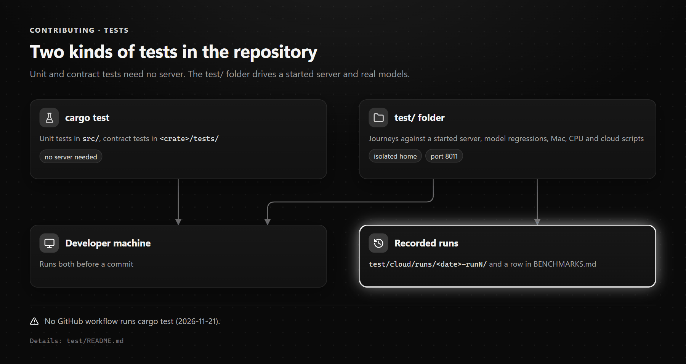
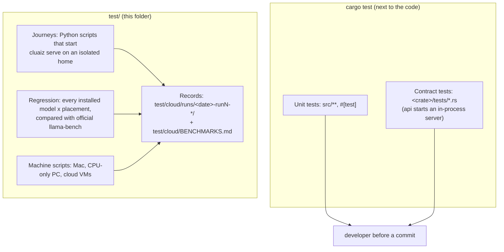

# Component: `test/` (tests against a running Engine, and recorded machine runs)

## Technical specification

- **Purpose:** the tests that need a whole Engine, a real model or a real machine. Unit and contract
  tests that `cargo test` runs live next to the code, in each crate's `src/` and `tests/` (counts
  below). This folder holds what `cargo test` cannot do: journeys against a started server, scripts
  for cloud VMs, Mac and CPU-only PCs, and the record of every run.
- **Platform support:** Python 3 scripts (any OS), PowerShell scripts (Windows), Bash scripts (Linux,
  macOS, Git Bash), two small Rust programs.
- **Safety rule for every script here:** run it against an isolated home (`CLUAIZ_HOME=<temp folder>`)
  on port 8011, never the developer's own `~/.cluaiz` or a server on port 8000. Scripts that start
  their own server take `--home` and `--port`; the older ones that assume port 8000 are marked below.

## Two kinds of tests in this repository

No GitHub workflow runs `cargo test` (2026-11-21: the workflows in `.github/workflows/` build drivers,
run the release smoke test `.github/scripts/smoke_test.sh`, the clean-Windows runtime check
`test/workflows/test_clean_windows_runtime.py` and the docs check). Unit tests run on developer
machines and inside cloud runs (`test/cloud/remote/linux_tests.sh`).

### Test functions next to the code (`#[test]` / `#[tokio::test]`, counted 2026-11-21)

| Crate | Unit (`src/`) | Contract / integration (`tests/`) |
|---|---|---|
| `agents` | 162 | 2 |
| `api` | 87 | 39 |
| `automation/core` | 70 | 46 |
| `cmd` | 54 | 13 |
| `terminal` | 2 | 49 |
| `context` | 30 | 0 |
| `cep` | 16 | 5 |
| `security` | 4 | 0 |
| `ffi`, `automation/host`, `tools/cluaiz-builder` | 3, 1, 1 | 0 |
| `engine/*` | see [`engine/README.md`](../engine/README.md#tests) | |

## What is in this folder

| Path | What it tests | How it runs | State (2026-11-21) |
|---|---|---|---|
| [`cloud/`](cloud/README.md) | every recorded machine run: VM helper, remote scripts, `runs/`, `BENCHMARKS.md` | `test/cloud/vm.sh`, scripts copied to the VM | active; runs 1-31 |
| [`context-runtime/`](context-runtime/README.md) | tool routing set, KV equality after edits, long sessions and compaction, memory, tool-call format, chat templates, speed | Python against a running isolated server | active; results inside its README |
| [`engine_regression/`](engine_regression/README.md) | every installed GGUF chat model x placement (auto, gpu, split, cpu): answer not empty, no control-token leak, speed against llama-bench | `python test/engine_regression/run.py [--llama-bench ...] [--report ...]` | active; used by cloud regression runs |
| [`cep/`](cep/wave_b/README.md) | CEP journeys (`journeys.py`), MCP over HTTP and stdio (`mcp_journey.py`), the C library through Python ctypes (`ffi_python.py`), and `wave_b/` file, system, model and tool contracts | each script starts its own server: `--exe --home [--port 8011]` | active |
| [`media_regression/`](media_regression/README.md) | release acceptance for embeddings, vision and attachments with the real executable; `video_spike/` for native video packaging | Rust acceptance tests and commands in its README | active |
| [`workflows/`](workflows/README.md) | the GitHub workflows locally (actionlint, act), installer banner and progress, clean Windows runtime | PowerShell / Python | active; one script runs in `release.yml` |
| [`mac/`](mac/README.md) | install, pull, chat and planner on Apple Silicon; one recorded run (M5 Air 16 GB, 2026-10-28) | `bash test/mac/mac_test.sh` | last run 2026-10-28 |
| [`cpu/`](cpu/README.md) | a Windows PC without a GPU | `.\test\cpu\cpu_test.ps1` | last change 2026-11-07 |
| `smoke.ps1` | CEP `models.list` + `system.plan` for every installed chat model, written to `system_plan_audit.txt` | `.\test\smoke.ps1 [-Port 8011]`; default port 8000 | old default port |
| `smoke.sh` | `/v1/models` and `/v1/chat/completions`; `--start` boots `cluaiz serve` | `./test/smoke.sh [port] [--start]`; default port 8000 | last change 2026-08-25 |
| `plugin_testing/` | the `cluaiz-search` plugin through CEP `tools.call` | `cargo run -p plugin_testing`; port 8000 fixed in the code | workspace member; old port |
| `comprehensive_e2e_trace/` | a 10-step trace of one web-search chat; needs a sibling `cluaiz-tools` checkout | `cargo run --manifest-path test/comprehensive_e2e_trace/Cargo.toml`; port 8000 fixed | excluded from the workspace; its saved output predates current wording |
| `test_custom.rs` | skill KV cache and router checks | not built: it imports a crate `engines` that does not exist | dead file |
| `benchmark_suite.json` | 46-line prompt list by category and difficulty | no script reads it (searched 2026-11-21) | last changed 2026-05-28 |
| `*.txt` | local outputs (`system_plan_audit.txt`, ...) | git-ignored (`.gitignore:76`) | not in the repository |

## How a run is recorded

Every test on a real machine gets a folder `test/cloud/runs/<date>-runN-<what>/` with a `SUMMARY.md`
(machine, build, settings, results, what it does not prove), the raw output files and the script that
produced them, and one row in [`cloud/BENCHMARKS.md`](cloud/BENCHMARKS.md). Usernames and keys are
removed from recorded files (`<user>`, `<key>`). Details: [`cloud/README.md`](cloud/README.md).

## Decisions and why

| Decision | Why | Alternative not taken |
|---|---|---|
| Live tests start their own server on an isolated home and port 8011 | a test against the developer's own server can change its settings, tokens and installed models; an isolated home also starts from a known state | test against whatever runs on 8000 |
| Speeds compared with official llama.cpp tools on the same machine and settings | a speed number alone says nothing about whether the Engine adds overhead | report Cluaiz numbers alone |
| Raw output kept next to each summary | a number in a README must be traceable to the output that produced it | summaries only |

## Pending

| Item | Why it matters | Needs |
|---|---|---|
| `cargo test` in CI | today nothing runs the unit tests automatically on a push | a workflow that runs the crates that build without native backends (`core`, `hw`, `media`, `models`, `plan`, `security`, `cep`, `context`, `agents`) |
| `test_custom.rs` does not compile | a reader may think it covers skills and routing | delete it, or rewrite it against current crates |
| `benchmark_suite.json` has no reader | unused data | delete it, or point a script at it |
| `smoke.sh`, `smoke.ps1`, `plugin_testing`, `comprehensive_e2e_trace` and `engine_regression/run.py` default to port 8000 | they can hit the developer's own server | take a port and home like the `cep/` scripts |
| `comprehensive_e2e_trace/output/comprehensive_trace.json` | an old saved answer with wording the project no longer uses | regenerate or delete |

