# MTP (multi-token prediction): off, on and Auto

## Answer

MTP Auto (run 24, L4) keeps most of the gain where MTP is fast and loses much less where it is slow; its guard
costs 2-5% on a gainful case. Gain over MTP off:

| Case | Placement | MTP on | MTP Auto |
|---|---|---|---|
| Dense 2B | Full GPU, four prompts | 0.77-1.38x | 0.81-1.33x |
| MoE 35B A3B | Full GPU | 1.21-1.72x | 1.19-1.66x |
| MoE 35B A3B | Split (ngl 41) | 1.06-1.66x | 1.15-1.61x |
| MoE, experts in RAM (8 GB VRAM) | MoE split | 0.70-1.14x | 0.89-1.12x |
| MoE, experts partly from the SSD | MoE split | 0.64-0.99x | 0.97-1.02x |

```mermaid
xychart-beta
    title "MoE 35B A3B on the full GPU: gain over MTP off (run 24)"
    x-axis ["code", "chat", "list", "long"]
    y-axis "x faster" 0 --> 2
    bar [1.51, 1.21, 1.72, 1.26]
    bar [1.53, 1.19, 1.66, 1.21]
```



Bars: MTP on first, MTP Auto second.

Run 25: MTP usage reporting (serialization and CLI) passed.

Below: every current run of this test type, newest first, in full.

<a id="run-25"></a>

## Run 25 (2026-11-20)

Date: 2026-11-20. Windows build 26300. Engine base `e114cc07` plus the local reporting patch.

#### Checks

- `cargo test --release -p cluaiz-api --lib --test mtp_contract handlers::chat::turn_end::tests` passed:
  `test result: ok. 5 passed; 0 failed; 0 ignored; 0 measured; 82 filtered out`.
  The `mtp_contract` test binary compiled and lists
  `mtp_usage_is_returned_for_streaming_and_non_streaming`. The live test was filtered out.
- `cargo build -p cmd` finished successfully: `Finished dev profile [unoptimized] target(s) in 45m 10s`.

- The API payload unit tests and CLI percentage calculation ran in an isolated Rust harness using
  the source from `api/src/handlers/chat/turn_end.rs`, `engine/llama/src/native/core.rs`,
  and `cmd/src/chat/mod.rs`. The harness used the locked serde and serde_json versions.
  Output: `test result: ok. 6 passed; 0 failed; 0 ignored; 0 measured; 0 filtered out`.
- App `npm run sync:api` and `npm run check:api`: both printed
  `API docs: 123 requests in 27 groups`. Direct catalog inspection found `usage.mtp`
  on `/v1/chat/completions`.
- App `npm run test:api-docs`: 19 passed, 1 failed on
  `notes.move: Parameters, defaults and value effects`. The same assertion failed with the
  pre-change Engine chat page restored in a separate baseline docs copy.

- In an isolated home, `cluaiz run <TinyLLama-v0.1-5M-F16.gguf> --local --mtp on --n-gpu-layers 0 --n-predict 4 --temp 0 -v -p 'Hello'`
  generated four tokens on CPU. The observed checks were `CLI exit: 0` and `MTP kept lines: 0`.
  The fixture has no MTP layers. This was an output check, not a throughput benchmark.

#### Scope

These checks cover JSON serialization, existing token totals, CLI percentage arithmetic and catalog
generation. The CLI smoke check exercised a GGUF without MTP. The live API model test requires an MTP-capable
GGUF available by path outside the owner's runtime home.

To run the repository tests from the Engine root:

```powershell
cargo test --release -p cluaiz-api --lib handlers::chat::turn_end::tests
```

For the live test, set `CLUAIZ_HOME` and `CLUAIZ_MTP_TEST_HOME` to the same fresh empty
absolute directory and set `CLUAIZ_MTP_TEST_MODEL` to the path of an MTP GGUF on the same volume.
The test uses an in-process router and hard-links the model into a temporary package.

```powershell
cargo test --release -p cluaiz-api --test mtp_contract -- --ignored
```

#### Live check at review (2026-11-20, laptop RTX 3050 4 GB)

Same patch, `cargo build -p cmd --release`, isolated `CLUAIZ_HOME`, port 8011, `CLUAIZ_MTP=on`,
`unsloth/Qwen3.5-2B-MTP-GGUF` Q4_K_M:

- `cluaiz run <model> --local -v -n 120 -p "Write a JSON list of 8 fruits with name and color."` printed
  `MTP 80% kept`; the log line said 411 of 513 guessed tokens accepted.
- `POST /v1/chat/completions` (not streaming) returned `usage.mtp = {"accepted": 2012, "drafted": 3211, "stopped": false}`,
  matching the log line "2012 of 3211 guessed tokens accepted (63%)".
- The streaming request finished on the server (log: 1699 of 2610 accepted), but the client command was cut
  before its final usage event was read, so the streaming field is not shown here.
- `max_tokens: 120` did not limit the answer of this thinking model (3,211 drafted tokens); this is the known
  pending max_tokens-with-thinking decision, not part of this patch.

Logs, raw results and scripts: [`test/cloud/runs/2026-11-20-run25-mtp-usage/`](../cloud/runs/2026-11-20-run25-mtp-usage/)

<a id="run-24"></a>

## Run 24 (2026-11-20)

| | |
|---|---|
| Machine | Google Cloud `g2-standard-8` (us-central1-c): NVIDIA L4 23 GB, 8 vCPU, 31 GB RAM, Debian 13; laptop check on the RTX 3050 4 GB |
| Cluaiz | `main` at `b46c58d2` plus this change: `optimization.mtp = auto` decides per load (`engine/runtime/src/native_load.rs` `mtp_mode`) and a guard in every answer stops guessing where it is slower (`engine/llama/src/native/stream.rs`, "MTP guard") |
| Models | as run 23: `unsloth/Qwen3.5-2B-MTP-GGUF` Q4_K_M (dense), `unsloth/Qwen3.6-35B-A3B-MTP-GGUF` UD-IQ4_XS (MoE) |
| Method | `cluaiz bench <model> --mtp-compare` loads off, on and auto in turn every round on the same pinned placement, in a fresh `CLUAIZ_HOME` (no stored speeds at the start; the cases run in order, so a later case can use a speed an earlier one stored) |
| Records | [`results/`](../cloud/runs/2026-11-20-run24-mtp-auto/results/): `.json`, `.md`, `.err`, `.gpu` per case, `steps.log`, `auto_and_guard.log` (every Auto decision and guard stop); script `test/cloud/remote/mtp23/run24.sh` |

Background: [run 23](mtp.md) measured off and on everywhere and found
no fixed rule by placement that is right for every model and text.

#### What Auto does

At load (first rule that applies): weights read from the disk -> off; MTP's memory (about 1.6 blocks
of weights + 0.15 GB, from run 23) does not fit next to the planned placement -> off; a stored
`bench --mtp-compare` result for this model and placement -> on if generation was at least 5% faster,
else off; otherwise -> on with the guard.

The guard, in each answer: the first 8 steps decode one token each without guesses (this answer's
plain speed); then drafting is timed, and every 32 tokens from drafting steps it is compared with
plain; slower stops guessing for the rest of the answer.

#### Results (gain over MTP off; "stopped" = answers where the guard stopped guessing)

| Case | Placement | Prompt | on | **auto** | stopped |
|---|---|---|---|---|---|
| A dense 2B | Full GPU | code | 1.12x | 1.09x | 0 of 2 |
| | | chat | 0.80x | **0.85x** | 2 of 2 |
| | | list | 1.38x | 1.33x | 0 of 2 |
| | | long | 0.77x | **0.81x** | 2 of 2 |
| | Split (ngl 25) | code | 1.05x | 1.06x | 1 of 2 |
| | | chat | 0.78x | **0.83x** | 2 of 2 |
| | | list | 1.33x | 1.30x | 0 of 2 |
| | | long | 0.75x | **0.84x** | 2 of 2 |
| | CPU only | code | 0.89x | **1.00x** | 2 of 2 |
| | | chat | 0.69x | **0.83x** | 2 of 2 |
| | | list | 1.25x | 1.23x | 0 of 2 |
| | | long | 0.70x | **0.86x** | 2 of 2 |
| D dense 2B, after A | Full GPU | all four | 0.79-1.37x | **1.00x** | Auto off: A stored on/off averaged over its prompts, 2% faster, below the 5% rule |
| E MoE 35B-A3B | Full GPU | code / chat / list / long | 1.51 / 1.21 / 1.72 / 1.26x | 1.53 / 1.19 / 1.66 / 1.21x | 0 of 8 |
| | Split (ngl 41) | code / chat / list / long | 1.51 / 1.06 / 1.66 / 1.21x | 1.49 / **1.15** / 1.61 / 1.19x | 0 of 8 |
| | CPU only | code / chat / list / long | 1.14 / 0.84 / 1.34 / 0.96x | 1.14 / **0.94** / 1.34 / 0.89x | 6 of 8 |
| F MoE, experts in RAM (8 GB VRAM) | MoE split | code / chat / list / long | 1.06 / 0.70 / 1.14 / 0.83x | 1.06 / **0.95** / 1.12 / 0.89x | 6 of 8 |
| G MoE, experts partly from the SSD (RAM capped at 12 GB, 136,024 MiB read from disk) | MoE split | code / chat / list / long | 0.80 / 0.64 / 0.99 / 0.91x | **0.97 / 1.02 / 1.01 / 1.02x** | Auto off: F had stored this placement as slower |

Auto decisions in the logs: 14 loads "on with the per-answer guard (no measurement)", 3 loads "off
(measured slower on this placement)" (D's full-GPU loads after A, and G after F).

#### What this shows

1. **Auto loses much less than always-on where MTP is slow** (dense prose 0.69-0.80x -> 0.83-0.86x;
   MoE experts in RAM, prose 0.70x -> 0.95x; experts from the SSD 0.64x -> 1.02x) and **keeps most of
   the gain where MTP is fast** (JSON 1.38x -> 1.33x; MoE on the GPU 1.21-1.72x -> 1.19-1.66x, no
   stop in 16 answers).
2. **What the guard still costs:** its first ~40 tokens are measured before it can stop, so slow
   cases stay at 0.81-0.89x instead of 1.00x, and a gainful case gives up 2-5% (8 plain probe steps).
3. **A stored measurement decides well when one exists** (G: off, about 1.00x where always-on was
   0.64-0.99x). It is an average over the four prompts, so it can also turn off a placement where
   JSON would gain (D).
4. **Two cases went the wrong way, both small:** E CPU `long` 0.96x on -> 0.89x auto (the guard
   stopped where on was nearly even), F `long` within noise.
5. G's SSD reads were not known to the planner (the cap was a cgroup, the planner saw 31 GB RAM), so
   the "disk -> off" rule did not fire; the stored F measurement turned it off instead.

#### Not measured

| Item | Why it matters |
|---|---|
| The laptop full-GPU placement | other apps held the GPU; the planner chose a 4-layer split |
| A planner that sees the SSD case itself (`disk_stream_gb > 0`) | the "disk -> off" rule was only reached through a stored measurement here |
| Longer answers (500+ tokens) | the guard's fixed cost is smaller over a longer answer |
| Vulkan, Metal | other kernels |

Logs, raw results and scripts: [`test/cloud/runs/2026-11-20-run24-mtp-auto/`](../cloud/runs/2026-11-20-run24-mtp-auto/)

## All logs

| Run | Folder |
|---|---|
| 25 | [`2026-11-20-run25-mtp-usage`](../cloud/runs/2026-11-20-run25-mtp-usage/) |
| 24 | [`2026-11-20-run24-mtp-auto`](../cloud/runs/2026-11-20-run24-mtp-auto/) |
