# Speed against official llama.cpp with the same settings (GPU, GPU + RAM split, CPU)

## Answer

Same model file, same placement, same settings, Cluaiz against official llama.cpp's `llama-bench`:
generation is equal on every GPU tested (RTX 3050 laptop, Tesla T4, L4) and on the CPU. Prompt fully on the GPU
is equal on the laptop and the T4, llama.cpp up to 11% faster on the L4. Split across GPU and RAM, the chat API's
prompt is up to 1.6x faster on the T4 (even prompt chunks) and equal with `cluaiz bench`. CPU only: equal on a
1 vCPU server; about 5% behind on an 8-thread Windows laptop (run 54). One exception: Ternary-Bonsai Q2_0 on a
1 vCPU server, 13-20% slower (run 16, in [vs-ollama-and-load.md](vs-ollama-and-load.md)).

```mermaid
xychart-beta
    title "Generation t/s, full GPU, Tesla T4 (run 5) and L4 (run 9)"
    x-axis ["T4 Qwen3 4B", "T4 Gemma3 12B", "T4 Mistral 24B", "L4 Qwen3 4B", "L4 Gemma3 12B", "L4 Mistral 24B"]
    y-axis "tokens/s" 0 --> 90
    bar [65.5, 17.0, 8.0, 82.6, 30.4, 17.1]
    bar [62.3, 15.7, 8.2, 82.9, 30.4, 17.1]
```



Bars: Cluaiz first, llama.cpp second.

Below: every current run of this test type, newest first, in full.

<a id="run-54"></a>

## Run 54 (2026-11-23)

Date: 2026-11-23. The fix chosen after run 47 (`engine/llama/build.rs` `build_llvm_cpu_backends`): ggml-base and the
CPU variants built with upstream's `cmake/x64-windows-llvm.cmake` (clang 22.1.2, Ninja) and LLVM OpenMP,
`libomp.dll` beside the exe. Script: `test/cloud/remote/warm_tg_gap/run_warm_tg_gap.ps1`. Raw output: `results/` (every file kept; none is over 1 MB, so nothing was left out of git).

#### Setup

| | |
|---|---|
| Machine | run 47 laptop: Windows 11, Ryzen 7 7435HS (8 cores), 23.7 GB RAM, RTX 3050 Laptop 4 GB |
| Load from other programs | the owner's apps and another agent's `cluaiz serve` ran throughout; free RAM 0.5-7.7 GB (parts `final-cpu`, `final-split` were the busiest, `final-cpu2`, `final-split2` quieter) |
| llama.cpp | official `llama-bench` b12428 (`b4c0e00a4`) |
| C-llvm | `CARGO_TARGET_DIR=target-llvm cargo build -p cmd --release --no-default-features` (the release workflow's core build, 29 min 08 s) on `f38411a8` + this change; `ggml-cuda.dll` copied from `target\release` for the split part (MSVC, as upstream; with `GGML_BACKEND_DL` it is the GPU pack) |
| C-msvc | `target\release\cluaiz.exe` with its MSVC-built ggml-base and CPU modules (same sources, run 47 build) |
| Imports checked | C-llvm `ggml-base.dll` and `ggml-cpu-haswell.dll` import `libomp.dll`; no `VCOMP140.DLL` |
| Models | Qwen3-1.7B IQ4_XS (1,175,689,632 bytes), granite-3.1-3b-a800m-instruct IQ4_XS (1,783,219,776 bytes) |
| Flags | 8 threads, flash attention on, KV f16, 3 repetitions, pp512 + tg128; CPU only `-ngl 0 -dev none` / `--n-gpu-layers 0`; split `-ngl 99 -ncmoe 32` / `--n-gpu-layers all --n-cpu-moe 32` |

#### Results (median of rounds 2 and later; every round in the part's `results.md`)

| Part | Rounds | L pp512 / tg128 | C-llvm pp512 / tg128 | C-msvc pp512 / tg128 |
|---|---|---|---|---|
| CPU only, `final-cpu2` (quieter) | 8 | 136.16 / 26.15 | 129.45 / 25.03 | 117.39 / 24.54 |
| CPU only, `final-cpu` (busy) | 5 | 119.72 / 24.10 | 102.26 / 19.57 | 97.95 / 20.12 |
| MoE split, `final-split2` (quieter) | 8 | 1631.86 / 37.14 | 1515.50 / 34.95 | 1610.15 / 32.43 |
| MoE split, `final-split` (busy) | 6 | 1626.25 / 30.66 | 1557.73 / 34.13 | 1632.46 / 35.01 |

Run 47's swap test for comparison (CPU only, llama.cpp's own clang 20 DLLs inside Cluaiz): pp512 137.34 against
llama-bench 139.24 and MSVC 120.99.

#### Clean-folder start through the dev sync

`target-llvm\release\cluaiz.exe dev-sync core` run with an isolated `CLUAIZ_HOME` from a folder whose
`target\release` is a junction to `target-llvm\release` (the sync reads `<cwd>\target\release` when the exe is
not under `target`). The synced `bin\` held `libomp.dll` next to `ggml-base.dll` and the CPU modules
(`results/devsync/`). From there `cluaiz bench` (CPU only, pp256 / tg32) exited 0 at 133.00 / 30.71 t/s and the
engine log shows `loaded CPU backend from ...\home\bin\ggml-cpu-haswell.dll`. With `libomp.dll` renamed away the
same exe did not start: exit code -1073741515 (0xC0000135, a DLL not found), so the sync and the package must
carry it.

#### What this shows

1. CPU-only prompt speed: C-llvm 129.45 against MSVC 117.39 (+10%), against llama-bench 136.16 (-5%; MSVC was
   -14%). Generation equal within the spread in all three.
2. MoE split generation in the quieter part: C-llvm 34.95, MSVC 32.43 (+8%), llama-bench 37.14; the busy part
   shows no order. Prompt speed in split mode is equal within the spread (GPU-bound with op offload).
3. Not full parity: llama.cpp's own clang 20 DLLs reached 137.34 in run 47 where this clang 22 build reaches
   129.45. Candidates, not measured: compiler version (22 vs 20), LLVM OpenMP version (22 vs 20.1.8), the
   machine load of this run.

#### Pending

| Item | Why |
|---|---|
| The remaining 5% CPU-only prompt gap | build with clang 20 (upstream's CI version) and compare on the same machine |
| A quiet-machine rerun | most parts had other programs on the CPU and GPU |
| The release workflow on GitHub | `CLUAIZ_REQUIRE_LLVM_CPU=1` and the runner's LLVM (version, `libomp.dll` present) were not run in CI yet |
| Gemma 4 26B warm tg gap (run 42) | still needs free RAM to measure (run 47) |

Logs, raw results and scripts: [`test/cloud/runs/2026-11-23-run54-windows-llvm-cpu-backends/`](../cloud/runs/2026-11-23-run54-windows-llvm-cpu-backends/)

<a id="run-17"></a>

## Run 17 (2026-11-16)

| | |
|---|---|
| Machine | Laptop, AMD Ryzen 7 7435HS (8 cores), RTX 3050 4 GB (about 2.1 GB free during the run), Windows 11 |
| Cluaiz | local release build of main at `eb11d47d` (the v0.1.0 tag), `cluaiz bench` |
| Reference | official llama.cpp (ggml-org) prebuilt `b12428`, win CUDA 13.5, `llama-bench` |
| Records | [Archived commands, settings and results](../cloud/runs/2026-11-16-run17-laptop-same-settings/results/); the original runner script is not included in this archive |
| Settings, both tools | 8 threads, prompt 512, generation 128, flash attention auto, 3 runs |

`auto`: Cluaiz's planner picks; llama-bench gets the `n_gpu_layers`, `n_cpu_moe` and KV type the plan printed.
`gpu`, `split` (half of the blocks + 1 on the GPU) and `cpu` are forced in both tools with an F16 KV cache.

Prompt / generation t/s:

| Model | Mode | Cluaiz | llama.cpp |
|---|---|---|---|
| Ternary-Bonsai-2-4B Q2_0 (1.12 GiB) | auto (full GPU) | 1954 ± 96 / 68.9 ± 1.4 | 2028 ± 30 / 70.8 ± 1.3 |
| | gpu | 1925 ± 114 / 70.1 ± 1.5 | 2011 ± 31 / 69.8 ± 0.7 |
| | split (17 of 32) | 1310 ± 88 / 17.7 ± 4.6 | 1298 ± 81 / 15.7 ± 4.3 |
| | cpu | 22.7 ± 0.1 / 14.2 ± 0.3 | 24.2 ± 0.1 / 14.4 ± 0.2 |
| Qwen3.5-4B Q4_K_M (2.54 GiB) | auto (split, 15 layers, Q8_0 KV) | 1139 ± 58 / 10.9 ± 3.3 | 1147 ± 92 / 10.1 ± 2.9 |
| | split (17 of 32) | 1225 ± 74 / 12.9 ± 3.9 | 1222 ± 84 / 12.5 ± 3.9 |
| | cpu | 51.6 ± 0.6 / 11.2 ± 0.2 | 59.7 ± 1.5 / 10.0 ± 0.4 |
| OLMoE-1B-7B Q4_K_M (3.92 GiB) | auto, MoE cache off (`-ncmoe 9`) | 1183 ± 334 / 65.3 ± 1.1 | 1274 ± 180 / 61.7 ± 1.9 |
| | split (9 of 16) | 1266 ± 308 / 67.9 ± 0.2 | 1384 ± 182 / 67.3 ± 0.5 |
| | cpu | 96.8 ± 3.3 / 42.7 ± 3.2 | 130.3 ± 2.6 / 40.0 ± 1.3 |

The `cpu` llama.cpp rows use `-ngl 0 -dev none`. With `-ngl 0` alone llama.cpp still sends large prompt batches
to the GPU (836-1052 t/s prompt here); Cluaiz's `--n-gpu-layers 0` keeps everything on the CPU, so `-dev none`
is the same setting.

#### MoE GPU cache (OLMoE)

| | Plan | Prompt / generation t/s |
|---|---|---|
| Cluaiz auto, MoE cache on | `-ngl -1 -ncmoe 16`, cache 1.51 GB, CPU share 0.8 | 1072 ± 315 / 77.4 ± 4.5 |
| Cluaiz auto, MoE cache off | `-ngl -1 -ncmoe 9` | 1183 ± 334 / 65.3 ± 1.1 |
| llama.cpp `-ngl 99 -ncmoe 16`, no cache | | 1071 ± 35 / 46.7 ± 3.4 |

The cache gives 1.18x generation over the best placement without it, and 1.66x over the same placement
without it. llama-bench has no MoE cache flag, so llama.cpp with the cache was not measured here (run 13
measured it with llama-server on the L4).

#### Findings

- GPU, split and auto: same speed within the run-to-run spread (prompt -9% to +1%, generation -3% to +13%).
- CPU only, 8 threads: Cluaiz reads prompts 6-26% slower than llama.cpp (Bonsai -6%, Qwen -14%, OLMoE -26%);
  generation is equal or faster (-1% to +12%). The same prompt gap showed on the L4 with 4 threads (run 11)
  and not on the 1 vCPU VPS (run 15). Not explained yet.
- `--n-gpu-layers 0` in Cluaiz does not use the GPU for prompt batches, while llama.cpp's `-ngl 0` does.
- Prompt length matters for a split model. Qwen3.5-4B, 17 of 32 layers on the GPU, prompt only:
  512 tokens 1032 ± 52 (Cluaiz) / 1106 ± 65 (llama.cpp); 530 tokens 625 ± 16 / 629 ± 20. Both bench tools cut 530
  into 512 + 18, and the last 18 tokens run on the CPU. The 1.4-2.2x split prompt gain in the README (2026-10-12)
  was measured through Cluaiz's chat API, which cuts 530 into 265 + 265, against llama-bench; `cluaiz bench` does
  not use that path, so it is not in this table.
- OLMoE prompt speed varies a lot between runs in both tools (±15-30%); other programs were running.

#### Not measured

- Ollama: not enough free disk on the laptop (2.7 GB); measured on the VPS (run 16).
- Full GPU for Qwen3.5-4B and OLMoE: they do not fit in the free VRAM.
- gpt-oss-20b and larger models: not enough free RAM.

Logs, raw results and scripts: [`test/cloud/runs/2026-11-16-run17-laptop-same-settings/`](../cloud/runs/2026-11-16-run17-laptop-same-settings/)

<a id="run-15"></a>

## Run 15 (2026-11-16)

| | |
|---|---|
| Machine | VPS, 1 vCPU (AMD EPYC 9354P, AVX-512), 3.8 GB RAM, no GPU, Ubuntu 24.04 |
| Cluaiz | release v0.1.0 installed with `install.sh`, `cluaiz bench` |
| Reference | official llama.cpp (ggml-org) prebuilt `b12428` ubuntu-x64, `llama-bench` |
| Script | [`vps_cpu_same_settings.sh`](../cloud/remote/vps_cpu_same_settings.sh) |
| Settings, both tools | 1 thread, prompt 512, generation 128, flash attention auto, 3 runs |

The `cpu` rows force the same placement and KV type in both tools (`-ngl 0`, F16 KV). In the `auto` rows,
Cluaiz's planner chose CPU only with a Q8_0 KV cache, and llama-bench was given the same KV type.

| Model | Mode | Cluaiz prompt / generation t/s | llama.cpp prompt / generation t/s |
|---|---|---|---|
| Bonsai 4B Q1_0 (0.53 GB) | cpu, F16 KV | 7.82 ± 0.09 / 6.49 ± 0.05 | 7.77 ± 0.03 / 6.56 ± 0.09 |
| Bonsai 4B Q1_0 | auto (Q8_0 KV) | 6.75 ± 0.16 / 5.79 ± 0.09 | 6.71 ± 0.14 / 5.99 ± 0.21 |
| Llama 3.2 3B Q4_K_M (1.88 GB) | cpu, F16 KV | 21.17 ± 0.23 / 8.16 ± 0.20 | 21.80 ± 0.66 / 7.60 ± 0.84 |
| Llama 3.2 3B Q4_K_M | auto (Q8_0 KV) | 17.10 ± 0.27 / 7.86 ± 0.65 | 16.71 ± 0.16 / 7.73 ± 0.06 |

With the same settings, both tools are within the run-to-run spread on this machine (prompt -3% to +2%,
generation -3% to +7%). The planner's Q8_0 KV cache on the CPU reads prompts 14-19% slower than F16 in
both tools; that is the KV type, not Cluaiz.

#### Not measured

- Ternary-Bonsai-2-4B: `cluaiz pull …:Q2_0` in release v0.1.0 took `Ternary-Bonsai-2-4B-PQ2_0.gguf`, a PrismML
  type (142) that neither tool loads, so both rows are empty. Fixed on main (the tag must be a whole name
  part, as in llama.cpp's `-hf`); the fixed build pulls `Ternary-Bonsai-2-4B-Q2_0.gguf` (1.76 GB).
- GPU, split, SSD and MoE cache modes: this machine has no GPU.
- The CPU-only gap seen on the L4 (0.80-0.96x of llama-bench with 4 threads, run 11) did not show here with
  1 thread; more threads were not tested on this machine.

Logs, raw results and scripts: [`test/cloud/runs/2026-11-16-run15-vps-cpu/`](../cloud/runs/2026-11-16-run15-vps-cpu/)

<a id="run-9"></a>

## Run 9 (2026-11-14)

The run 5 comparison (Tesla T4) repeated on the run 8 VM: `test/cloud/remote/regression_all.sh` with
`test/engine_regression/run.py`.

| | |
|---|---|
| VM | Google Cloud `g2-standard-8`, NVIDIA L4 22.5 GB (compute 8.9), Xeon 2.2 GHz 8 vCPU, 31 GiB RAM |
| OS / driver | Debian 13, driver 620.70.06; CUDA toolkit 13.2 (Google's `cuda_installer.pyz`) only to build llama-bench |
| Cluaiz | release v0.1.0 (`14ae569f`) installed by `install.sh`, CUDA 13 packs, through its chat API |
| llama.cpp | `llama-bench` built on the VM from the same fork commit (`8f9842cd1`), CUDA, `sm_89`, given the placement Cluaiz chose |
| Method | prompt ~544 tokens, 64 generated tokens, 3 runs per model and mode (first is cold) |

Reports: `results-regression/RESULTS_l4_<model>.md`; planner and server logs beside them.

#### Results (tokens per second, prompt / generation)

| Model | Mode | Placement | Cluaiz | llama.cpp | Generation ratio |
|---|---|---|---|---|---|
| Qwen3 4B Q4_K_M | auto | full GPU | 4483 / 82.9 | 4560 / 82.9 | 1.00 |
| | gpu | full GPU | 4735 / 82.6 | 4518 / 82.9 | 1.00 |
| | split | half the blocks on GPU | **832** / 14.7 | 625 / 15.3 | 0.96 |
| Gemma 3 12B Q4_K_M | auto | full GPU | 1477 / 30.4 | 1688 / 30.5 | 1.00 |
| | gpu | full GPU | 1497 / 30.4 | 1666 / 30.4 | 1.00 |
| | split | half | **294** / 6.3 | 240 / 6.3 | 1.00 |
| Mistral Small 3.2 24B Q4_K_M | auto | full GPU | 922 / 17.1 | 972 / 17.1 | 1.00 |
| | gpu | full GPU | 916 / 17.1 | 968 / 17.1 | 1.00 |
| | split | half | 153 / 3.4 | **204** / 3.4 | 1.00 |
| Gemma 4 31B Q4_K_M (17.1 GB) | auto | GPU + RAM, 57 of 60 blocks on GPU | 443 / 8.8 | 450 / 8.8 | 1.00 |
| | gpu | full GPU | 586 / **12.4** | 648 / 12.4 | 1.00 |
| | split | half | 116 / 2.4 | 118 / 2.4 | 1.01 |
| Gemma 4 31B Q8_0 (30.4 GB) | auto | GPU + RAM | 87 / 2.0 | 88 / 2.0 | 1.00 |
| | gpu | forced full GPU | failed (does not fit 22.5 GB; see 3) | — | — |
| | split | half | **71** / 1.7 | 60 / 1.7 | 1.00 |

14 of 15 passed.

#### Findings

1. **Generation equals llama.cpp in every test** (ratio 0.96–1.01).
2. **Prompt:** fully on the GPU llama.cpp is up to 11% faster (Gemma 3 12B, Gemma 4 31B); split, Cluaiz is
   up to 1.3x faster (Qwen3 4B, Gemma 3 12B, Gemma 4 Q8) except Mistral (llama.cpp 1.3x faster).
3. **Gemma 4 31B Q4 on 22.5 GB: the planner chose GPU + RAM (8.8 t/s) though the full-GPU load fits**
   (forced, it took 21.3 GB and wrote 12.4 t/s, 1.4x faster). The planner's estimate (18.70 GB for 57 blocks)
   leaves the last blocks in RAM.
4. Forcing the 30.4 GB Q8 model fully on the GPU fails as expected; the server log gives the reason (CUDA
   buffer of 32.6 GB, CPU fallback refused because the model is larger than free RAM), but the chat API
   answers HTTP 500 without that reason.

Logs, raw results and scripts: [`test/cloud/runs/2026-11-14-run9-linux-l4-regression/`](../cloud/runs/2026-11-14-run9-linux-l4-regression/)

<a id="run-5"></a>

## Run 5 (2026-10-28)

> **Summary.** The laptop test (`test/engine_regression/RESULTS.md`) repeated on a Google Cloud Tesla T4
> (16 GB) with release v0.1.0 installed by its one command. **Generation equals llama.cpp in every test**
> (18 of 18, -6% to +13%). Prompt processing in the release: Cluaiz 1.3x–1.5x faster when a model is split
> across GPU and RAM and the prompt is just over 512 tokens (e.g. 535); llama.cpp 7–22% faster elsewhere (prompt
> chunking, and the 4-token checkpoint of sliding-window models). With two fixes (`6120d017`, `4228752a`) the
> prompt is equal too: within 2–5% fully on the GPU, equal or up to 1.6x faster when split. Gemma 4 31B Q4
> (17 GB) and Q8 (32 GB) both ran; the planner split them across GPU and RAM and its choice was the fastest
> mode. With 15 GB RAM the planner refused the 32 GB dense model with the reason; forced, it read the weights
> from the disk at about one token per 70–120 s.

#### Who is who in this file

| Name in the tables | What it is | How it was run |
|---|---|---|
| **Cluaiz** | Release v0.1.0 (`7700bba`), installed with `install.sh` (CUDA 12 pack), `cluaiz serve`, called through its chat API (`/v1/chat/completions`) | Planner chooses the placement, prompt is split evenly, tokens are sampled and streamed like a real chat |
| **llama.cpp** | Plain llama.cpp, nothing from Cluaiz: its own `llama-bench` tool | Built on the VM from the **same** llama.cpp source as the release (fork commit `8f9842cd1`), CUDA, for the T4 (`sm_75`), given the **same** placement Cluaiz chose |

Same VM, same model file, same placement, same threads / batch / KV type, so the only difference is Cluaiz's own
code around llama.cpp. Speeds are in tokens per second (t/s): higher is better.

#### Short answer

| | Cluaiz vs llama.cpp |
|---|---|
| Generation speed (writing the answer) | **Same** in all 18 tests (-6% to +13%; the T4 moves a few percent between runs) |
| Prompt, release v0.1.0 | Split, prompt just over 512 tokens: **Cluaiz 1.3x–1.5x faster**; all other cases: **llama.cpp 7–22% faster** on the T4 |
| Prompt, with the two fixes (`6120d017`, `4228752a`) | **Same** fully on the GPU (llama.cpp +2–5%), **same or Cluaiz up to 1.6x faster** when split |
| Prompt, CPU only (measured fairly, `-dev none`) | **Same** (4B: 27 / 29, 12B: 10 / 10, 24B: 5 / 5, 31B: 4 / 4) |
| Planner's choice (auto) | **The fastest mode** for every model that does not fit the GPU |
| Gemma 4 31B (17 GB and 32 GB files, 16 GB GPU) | **Cluaiz runs both**, generation equal to llama.cpp (Q4 3.2 / 3.1, Q8 1.3 / 1.3) |
| Tests passed (Cluaiz checks: answer, no leaked tokens) | 18 of 18 (Q8 CPU only skipped: does not fit 29 GB RAM) |

#### Machine

| | |
|---|---|
| VM | Google Cloud `n1-standard-8` + 1× NVIDIA Tesla T4, Spot, us-east1-c (stopped by Google twice during the run, restarted) |
| CPU | Intel Xeon @ 2.30 GHz, 4 cores / 8 threads, AVX2 (Cluaiz and llama-bench use 4 threads) |
| RAM | 29.4 GB |
| GPU | Tesla T4, 15.0 GB VRAM, compute 7.5, ~320 GB/s memory |
| Disk | 200 GB balanced persistent disk, read ~206 MB/s (`hdparm -t`) |
| OS | Ubuntu 24.04, NVIDIA driver 580.178.04 (CUDA 13.0) |
| llama.cpp source | cluaiz fork `8f9842cd1`, used by both Cluaiz and the llama.cpp reference |

#### Generation speed (t/s): Cluaiz vs llama.cpp

| Model (file size) | Mode | Placement | **Cluaiz** | **llama.cpp** | Result |
|---|---|---|---|---|---|
| Qwen3 4B Q4_K_M (2.33 GB) | auto | full GPU | 65.5 | 62.3 | Cluaiz +5% |
| | gpu | full GPU | 62.9 | 60.1 | Cluaiz +5% |
| | split | half the blocks on GPU (`ngl 19`) | 14.5 | 13.9 | same (+4%) |
| | cpu | CPU only | 7.7 | 7.6 | same |
| Gemma 3 12B Q4_K_M (6.80 GB) | auto | full GPU | 17.0 | 15.7 | Cluaiz +9% |
| | gpu | full GPU | 14.4 | 12.7 | Cluaiz +13% |
| | split | half the blocks on GPU (`ngl 25`) | 5.5 | 5.4 | same |
| | cpu | CPU only | 3.1 | 3.0 | same |
| Mistral Small 3.2 24B Q4_K_M (13.35 GB) | auto | full GPU | 8.0 | 8.2 | same |
| | gpu | full GPU | 8.3 | 8.2 | same |
| | split | half the blocks on GPU (`ngl 21`) | 3.1 | 3.1 | same |
| | cpu | CPU only | 1.8 | 1.8 | same |
| Gemma 4 31B Q4_K_M (17.07 GB) | auto | **41 of 60 blocks on GPU (planner)** | **3.2** | 3.1 | same |
| | gpu | forced full GPU: does not fit, weights went to RAM (`ngl 0`)** | 1.2 | 1.3 | same (-6%) |
| | split | half the blocks on GPU (`ngl 31`) | 2.3 | 2.3 | same |
| | cpu | CPU only | 1.3 | 1.3 | same |
| Gemma 4 31B Q8_0 (30.39 GB) | auto | **23 of 60 blocks on GPU (planner, `ngl 24`)** | **1.3** | 1.3 | same |
| | split | half asked (`ngl 31`, 17.9 GB): did not fit, load fallback `ngl 15` | 1.1 | 1.1 | same |
| | cpu | file 30.4 GB > free RAM 27.8 GB: skipped | - | - | |

The T4's speed moves a few percent between runs (clock, temperature): Gemma 3 12B on full GPU gave 20–21 t/s in
an earlier round and 14–17 t/s in this one, for both Cluaiz and llama.cpp. Compare the two columns of one row,
not rows of different rounds.

\*\* Forcing `n_gpu_layers -1` for a model that cannot fit: the user's setting goes to llama.cpp as it is
(the planner is bypassed). llama.cpp could not allocate 18.3 GB on the GPU, so the engine's load fallback put the
weights in RAM (`ngl 0`) and kept the GPU for the prompt's matrix work: 1.2 t/s. The planner's own choice for
the same model (auto) gives 3.2 t/s. User settings stay as they are by design; only the load fallback acts, when
llama.cpp itself fails.

#### Prompt speed (t/s): Cluaiz vs llama.cpp

| Model | Prompt tokens | Mode | **Cluaiz** | **llama.cpp** | Result |
|---|---|---|---|---|---|
| Qwen3 4B | 535 (512 + 23) | auto (full GPU) | 1758 | 1882 | llama.cpp +7% |
| | | gpu (full GPU) | 1722 | 1855 | llama.cpp +8% |
| | | split | 584 | 380 | **Cluaiz 1.5x** |
| | | cpu | 27 | 29* | llama.cpp +8%* |
| Gemma 3 12B | 537 (512 + 25) | auto (full GPU) | 572 | 649 | llama.cpp +13% |
| | | gpu (full GPU) | 536 | 596 | llama.cpp +11% |
| | | split | 185 | 139 | **Cluaiz 1.3x** |
| | | cpu | 10 | 10* | same* |
| Mistral 24B | 527 (Cluaiz) / 1085 (llama.cpp) | auto (full GPU) | 315 (1085 tokens: 352) | 340 | llama.cpp +8% (1085 tokens: same) |
| | | gpu (full GPU) | 316 (1085 tokens: 343) | 350 | llama.cpp +11% (1085 tokens: same) |
| | | split | 119 (1085 tokens: 150) | 143 | llama.cpp +20% (1085 tokens: same) |
| | | cpu | 5 | 5* | same* |
| Gemma 4 31B Q4 | 544 (512 + 32) | auto (split, 41/60) | 96 | 117 | llama.cpp +22% |
| | | gpu (forced, weights in RAM) | 45 | 4** | not comparable** |
| | | split (half) | 75 | 91 | llama.cpp +21% |
| | | cpu | 4 | 4 | **same** (fair: `-dev none`) |
| Gemma 4 31B Q8 | 544 (512 + 32) | auto (split, 23/60) | 45 | 51 | llama.cpp +13% |
| | | split (`ngl 15`) | 38 | 42 | llama.cpp +10% |

Cluaiz numbers are the average of the warm requests (2 and 3). llama-bench is given the length of the first
request; the warm ones are a few tokens shorter (527–539). Mistral is the exception: its first request (thinking
on) was 1085 tokens and the warm ones only 527, so llama-bench measured 1085; Cluaiz's own first request at the
same 1085 tokens is shown in brackets and matches llama.cpp.

**\* CPU only, Qwen3 / Gemma 3 / Mistral.** Cluaiz gives a CPU-only model no GPU at all (`set_cpu_only`: an
empty device list). `llama-bench -ngl 0` keeps the weights in RAM but still sends the prompt's matrix work to
the GPU, so its first numbers (209 / 79 / 99) were not CPU numbers. `run.py` now passes `-dev none` for
CPU-only tests (fixed during this run). The rows above are llama-bench run again with `-dev none`
(`cpu_devnone.log`; generation there 7.9 / 3.1 / 1.7, the same as Cluaiz). Gemma 4 31B was measured that way in
the run itself: 4 / 4.

**\*\* Forced GPU, Gemma 4 31B Q4:** Cluaiz reported `CpuOnly ngl 0`, so `run.py` gave llama-bench `-dev none`,
but Cluaiz had kept the GPU for the prompt (46 t/s). Not a like-for-like pair.

**What decides who is faster on the prompt: how the prompt is cut.** llama.cpp cuts it into chunks of 512
tokens. Cluaiz cuts it into equal chunks of at most 512 (535 → 268 + 267, 544 → 272 + 272).

- When llama.cpp's last chunk is **below 32 tokens** (535 = 512 + 23), the layers in RAM compute that chunk on
  the CPU, which is slow. Cluaiz's equal chunks avoid it: **Cluaiz 1.3x–1.5x faster on split models**. This is
  the case the laptop test measured.
- When the last chunk is **32 or more** (544 = 512 + 32), both take the fast path, and on the T4 one chunk of
  512 is faster than two of 272: **llama.cpp 7–22% faster**, on split and on full GPU.
- Mistral at 1085 tokens (362 × 3 against 512 + 512 + 61) came out the same; at 527 tokens (264 + 263) Cluaiz
  was 8–20% behind llama.cpp's 1085, in line with the case above.

**Fix 1 (commit `6120d017`):** chunks of 512 like llama.cpp. Only when weights stay in RAM
while a GPU is used (split, MoE experts in RAM) and the last chunk would be below 32 tokens are the last two
chunks made equal (535 → 268 + 267). Fully on the GPU or with no GPU: always llama.cpp's cut (535 → 512 + 23,
544 → 512 + 32, 1085 → 512 + 512 + 61). That keeps Cluaiz's win on split models and removes the loss elsewhere.

**Fix 2 (commit `4228752a`):** Gemma 3 and Gemma 4 are sliding-window models. For the next turn the engine
saves a checkpoint 4 tokens before the prompt end (llama-server's offset), so those 4 tokens are a separate
llama_decode call. With weights in RAM that 4-token chunk runs on the CPU, about 1 s per prompt on Gemma 4 31B.
Fix 1 alone therefore did not move Gemma 4 (94 against 115). With weights in RAM the checkpoint now keeps 32
tokens after it (544 → 512 + 32, exactly llama.cpp's cut); fully on the GPU it stays 4. The next turn processes
up to 28 tokens more, a few milliseconds.

#### After the two prompt fixes

Engine built on the VM from `main` with both fixes (`CLUAIZ_BIN`, same CUDA 12 / `sm_75` build as llama-bench),
same models and `run.py`, auto and split. Reports: `RESULTS_fix_*.md` (fix 1), `RESULTS_fix2_*.md` (fix 1 + 2,
Gemma 3 / 4).

| Model | Mode | Prompt t/s, release v0.1.0 (Cluaiz / llama.cpp) | Prompt t/s, with the fixes (Cluaiz / llama.cpp) | Generation with the fixes |
|---|---|---|---|---|
| Qwen3 4B | auto (full GPU) | 1758 / 1882 (llama.cpp +7%) | **1935 / 1978 (+2%)** | 68.0 / 66.9 |
| | split | 584 / 380 (Cluaiz 1.5x) | **593 / 393 (Cluaiz 1.5x)** | 14.3 / 13.3 |
| Gemma 3 12B | auto (full GPU) | 572 / 649 (llama.cpp +13%) | **690 / 725 (+5%)** | 24.6 / 22.6 |
| | split | 185 / 139 (Cluaiz 1.3x) | **228 / 141 (Cluaiz 1.6x)** | 5.6 / 5.4 |
| Mistral 24B | auto (full GPU) | 315 / 340 (llama.cpp +8%) | **372 / 385 (+3%)** | 10.6 / 10.0 |
| | split | 119 / 143 | 119 / 153 (527 tokens against 1085; first request at 1085: 154 / 153) | 3.1 / 3.1 |
| Gemma 4 31B Q4 | auto (41/60 on GPU) | 96 / 117 (llama.cpp +22%) | **116 / 117 (same)** | 3.2 / 3.1 |
| | split | 75 / 91 (llama.cpp +21%) | **90 / 56** (llama.cpp measured 87–91 in the two runs before) | 2.3 / 2.3 |
| Gemma 4 31B Q8 | auto (23/60 on GPU) | 45 / 51 (llama.cpp +13%) | **50 / 51 (same)** | 1.4 / 1.4 |
| | split | 38 / 42 (llama.cpp +10%) | **43 / 44 (same)** | 1.2 / 1.2 |

- The prompt gap on the T4 is closed: same within 2–5% fully on the GPU, same or Cluaiz faster when split.
  The split win of the laptop test is kept and grew for Gemma 3 (1.6x).
- Generation is unchanged and equal to llama.cpp (0.99x to 1.09x).
- The T4 itself moves between runs (Gemma 3 12B full GPU generation: 14–25 t/s across the day, both
  engines alike); compare the two numbers of one cell.

#### Planner decisions (auto mode)

| Model | Planner chose | Why (from the server log) |
|---|---|---|
| Qwen3 4B | Full GPU, context 40960, KV F16 | weights 2.32 + KV 5.62 + buffers 0.31 = 8.26 GB of 13.56 GB usable VRAM |
| Gemma 3 12B | Full GPU, context 17408, KV F16 | weights 6.79 + KV 6.38 + buffers 0.54 = 13.71 GB of 13.76 GB usable VRAM |
| Mistral 24B | Full GPU, context 4096, KV Q8_0 | weights 12.99 + KV 0.33 + buffers 0.29 = 13.62 GB of 13.77 GB usable VRAM |
| Gemma 4 31B Q4 | GPU + RAM split, 41 of 60 blocks + output head on GPU (13.97 GB), 19 blocks in RAM (6.20 GB), context 4096, KV Q8_0 | full GPU needs 19.43 GB; CPU only fits (18.34 GB) but is slower |
| Gemma 4 31B Q8 | GPU + RAM split, 22–23 of 60 blocks + output head on GPU (13.9–14.4 GB), 37–38 blocks in RAM, context 4096, KV Q8_0 | full GPU needs 32.76 GB; CPU only needs 31.67 GB, 6.51 GB more RAM than allowed |

The planner fills the GPU with context when the model is small (4B: 40960 tokens), shrinks the context and the
KV type to keep a 13 GB model fully on the GPU (Mistral: 4096, Q8_0), and keeps the context at the 4096 floor
when the model has to be split, so every byte of VRAM goes to weights.

For Gemma 4 31B Q4 the planner's choice was the fastest of the four modes: 3.2 t/s against 2.3 (half on GPU),
1.3 (CPU only) and 1.2 (forced full GPU).

#### Cloud T4 vs the laptop (Cluaiz, same test)

| Model | Mode | Laptop RTX 3050 4 GB (gen / prompt) | Cloud T4 16 GB (gen / prompt) |
|---|---|---|---|
| Qwen3 4B Q4_K_M | full GPU | 39.3 / 1863 | 65.5 / 1758 |
| | split | 15.9 / 810 | 14.5 / 584 |

On full GPU the T4 writes faster (more memory bandwidth); the prompt is about the same. Split is slower on the
cloud VM: its 4 CPU cores and RAM are slower than the laptop's Ryzen 7 (8 cores).

#### Settings used

**Cluaiz** (defaults, as installed):

| Setting | Value |
|---|---|
| n_ctx | Auto, at least 4096 (planner) |
| KV cache | Auto: F16 when it fits, Q8_0 when split (per row in the detail reports) |
| flash attention | Auto |
| op_offload | on |
| threads | 4 (physical cores) |
| batch / ubatch | 512 / 512 |
| mmap | on |

**Modes** (what was sent in the request's `llama` params): auto = nothing (planner decides); gpu =
`n_gpu_layers: -1`; split = half of the blocks on the GPU; cpu = `n_gpu_layers: 0`.

**llama.cpp** (`llama-bench`): the same `-ngl` / `-ncmoe` / KV type / flash attention / op offload / threads /
batch / ubatch / mmap that Cluaiz reported for that test, `-r 2`. Prompt: `-p <tokens> -n 0`. Generation:
`-p 0 -n 64 -d <tokens>`. Exact commands per test are in the detail reports.

**Requests to Cluaiz:** prompt ~535 tokens with a random number in front (no cache reuse), `max_tokens` 64,
3 runs per test. Run 1 is the cold run (also checks thinking and leaks); the speeds are the average of runs 2–3
with thinking off.

#### Less RAM, and a model bigger than RAM + VRAM (15 GB RAM)

The same VM resized to `n1-standard-4` (2 cores / 4 threads, 15 GB RAM, same T4), engine with both prompt fixes.

| Model | Mode | What happened | Prompt t/s (Cluaiz / llama.cpp) | Gen t/s (Cluaiz / llama.cpp) |
|---|---|---|---|---|
| Gemma 4 31B Q4 (17.1 GB) | auto | Planner: 41 of 60 blocks + output head on GPU | 112 / 112 | 2.3 / 2.3 |
| | split | half the blocks on GPU (`ngl 31`) | 88 / 81 | 1.6 / 1.7 |
| Gemma 4 31B Q8 (30.4 GB, dense) | auto | **Refused by the planner**: "closest placement (GPU + RAM split) is 8.04 GB short … Free memory, lower the context, or use a smaller quantization" (`planner_ssd_ram15_q8.log`) | - | - |
| | user setting `n_gpu_layers 23` | Load took 7 min (88 GB read from the disk), then the KV cache did not fit the GPU: "Context Init Failure" (`ssd_ram15_q8_forced.log`) | - | - |
| | user setting `n_gpu_layers 20` | Runs, reading the weights from the disk on every token: 385 GB read for the first request (31 min), 156 GB for the second (13 min) (`ssd_ram15_q8_ngl20.log`) | 1.5–3.0 / not measured | 0.008–0.014 / not measured |

- Generation is lower than on the 29 GB VM (Gemma 4 Q4 auto 3.2 → 2.3 t/s): the blocks in RAM run on 2 cores.
- Cluaiz streams from the SSD only for MoE experts (Gemma 4 26B on the laptop, 7–18 t/s). A dense model that
  does not fit RAM + VRAM is refused with the reason; forced by the user it runs, at disk speed (this disk:
  206 MB/s), about one token per 70–120 s. llama.cpp for that case was not measured: the cloud test was ended
  during that step.

**Finding: the hardware profile is not refreshed after a hardware change.** After the resize, the plan still said
"RAM free 13.66 of **29.37 GB**" and the engine used 4 threads: `hardware_profile.json` (written on the first start)
still had 4 cores / 8 threads and 29.4 GB. Free RAM and VRAM are measured live, so the placement decisions above
were right; the total RAM, the 95% RAM ceiling and the thread count stay old until `cluaiz calibrate`. Proposed
(not changed): refresh total RAM and the core count with the free memory on every start. Both engines used the
same 4 threads here, so the comparison is fair.

#### Not covered by this test

- Only NVIDIA T4 with the CUDA 12 pack; no AMD / Intel / Vulkan, no Mac, no Windows in this run.
- Long chats (8k+ tokens).
- First-call slowness of the CUDA 12 pack on the T4 (the driver compiles the GPU code once, 80–95 s) is not
  in these numbers; run 4b, since replaced by the Linux release run 72 in [release-and-platforms.md](release-and-platforms.md).

#### Files

- `RESULTS_<round>_<model>.md`: `run.py`'s report per model, with every setting per test and the exact
  llama-bench command. Rounds: `ram29` (release v0.1.0, 29 GB RAM), `fix` (prompt fix 1), `fix2` (fixes 1 + 2,
  Gemma 3 / 4), `ram15` (15 GB RAM).
- `planner_<round>_<model>.log`: the planner's blocks and load lines from the server log of that round.
- `cpu_devnone.log`: llama-bench CPU only (`-dev none`) for Qwen3 4B, Gemma 3 12B, Mistral 24B.
- `ssd_ram15_q8_planner.log`, `ssd_ram15_q8_forced.log` (`ngl 23`), `ssd_ram15_q8_ngl20.log`, with
  `planner_ssd_*.log`: Gemma 4 31B Q8 on 15 GB RAM, disk reads per request.
- `machine_ram29.txt`, `machine_ram15_*.txt`, `pulls.log`: the VM and the downloads. Server logs stay out of git.
- Scripts: `test/cloud/remote/regression_tests.sh` (one model), `test/cloud/remote/regression_all.sh` (one
  model at a time, picks up after a Spot stop), `test/cloud/remote/ssd_test.sh` (a model bigger than RAM +
  VRAM), models in `test/cloud/remote/models_regression.txt`.

#### Run it again

```
bash test/cloud/vm.sh create cluaiz-t4-reg ...          # T4 VM: see the usage at the top of test/cloud/vm.sh
bash test/cloud/vm.sh put cluaiz-t4-reg test/cloud/remote/regression_tests.sh rt/
bash test/cloud/vm.sh put cluaiz-t4-reg test/cloud/remote/regression_all.sh rt/
bash test/cloud/vm.sh put cluaiz-t4-reg test/cloud/remote/models_regression.txt rt/
# on the VM:
~/rt/regression_all.sh 7700bbaa 75 ~/rt/models_regression.txt ram29 qwen3-4b,gemma-3-12b,mistral,gemma-4-31b-it-gguf-q4 \
    --modes auto,gpu,split,cpu --runs 3
```

Logs, raw results and scripts: [`test/cloud/runs/2026-10-28-run5-linux-t4-regression/`](../cloud/runs/2026-10-28-run5-linux-t4-regression/)

## All logs

| Run | Folder |
|---|---|
| 54 | [`2026-11-23-run54-windows-llvm-cpu-backends`](../cloud/runs/2026-11-23-run54-windows-llvm-cpu-backends/) |
| 17 | [`2026-11-16-run17-laptop-same-settings`](../cloud/runs/2026-11-16-run17-laptop-same-settings/) |
| 15 | [`2026-11-16-run15-vps-cpu`](../cloud/runs/2026-11-16-run15-vps-cpu/) |
| 9 | [`2026-11-14-run9-linux-l4-regression`](../cloud/runs/2026-11-14-run9-linux-l4-regression/) |
| 5 | [`2026-10-28-run5-linux-t4-regression`](../cloud/runs/2026-10-28-run5-linux-t4-regression/) |
