# MoE models larger than VRAM + RAM: SSD streaming, MoE cache, expert prefetch

## Answer

On a MoE model larger than VRAM + RAM (Qwen3.6 35B A3B, 18.2 GB file, L4 with about 8 GB VRAM free and a 12 GB
RAM limit), Cluaiz with all its features on (planner's MoE cache + expert prefetch, its default there) generates
**1.21-1.43x faster than llama.cpp at its best setting** (llama-server with its own MoE cache) and **1.65-2.29x
faster than llama.cpp at its defaults** (run 48). With the same cache and the prefetch off, both are equal
(1.01-1.03x), so the gain is the prefetch. Prompt processing: pp512 equal, pp2048 0.91-0.94x (run 75, open).
On a 4 GB laptop GPU with low free RAM, Cluaiz equals llama.cpp (15.97 vs 15.73 t/s, run 44); the prefetch is
off by default on Windows.

```mermaid
xychart-beta
    title "Generation t/s, Qwen3.6 35B A3B, L4 8 GB VRAM, 12 GB RAM (run 48, median of 3)"
    x-axis ["code", "chat", "list", "long"]
    y-axis "tokens/s" 0 --> 28
    bar [10.21, 25.11, 18.83, 19.76]
    bar [7.63, 20.70, 13.15, 15.93]
    bar [6.17, 10.97, 8.73, 9.09]
```



Bars left to right in each group: Cluaiz (all features on), llama.cpp with its MoE cache, llama.cpp defaults.

| Prompt | Cluaiz | llama.cpp with its MoE cache | llama.cpp defaults | vs best | vs defaults |
|---|---|---|---|---|---|
| code | 10.21 | 7.63 | 6.17 | 1.34x | 1.65x |
| chat | 25.11 | 20.70 | 10.97 | 1.21x | 2.29x |
| list | 18.83 | 13.15 | 8.73 | 1.43x | 2.16x |
| long | 19.76 | 15.93 | 9.09 | 1.24x | 2.17x |

Below: every current run of this test type, newest first, in full.

<a id="run-48"></a>

## Run 48 (2026-11-23)

Date: 2026-11-23 (13:28 to 22:49 UTC). Raw files: `results/` (`results.md` is every run and every median,
made by `test/cloud/remote/ssd_prefetch/summarize_fair.py results`; build and phase logs in `results/logs/`).

#### Question

Runs 43 and 45 left two things open:

1. Run 43's "Cluaiz with the prefetch is 1.37-2.20x llama.cpp" was against llama.cpp **without** its own MoE
   cache, and Cluaiz loaded the model once per prompt while llama-server loaded it once. Is Cluaiz still faster
   against llama.cpp **with** its cache (`--moe-cache-mib`, upstream PR #29887), with one load on both sides, and
   against BigMoeOnEdge, the closest competitor on SSD streaming?
2. Run 45: Cluaiz's prompt processing was 9-11% behind llama-bench at pp512 / pp2048. Why?

#### Setup (the same for every number below unless a row says otherwise)

| Item | Value |
|---|---|
| Machine | GCP `g2-standard-8` (<vps>): NVIDIA L4 23 GB, 8 vCPU (4 cores), 31 GB RAM, NVMe boot disk, Debian 13, kernel 6.12.117 (6.12.118 booted without the NVIDIA module; booted once into 6.12.117 with `grub-reboot`), driver 620.70.06 |
| VRAM | `vram_hog.py 0 8` held 13.90 GB, so about 8 GB was left (`results/hog.log`) |
| RAM | each run in its own `systemd-run --scope -p MemoryMax=12288M -p MemorySwapMax=0` cgroup (page cache counted); peak RSS of every run that loaded the model was 12,275-12,341 MiB |
| Page cache | dropped before every run |
| Model | Qwen3.6-35B-A3B UD-IQ4_XS, 18,209,036,576 bytes (experts 14.5 GB), the file of runs 23 / 43 / 45 |
| Threads | 4 everywhere (Cluaiz `n_threads = 4, n_threads_batch = 4` in its logs) |
| Rounds | 3, the order rotated each round (2 rounds for `C-pin-c4608`, 1 round for `C-auto`) |
| Cluaiz | release `cargo build -p cmd --release` (CUDA arch 89) of Engine `03de2c96` (contains the prefetch Auto rule `2419189e`) with fork `8676a916e` (the committed pointer `a2d0fbed9` plus one docs commit). Planner default plan: `n_gpu_layers = -1, n_cpu_moe = 41, n_ctx 16384, KV f16`, MoE cache 3602.69 MiB with 90% of the misses on the CPU (`results/plans.txt`) |
| llama.cpp | official `b54752d` (2026-11-15), `-ngl 99 -ncmoe 41 -fa auto -t 4`, f16 KV, plain mmap |
| BigMoeOnEdge | `Helldez/BigMoeOnEdge` `d02bb94` (2026-11-23), `bmoe-server` 0.48.0, llama.cpp submodule `09e3dc4`, built with `scripts/build-host.sh -DGGML_CUDA=ON -DCMAKE_CUDA_ARCHITECTURES=89 -DBMOE_BUILD_DESKTOP=OFF -DBMOE_BUILD_TESTS=OFF` (no error; the second half of the build took 1,129 s, `results/logs/bmoe_build2.log`) |
| Script | `test/cloud/remote/ssd_prefetch/run_case_g.sh`; configurations in that folder's README ("Run 48 additions") |

Two methods, each with **one load per run**:

- **Serve** (`fair_client.py`): the server loads the model once, then gets run 43's four prompts (code, chat,
  list, long; greedy, thinking off, MTP off) and three long prompts for prompt speed (527 / 2165 / 4404 tokens
  in llama-server and bmoe-server, 525 / 2163 / 4402 in `cluaiz serve`). llama-server and bmoe-server report
  their own `timings`; Cluaiz's numbers are the `llama.cpp timings:` lines of `cluaiz serve -vv`.
- **Bench**: llama-bench or `cluaiz bench`, `-p 512,2048,4096 -n 128 -r 2`, one warm-up, random tokens.
  BigMoeOnEdge has no such command; `bmoe-cli --auto -n 128` on a short prompt is its own figure.

#### 1. The fair comparison: generation, serve, one load each (t/s, median of 3, range in brackets)

| Config | MoE cache | Prefetch | code | chat | list | long | disk read per run |
|---|---|---|---|---|---|---|---|
| L-serve: llama-server | none | - | 6.17 (6.17-6.17) | 10.97 (10.94-11.16) | 8.73 (8.59-8.74) | 9.09 (8.99-9.12) | 91-126 GB |
| **L-serve-mc**: llama-server `--moe-cache-mib 3600 --moe-cache-cpu-share 0.9` | 3600 MiB, upstream | - | 7.63 (7.63-7.69) | 20.70 (20.02-20.81) | 13.15 (12.84-13.20) | 15.93 (15.57-16.11) | 45 GB |
| B-serve: bmoe-server `--auto` | its plan: 1856 MiB device cache, 8892 MiB RAM expert cache, O_DIRECT | its own, off by default | 4.51 (4.50-4.68) | 10.13 (10.09-10.13) | 6.29 (6.28-6.33) | 4.87 (4.82-4.97) | 75 GB |
| C-serve: `cluaiz serve`, `CLUAIZ_EXPERT_PREFETCH=off` | 3602.69 MiB (planner) | off | 7.74 (7.67-7.86) | 21.34 (21.13-21.76) | 13.44 (12.99-13.46) | 16.05 (15.71-16.38) | 47-48 GB |
| **C-pf-serve**: `cluaiz serve`, `CLUAIZ_EXPERT_PREFETCH=on` (= the default here, see below) | 3602.69 MiB (planner) | on | **10.21** (10.18-10.21) | **25.11** (24.91-25.24) | **18.83** (18.76-18.91) | **19.76** (19.63-19.88) | 44 GB |

| Ratio of medians | code | chat | list | long |
|---|---|---|---|---|
| C-pf-serve / L-serve-mc | 1.34x | 1.21x | 1.43x | 1.24x |
| C-serve / L-serve-mc (both the same upstream cache) | 1.01x | 1.03x | 1.02x | 1.01x |
| C-pf-serve / B-serve | 2.26x | 2.48x | 2.99x | 4.06x |
| L-serve-mc / L-serve (llama.cpp's cache on its own) | 1.24x | 1.89x | 1.51x | 1.75x |

The rounds of C-pf-serve and L-serve-mc do not overlap on any prompt.

**Is the prefetch on by default now?** Yes on this shape. `C-auto` (`cluaiz bench` with no
`CLUAIZ_EXPERT_PREFETCH`) logged `Expert prefetch : on, at most 3.52 GB per MoE cache upload` and
`Expert prefetch on: at most 3605 MiB per MoE cache upload` (`results/r1_C-auto.log`), as the Auto rule says
(Linux, cache 3.6 of 14.5 GB = 25%, at least 20%). So C-pf-serve is Cluaiz's default here, and C-serve is
Cluaiz with the prefetch turned off.

Evidence that llama-server's cache ran: the flags were accepted, generation rose 1.24-1.89x over L-serve, and
the disk read per run fell from 91-126 GB to 45 GB. llama-server prints no `MoE cache size` line at its
default log level, so there is no log line for it.

What this says:

- With the same upstream MoE cache on both sides, Cluaiz and llama.cpp generate at the same speed (1.01-1.03x).
  The gain over llama.cpp's best setting tested here is the prefetch alone: **1.21-1.43x**.
- Run 43's 1.37-2.20x was mostly llama.cpp's missing cache: the cache alone gives llama.cpp 1.24-1.89x.
- BigMoeOnEdge's `--auto` is the slowest of the three on this shape (4.5-10.1 t/s).

##### Compared with run 43 (one load per prompt)

| Cluaiz with prefetch | code | chat | list | long |
|---|---|---|---|---|
| Run 43 C-pf-text, `cluaiz run` per prompt (4 loads) | 10.21 | 14.93 | 13.55 | 19.52 |
| Run 48 C-pf-serve, one `cluaiz serve` (1 load) | 10.21 | 25.11 | 18.83 | 19.76 |

The first prompt (code) is the same: it runs right after the load in both methods. Chat and list are faster
with one load, likely because experts read for earlier prompts are still in the cgroup's page cache (not
measured per prompt).

#### 2. Generation, bench (tg128, t/s, median of 3)

| Config | Placement | MoE cache | tg128 |
|---|---|---|---|
| L-bench: llama-bench `b54752d` | `-ngl 99 -ncmoe 41` | none (llama-bench has no cache flag) | 10.49 (10.45-11.40) |
| LF-bench: llama-bench built from the Cluaiz fork `8676a916e` (same CMake flags as the official build) | `-ngl 99 -ncmoe 41` | none | 11.14 (10.49-11.43) |
| C-pin: `cluaiz bench --n-gpu-layers all --n-cpu-moe 41 -c 16384` | same as llama-bench | none (a user placement gets no cache) | 10.82 (10.53-10.88) |
| C-plan: planner default, prefetch off | ngl -1, ncmoe 41 | 3602.69 MiB | 20.87 (18.87-21.39) |
| C-pf: planner default, prefetch on | same | 3602.69 MiB | 26.58 (24.91-26.76) |
| C-auto: planner default, no prefetch env (1 round) | same | 3602.69 MiB | 26.68 |
| C-off: `CLUAIZ_MOE_CACHE=off` | **ngl -1, ncmoe 32** (the planner places differently without a cache) | none | 16.72 (16.68-16.91) |
| B-cli: `bmoe-cli --auto -n 128` | its plan: 11,400 MiB RAM expert cache | its own | 2.33 (2.33-2.33) |

At the same placement with no cache, Cluaiz and llama.cpp generate at the same speed (10.82 against 10.49 and 11.14).

`B-cli` reported `4476 experts dropped by the system under memory pressure` and `predicted 0.170 s/token,
measured 0.429 (-60%)` (`results/r1_B-cli.log`): its CLI's auto plan took an 11.4 GB RAM cache inside the
12 GB cgroup. That is BigMoeOnEdge's own default here, not a tuned setting.

#### 3. The prompt-speed gap (part B)

Bench, prompt t/s, median of 3 (range in brackets):

| Config | What differs from L-bench | pp512 | pp2048 | pp4096 |
|---|---|---|---|---|
| L-bench (official `b54752d`) | - | 50.10 (49.16-50.37) | 108.12 (106.95-109.43) | 91.62 (86.74-96.28) |
| LF-bench (fork `8676a916e`) | llama.cpp version | 49.37 (48.73-49.92) | 108.14 (97.65-111.24) | 88.65 (84.61-101.34) |
| C-pin (no cache, same placement) | Cluaiz's bench and load path | 44.33 (43.72-46.12) | 85.91 (85.75-94.31) | 88.82 (82.65-92.59) |
| C-plan (planner, MoE cache) | + MoE cache | 44.33 (43.63-45.16) | 88.28 (86.91-91.24) | 91.09 (84.28-91.71) |
| C-b2048 (planner, `--batch-size 2048 --ubatch-size 512`; log `n_batch = 2048`, `n_ubatch = 512`) | + llama-bench's batch sizes | 43.91 (43.61-44.72) | 87.55 (86.49-87.59) | 91.33 (83.53-94.67) |
| C-pf (planner, prefetch on) | + prefetch | 44.50 (44.48-45.02) | 90.44 (88.85-96.79) | 88.97 (81.72-94.49) |
| C-pin-c4608 (2 rounds) | C-pin with `-c 4608` | 38.49 (37.95-39.03) | 78.03 (76.19-79.88) | 68.97 (66.58-71.36) |
| C-off (`CLUAIZ_MOE_CACHE=off`, ncmoe 32) | another placement | 112.86 (111.22-114.00) | 215.50 (210.40-217.57) | 245.45 (239.35-246.95) |

| Candidate cause | Test | Result |
|---|---|---|
| The MoE cache | C-pin (no cache) against C-plan (cache), same placement | **not the cause**: 44.33 / 85.91 / 88.82 against 44.33 / 88.28 / 91.09 |
| The llama.cpp version (fork against official) | LF-bench against L-bench, same command | **not the cause**: 49.37 / 108.14 / 88.65 against 50.10 / 108.12 / 91.62 |
| Batch size (Cluaiz 512 / 512, llama-bench 2048 / 512) | C-b2048 against C-plan | **not the cause**: 43.91 / 87.55 against 44.33 / 88.28 |
| Threads | logs | **not the cause**: 4 for generation and prompt on both |
| Context size (Cluaiz 16384, llama-bench sizes it to each test) | C-pin-c4608 against C-pin | **not the cause**: the smaller context was slower (38.49 / 78.03 / 68.97) and read more from disk (66 GB against 54-56 GB per run); why is not known (?) |

**Finding:** the gap is inside Cluaiz's own bench / load path (same llama.cpp library, same placement, same
batch, same threads, no cache): 0.90x of the fork's llama-bench at pp512, 0.79x at pp2048, equal at pp4096.
The exact cause is not known (?). Two differences were seen but not tested:

- major page faults per run: C-pin 571-623 thousand, llama-bench 1.26-1.28 million, for about the same bytes
  read (54-56 against 50-51 GB): the two read the file in pieces of different size (Cluaiz loads with
  `load_mode = 1`);
- the random tokens: `cluaiz bench` uses its own xorshift stream, llama-bench its own; on this shape the
  tokens decide which experts are read from the SSD.

The serve rows show the same direction with **identical** prompt text and the same upstream cache on both
sides: C-serve 30.13 / 101.71 / 150.91 against L-serve-mc 33.73 / 124.06 / 188.17 (0.89x / 0.82x / 0.80x).
So the token stream is not the whole answer either.

C-off is a separate fact: without a cache the planner keeps 9 more expert layers on the GPU (`n_cpu_moe =
32`), which gives 2.5x the prompt speed (112.86 against 44.33 at pp512) and 0.80x the generation (16.72
against 20.87; with the prefetch, which needs the cache, 26.58). On this shape the planner's cache placement
trades prompt speed for generation speed.

#### BigMoeOnEdge on Cluaiz's placement: not run

- `B-serve-pin` (`--no-auto --moe-stream --gpu-layers 99 --device-cache-mb 3600 --device-cache-cpu-share 0.9
  --cache-type-k f16 --cache-type-v f16`): bmoe-server started but did not load the model: `"Device cache
  misses on the CPU" computes misses from the experts' resident copy: it needs "Expert streaming" off`
  (`results/r1_B-serve-pin.server.log`). Each round waited the 30 min limit (1,820 s).
- `B-serve-pin0` (the same without `--device-cache-cpu-share`): `allocating 16435.34 MiB on device 0:
  cudaMalloc failed: out of memory` (`results/r1_B-serve-pin0.server.log`): `--gpu-layers 99` also put the
  experts on the GPU. Stopped after this second failure. B-serve (its `--auto` plan) is the BigMoeOnEdge row.

#### Caveats

- One machine, one model, one shape (model larger than the RAM cap, experts read from the SSD).
- Serve prompt speed and bench prompt speed are different methods (real text against random tokens, cold
  against after a warm-up); compare rows within one method only. llama-server without the cache was very
  slow on the long prompts (14-28 t/s) and read 91-126 GB per run; that row is shown as measured.
- BigMoeOnEdge ran with its own `--auto` plan (q8_0 KV, `n_ubatch 8192`, its own RAM cache with O_DIRECT, a
  1856 MiB device cache with no CPU share), not on the other rows' placement (see above). Its `--auto` measures
  the machine at each load (`plan: the storage stage took 32.9 s` and others) and kept its stored verdicts in
  its data folder across the rounds, as a user's install would.
- llama.cpp and Cluaiz used plain mmap; llama.cpp's `--load-mode none` was not tried.
- Text equality across tools was not checked.
- Disk and fault numbers are for the whole VM (`/proc/diskstats`, `/proc/vmstat`).
- No raw file is over 1 MB (`results/` is 4.6 MB in all), so all of them are in git. User name replaced by `<user>`.

#### Pending

| Item | Why |
|---|---|
| Cause of the pp512 / pp2048 gap inside Cluaiz's bench path | narrowed (not the cache, version, batch, threads or context); next: compare the load mode / page-fault pattern, and run llama-bench with Cluaiz's token stream |
| Why a smaller context (`-c 4608`) read more from disk and was slower | not explained (?) |
| BigMoeOnEdge on the same placement | its flags refuse a device cache with CPU misses while streaming, and `--gpu-layers 99` puts the experts on the GPU; needs the right flag set from its docs |
| Planner choice between the cache placement (ncmoe 41, better generation) and ncmoe 32 (2.5x prompt) | a planner decision for the owner; this run shows both sides on one shape |
| `competitor-repos/.agent/compare/angles/ssd-streaming.md` | still says any "faster than" covers only llama.cpp without its cache; these numbers can replace that line |

Logs, raw results and scripts: [`test/cloud/runs/2026-11-23-run48-l4-fair-baselines/`](../cloud/runs/2026-11-23-run48-l4-fair-baselines/)

<a id="run-75"></a>

## Run 75 (2026-11-25)

Follow-up to run 71 (replaced by this run): Cluaiz `bench` pp2048 on the 35B MoE
with experts read from the disk is about 0.86-0.92x of llama-bench, pp512 is equal, and the slower tool reads more
bytes in the pp2048 phase. Run 71 rejected batch size, context size and the load warmup as the cause.

#### Setup

| Item | Value |
|---|---|
| Machine | GCP L4 VM (the run 48 VM), kernel 6.12.118 (run 71: 6.12.117; the NVIDIA DKMS module was rebuilt for the new kernel before this run) |
| Binaries | unchanged from run 71: Cluaiz `~/ppcause/bin/cluaiz` (run 71's build) and the llama-bench fork build of runs 48/59/63/71 (build `8676a916e`); md5 of both and of `pp_gap.sh` in `raw/inputs.md5` |
| Model | Qwen3.6 35B A3B MTP UD-IQ4_XS (16.95 GiB, `qwen35moe`), `n_cpu_moe` 41, all layers on the GPU otherwise |
| Conditions | run 71's harness `pp_gap.sh`: VRAM hog holding 14,424 MiB, 12 GB RAM cgroup, page cache dropped before each run, 2 repetitions per test, 3 rounds with the tool order rotated; C = Cluaiz defaults, LF = llama-bench defaults |
| Sets | `p2048`: `-p 2048` alone on both tools (no pp512 phase before it). `p512_2048`: `-p 512,2048` as in run 71 |
| New | `mincore_watch.py` beside each set: a `mincore` snapshot of the model file at the first pp2048 phase mark of each run (`<run>.mincore.json`) |
| Script | `run.sh` (on the VM: `bash run.sh <out root>`); 21:06 to 22:38 UTC |

#### Results (`raw/p2048/`, `raw/p512_2048/`; each run's `.md` speed table and `phases.md`)

| Set | Cluaiz pp2048 (3 rounds) | llama-bench pp2048 (3 rounds) | Ratio of means |
|---|---|---|---|
| `p2048` (alone) | 88.13, 93.60, 93.50 (mean 91.74) | 98.26, 96.75, 96.55 (mean 97.19) | 0.944 |
| `p512_2048` (as run 71) | 93.38, 92.11, 97.52 (mean 94.34) | 101.72, 108.78, 100.67 (mean 103.72) | 0.910 |

- pp512 equal again: Cluaiz 51.31-51.90, llama-bench 52.33-52.42.
- Run times: Cluaiz 357-379 s with 0.48-0.49 M major faults per run; llama-bench 543-560 s with 1.19-1.20 M
  (llama-bench's first warmup prompt run pages the model in, as in run 71).
- **Page cache at the pp2048 start (`p512_2048`)**: both tools had the same residency, 11.39-11.43 GB of the
  14.88 GB of experts and 11.62-11.64 GB of the 17.37 GB file. So the gap is not a difference in what was already
  in RAM when pp2048 began.
- **Bytes read in the pp2048 phase (`p512_2048`, `phases.md`)**: Cluaiz 6,165-6,329 MiB in 67-70 s; llama-bench
  about 5.2-5.4 GB (its warmup prompt run 2,058-2,095 MiB plus two prompt runs of 1,490-1,743 MiB each). Same
  direction as run 71 (llama-bench 5,222-5,891 MiB, Cluaiz 5,806-7,022 MiB).
- `p2048` alone: the snapshots are not comparable between the tools. Cluaiz's mark falls after its load warmup
  (9.65 GB of experts resident), llama-bench's after its start (0 resident). The ratio (0.944) is inside run 71's
  range.

#### What this proves

- The pp2048 gap repeats on a second day and kernel: 0.910 with run 71's exact settings, 0.944 with `-p 2048` alone.
  So it is not caused by the pp512 phase that ran before pp2048.
- With the same pages resident at the phase start, Cluaiz still reads more from the disk during pp2048 and is
  slower. The cause sits in how the pp2048 phase itself touches expert pages, not in what earlier phases left
  in RAM.

#### What this does not prove

- The root cause is still not found. Next steps from run 71's list are still open: a thread pool in `cluaiz bench`,
  and a page-level trace (which expert blocks each tool reads in the phase).
- One model, one machine, 3 rounds per set; it does not show the gap on a model that fits in RAM (runs 63 and 71
  show it only with experts read from the disk).
- These are run 71's binaries, not the current source.

#### Files

`run.sh`, `mincore_watch.py`; `raw/steps.txt`, `raw/inputs.md5`, `raw/p2048.out`, `raw/p512_2048.out`; per set:
per run `.md` (speed table), `.log` (time-stamped stderr), `.samples.csv` (1 s sampler), `.time`, `.delta`,
`.mincore.json`, `.done`, plus `steps.log`, `machine.txt`, `mincore_watch.log`, `phases.md`. User name replaced
with `<user>`; no token, VM address or project id in any file.

#### Pending

| Item | Needs |
|---|---|
| Root cause of the pp2048 gap | page-level read trace per tool in the pp2048 phase; a thread pool in `cluaiz bench` |
| Same check on the current source | a VM build of the current main |

Logs, raw results and scripts: [`test/cloud/runs/2026-11-25-run75-pp2048-followup/`](../cloud/runs/2026-11-25-run75-pp2048-followup/)

<a id="run-44"></a>

## Run 44 (2026-11-23)

Date: 2026-11-23. Same laptop, model, script and build as run 42 (`run_prefetch_laptop.ps1`, debug build at `da22cab3`).
Difference: the owner filled about 13 GB of RAM with another program and closed desktop apps to free VRAM, so
free RAM during the runs was 0.06-1.9 GB and every run read 0.7-18 GB from disk. Raw output: `results/`.

#### Results (tg128 t/s, median of 3 rounds, range in brackets)

| Config | tg t/s | pp t/s | MoE cache | prefetch |
|---|---|---|---|---|
| L (llama-bench b12428) | 15.73 (12.89-17.16) | 140.97 | - | - |
| C (run 20 placement) | 15.97 (14.78-16.79) | 188.85 | - | - |
| C-plan | 17.39 (15.92-18.39) | 174.55 | - | - |
| C-cache | 17.48 (15.72-20.09) | 172.20 | 402 and 273 MiB in rounds 1-2, none in round 3 | - |
| C-pf | 10.23 (8.68-14.98) | 177.23 | 452 and 258 MiB in rounds 1-2, none in round 3 | 11,548 and 11,554 calls, 173,143 and 215,027 MiB asked, in rounds 1-2 |

#### What this shows

1. With the experts read from the SSD, Cluaiz matches llama.cpp: C 15.97 against L 15.73 t/s.
2. With little free RAM the planner did give a small MoE cache (258-452 MiB of VRAM) in 4 of 6 cache runs.
3. **The expert prefetch made generation slower.** In the two runs where it ran: 10.23 and 8.68 t/s, against
   20.09 and 17.48 t/s for the cache alone in the same rounds. It asked the OS to read 173-215 GB for
   about 128+ generated tokens and the prompt runs, far more than the 11.5 GB of experts (bytes asked = cache
   misses x expert size). It was not disk thrashing: round 1 C-pf read only 0.74 GB from disk against 7.16 GB
   for C-cache. The cost is about 48 ms per token spent asking for mostly resident pages; whether the Windows
   `PrefetchVirtualMemory` call or the smaller working set causes it is not known (?). Analysis:
   `.agent/plans/engine/ssd-streaming/03-prefetch-auto.md`. In round 3, with no cache and no prefetch, C-pf gave 14.98.
4. The cache alone was the fastest median (17.48), but its range overlaps C-plan (17.39); not a proven gain.

#### Caveats

- Three rounds on a busy laptop; free RAM changed between runs (0.06-1.9 GB). Debug build. No release build.
- The cloud repeat of run 23 case G (run 43) is the cleaner test.

#### Pending

| Item | Why |
|---|---|
| Prefetch reads far too much | 173-215 GB asked per run; needs a cap per step or a smarter window before it can be turned on |
| Prefetch stays off by default | it is slower in every run where it ran |

Logs, raw results and scripts: [`test/cloud/runs/2026-11-23-run44-laptop-prefetch-low-ram/`](../cloud/runs/2026-11-23-run44-laptop-prefetch-low-ram/)

<a id="run-61"></a>

## Run 61 (2026-11-24)

Date: 2026-11-24. Script: `test/cloud/remote/ssd_prefetch/run_prefetch_laptop.ps1 -Set lazy` (rotated order, one
load per config per round, typeperf every second), tables by `analyze_lazy_load.py`. Raw output: `results/`.

#### Question

At load, llama.cpp asks the OS to read the whole model file (Windows `PrefetchVirtualMemory`). When the model
does not fit in free RAM, most of that is evicted again. Does leaving the CPU-mapped weights (the experts) out
of that prefetch (`CLUAIZ_LAZY_HOST_WEIGHTS=on`, fork patch 3, `engine/plan/src/load_prefetch.rs`) cut load time
and disk reads without costing prompt (pp) or generation (tg) speed?

#### Setup

| | |
|---|---|
| Machine | Windows 11 build 26300, Ryzen 7 7435HS (8 cores), 23.7 GB RAM, RTX 3050 Laptop 4 GB (driver 610.47) |
| Other programs | the owner's apps ran throughout: free RAM before each run 7,967-13,944 MiB, lowest free RAM during a run 0-1,680 MiB (per-run columns below); 891-1,047 MiB of VRAM used by others at the start |
| Model | Gemma 4 26B A4B IQ4_XS, 14,205,004,928 bytes (13.21 GiB): larger than free RAM in every run, so the plan reads experts from disk (`1.59 GB over the RAM limit is read from disk when used`) |
| Cluaiz | `cargo build -p cmd --release` of the working tree on `c9fcf0f6` + fork `8676a916e` with patch 3 and the ask-once prefetch (not committed at run time) |
| llama.cpp | official `llama-bench` b12428 (`b4c0e00a4`), CUDA build |
| Flags | `-p 512 -n 128 -r 1 -t 8`, KV f16, flash attention on, `-c 1024` (Cluaiz); L: `-ngl 99 -ncmoe 30 -fa 1`; C / C-lazy: `--n-gpu-layers all --n-cpu-moe 30` (the same placement as L); C-cache / C-pf / C-lazy-pf: the planner's placement with `CLUAIZ_MOE_CACHE=on` |
| Home | a new isolated `CLUAIZ_HOME` per invocation under `%LOCALAPPDATA%\cluaiz-test`; no server, no port |
| Load window | the Engine's `MEMORY TRACE: 1. BEFORE MODEL LOAD` and `2. AFTER MODEL LOAD` lines (`-vv`); disk GB in load = typeperf disk read bytes in that window (+-1 s) |

Two invocations: `matrix` (6 configs, 3 rounds, 08:36-09:01) and `pairs` (C and C-lazy only, 6 rounds,
09:10-09:44). A first invocation with `-r 3` (`results/aborted-reps3/`) was stopped after one llama-bench run
and part of one Cluaiz run: a pp512 pass took 11 minutes at 0.2-1 GB free RAM.

#### Results: same placement (C against C-lazy), 9 pairs

| Invocation, round | free RAM before C / C-lazy MiB | load s C / C-lazy | disk GB in load C / C-lazy | disk GB whole run C / C-lazy | pp512 C / C-lazy | tg128 C / C-lazy |
|---|---|---|---|---|---|---|
| matrix r1 | 10,270 / 11,250 | 11.2 / 4.3 | 2.93 / 1.14 | 9.14 / 12.25 | 52.51 / 53.54 | 12.98 / 12.47 |
| matrix r2 | 12,810 / 12,769 | 7.9 / 2.5 | 2.84 / 0.06 | 12.46 / 0.40 | 80.71 / 278.32 | 17.19 / 19.06 |
| matrix r3 | 13,044 / 11,739 | 8.4 / 9.4 | 2.90 / 0.80 | 12.70 / 11.00 | 91.87 / 104.43 | 17.36 / 15.54 |
| pairs r1 | 12,819 / 11,241 | 7.7 / 5.4 | 1.83 / 1.57 | 13.42 / 36.74 | 52.90 / **4.53** | 3.40 / 9.93 |
| pairs r2 | 12,036 / 8,128 | 6.5 / 5.1 | 2.90 / 1.15 | 12.30 / 25.65 | 57.18 / **7.63** | 15.77 / 14.06 |
| pairs r3 | 13,244 / 12,851 | 8.5 / 2.5 | 2.91 / 0.03 | 14.08 / 0.23 | 75.42 / 271.11 | 15.17 / 19.92 |
| pairs r4 | 12,873 / 12,844 | 7.4 / 2.5 | 2.46 / 0.03 | 12.07 / 0.14 | 91.69 / 262.57 | 17.14 / 18.06 |
| pairs r5 | 12,929 / 13,944 | 8.1 / 8.0 | 2.92 / 2.55 | 12.62 / 12.19 | 81.31 / 75.21 | 14.18 / 15.03 |
| pairs r6 | 13,596 / 13,573 | 8.0 / 2.5 | 2.39 / 0.03 | 11.75 / 0.07 | 94.90 / 259.14 | 17.89 / 18.40 |
| **median of 9** | | **8.0 / 4.3** | **2.90 / 0.80** | **12.46 / 11.00** | **80.71 / 104.43** | **15.77 / 15.54** |

Lowest free RAM during the C-lazy runs of pairs r1 and r2: 0 MiB (C in the same rounds: 135 and 1,018 MiB).

#### Results: planner placement, MoE cache asked for (matrix, 3 rounds each)

| Config | load s | disk GB in load | pp512 | tg128 |
|---|---|---|---|---|
| C-cache (no skip) | 14.0 (8.8-14.6) | 2.68 (2.12-2.90) | 76.50 (53.30-76.64) | 13.02 (12.53-17.88) |
| C-pf (no skip) | 8.8 (6.9-11.2) | 2.52 (2.51-2.59) | 68.99 (19.55-80.80) | 7.49 (6.12-14.77) |
| C-lazy-pf (skip on) | 3.0 (2.6-3.5) | 0.78 (0.07-0.88) | 110.33 (24.76-243.80) | 16.61 (3.90-17.42) |
| L (llama-bench, `-ncmoe 30`) | - | - | 35.89 (13.99-124.94) | 7.50 (1.99-16.72) |

No run of these three configs got a MoE cache (no `MoE cache size` line; usable VRAM 2.15 GB, the plan was a
MoE partial split with 24-30 blocks on the GPU), so the expert prefetch never ran; the three are the planner's
placement with and without the load skip, placements differing by a few blocks between runs.

#### What this shows

1. Load: the skip worked as designed. The fork's line `file 0: 11797 MiB of CPU-mapped weights left out of the
   load prefetch` appears in every C-lazy run (all experts). Median load time 8.0 -> 4.3 s (9 pairs; faster in
   7, equal in 1, slower in 1) and disk read during the load 2.90 -> 0.80 GB. With the planner's placement:
   load 3.0 s against 8.8-14.0 s.
2. Across runs: when free RAM stayed above the experts' working set, C-lazy read almost nothing from disk in
   the whole run (0.07-0.40 GB in 4 of 9 pairs) while C read 9.14-14.08 GB every time: the whole-file prefetch
   (14.2 GB into 10-13 GB of free RAM) evicts its own pages, so each load reads the file again, while the
   skip leaves the pages actually used in the OS cache from the run before.
3. Risk: when free RAM fell to 0 MiB (pairs r1 and r2), C-lazy's prompt pass was 7-12x slower than C's
   (4.53 and 7.63 against 52.90 and 57.18 t/s) and read 26-37 GB in the run: without the load prefetch the
   experts are read by page faults, small reads that the eviction then repeats. C's single large prefetch at
   load did better in that state.
4. Generation: median 15.77 (C) against 15.54 (C-lazy) t/s; the ranges overlap (3.40-17.89 and 9.93-19.92).
   Not lower beyond the noise, not proven equal at +-3% either.
5. Official llama.cpp (L, same placement as C) was the slowest and the noisiest here (tg 1.99-16.72 t/s); the
   machine was too busy for a fair Cluaiz against llama.cpp number in this run.

#### Decision

The skip is not turned on by default (Auto stays off, `engine/plan/src/load_prefetch.rs`): it halves load time
and cuts load disk reads by about 2 GB, but in 2 of 9 pairs, at 0 MiB free RAM, prompt processing was 7-12x
slower. The switch `CLUAIZ_LAZY_HOST_WEIGHTS=on` (only for plans that read from disk) is kept for further runs.

#### Rerun

```
powershell -ExecutionPolicy Bypass -File test\cloud\remote\ssd_prefetch\run_prefetch_laptop.ps1 -Set lazy -Only L,C,C-lazy,C-cache,C-pf,C-lazy-pf -Reps 1 -Cluaiz target\release\cluaiz.exe -Out <folder>
powershell -ExecutionPolicy Bypass -File test\cloud\remote\ssd_prefetch\run_prefetch_laptop.ps1 -Set lazy -Only C,C-lazy -Rounds 6 -Reps 1 -Cluaiz target\release\cluaiz.exe -Out <folder>
python test\cloud\remote\ssd_prefetch\analyze_lazy_load.py <folder>
```

#### Caveats

- A shared laptop under changing load: free RAM before a run moved between 8.0 and 13.9 GB, and another agent's
  CUDA build ran on the machine until 08:32 (the matrix started at 08:36). Single repetitions (`-r 1`).
- Windows cannot drop its file cache without an extra tool, so a run inherits what the run before left in RAM
  (the rotated order spreads this, it does not remove it).
- Load seconds come from the Engine's log lines and are not available for llama-bench.

#### Pending

| Item | Why |
|---|---|
| The skip together with the ask-once expert prefetch, with a MoE cache | the prefetch reads first-used experts in large requests (run 60: 1.8x on cold pages), which could remove the 0 MiB free RAM slowdown; needs free VRAM for a cache |
| A free-RAM guard (skip only when free RAM covers the experts used per prompt) | the two bad pairs had 0 MiB free; the planner knows free RAM but not the per-prompt working set |
| Linux | on Linux the lazy ranges also get `POSIX_MADV_RANDOM` (no read-around on faults); not measured |
| A quiet-machine repeat with llama-bench | for a Cluaiz against llama.cpp number |

Logs, raw results and scripts: [`test/cloud/runs/2026-11-24-run61-laptop-lazy-load/`](../cloud/runs/2026-11-24-run61-laptop-lazy-load/)

<a id="run-60"></a>

## Run 60 (2026-11-24)

Date: 2026-11-24. Machine: the run 20 / 44 laptop (Windows 11 build 26300, Ryzen 7 7435HS, 23.7 GB RAM,
RTX 3050 Laptop 4 GB). File: Gemma 4 26B A4B IQ4_XS (14,205,004,928 bytes), the run 44 model. The owner's apps
ran throughout; free RAM is given per part.

#### Question

Run 44 ([below](#run-44)): with the fork's MoE expert prefetch on, the
prefetch asked the OS for 173,143 and 215,027 MiB per run for 11,797 MiB of experts, and generation fell from
17.48 to 10.23 t/s, while round 1 read only 0.74 GB from disk. Where do the bytes come from, and what does
each asked byte cost?

#### Root cause

1. Bytes: the fork asked for every fill and every CPU miss of every MoE cache upload, every time
   (`engine/llama/llama.cpp/src/llama-cluaiz-prefetch.h`, `llama_cluaiz_moe_prefetch`, fork commit
   `a2d0fbed9`; bytes = misses x expert size: 56,365 misses x 3.072 MiB = 173,163 MiB against 173,143 logged,
   `.agent/plans/engine/ssd-streaming/03-prefetch-auto.md` section 2). Nothing remembered what was asked
   before, so the same resident experts were asked again token after token. With a cache of 2.2-3.8% of the
   experts, 95% of the misses go to the CPU: about 15 MiB per call, 30 calls per token.
2. Cost: Windows `PrefetchVirtualMemory` does its work on the calling thread, also for pages already in memory,
   and saves nothing for them (part 1). The prefetch is called from the MoE cache's `copy()` on the compute
   thread, so that time adds straight to each token.

#### Part 1: cost of one call (`pvm.rs`, `rustc -O`)

The program maps the file read-only (`CreateFileMappingW` / `MapViewOfFile`), picks N ranges of 1 MiB, 2 MiB
apart (one tensor's slice of N random experts is not contiguous), and times `PrefetchVirtualMemory` and a
touch of one byte per 4 KiB page. "Standby" = touched, then the process working set emptied
(`SetProcessWorkingSetSize(-1, -1)`), so the pages sit in the standby list. 50 iterations, median.
Free RAM: 3.1-3.9 GB. Raw output: `results/pvm_*.txt`.

| Pages | 15 x 1 MiB (run 44's 15 MiB per call) | 5 x 1 MiB |
|---|---|---|
| in the working set: `PrefetchVirtualMemory` | 648 and 658 us | 215 us |
| in the working set: touch | 42 and 46 us | 13 us |
| standby: `PrefetchVirtualMemory` | 1,235 and 1,395 us | 404 us |
| standby: touch after the prefetch / without it | 6,552 / 6,542 and 6,868 / 6,709 us | 2,176 / 2,086 us |
| not touched before (4 offsets): touch without prefetch | 36.2-38.8 ms | |
| not touched before (4 other offsets): prefetch, then touch | 12.1-13.7 ms, then 7.5-8.6 ms | |

Reading:
- Resident pages: about 43 us per MiB in the working set and 85 us per MiB on standby, and the touch after it
  costs the same as without it (standby pages still soft-fault). Pure cost.
- Pages read from disk: prefetch + touch took 20-22 ms against 36-39 ms for the touch alone (about 1.8x).
  This is the only case where the prefetch helps on Windows.
- Run 44 check: 15 MiB per call x 30 calls per token x 0.65-1.3 ms = 20-40 ms per token, the same order as the
  48 ms per token that run 44 lost.

#### Part 2: replay of the call pattern, before and after the fix (`replay.rs`)

2,000 calls, each asking for 15 random 1 MiB slices out of an 11,797 MiB region of the file (the expert bytes
of this model), then touching them as the CPU matmul would. Modes: `every` = the fork before the fix (asks every
call), `once` = after the fix (skips slices asked before in this process), `none` = prefetch off. One process
per mode; free RAM 11.5-12.5 GB (the owner's apps had freed memory by then), so most of the region was
resident, as in run 44. Raw output: `results/replay_round0.txt` (first pass on a cold file),
`results/replay_rounds1-3.txt`.

| Round | every: asked MiB / prefetch s / total s | once: asked MiB / prefetch s / total s | none: total s |
|---|---|---|---|
| 0 (order none-every-once-once-every-none) | 30,000 / 3.08, 3.66 / 9.42, 10.82 | 10,833 / 1.49, 1.60 / 7.32, 7.58 | 11.82 (first, cold), 6.97 (last) |
| 1 | 30,000 / 5.87 / 13.36 | 10,816 / 3.05 / 10.55 | 6.90 |
| 2 | 30,000 / 5.09 / 11.04 | 10,845 / 1.61 / 7.87 | 11.74 |
| 3 | 30,000 / 25.13 / 33.76 | 10,877 / 9.56 / 16.91 | 7.96 |

Reading:
- Ask-once cuts the asked bytes by 64% (30,000 -> 10,816-10,877 MiB) and the time in `PrefetchVirtualMemory`
  by 48-68%, and the total by 21-50%, in every round.
- With most pages resident, no prefetch at all was still the fastest in 3 of 4 warm comparisons (6.90-7.96 s
  against 7.32-16.91 s for `once`); round 2's `none` (11.74 s) is the exception. On this laptop ask-once
  removes most of the cost, but the prefetch does not beat "off" when the experts are already in RAM.

#### Part 3: live bench

The live A/B in run 61 ([above](#run-61), configs C-cache, C-pf, C-lazy-pf)
could not exercise the prefetch: with 1.0-2.2 GB of VRAM used by other programs the planner gave no MoE cache
in any of those 9 runs (no `MoE cache size` line), and without a cache the prefetch never runs. There is no
live before/after number for the fix on this laptop.

#### Decision

- The fork asks each expert slice at most once per context on Windows (`ask_once` in
  `src/llama-cluaiz-prefetch.cpp`, `CLUAIZ_PATCHES.md` patch 1). Linux is unchanged (run 43 measured the
  every-time behaviour as 1.27-1.43x faster there).
- The planner's Auto rule (`engine/plan/src/expert_prefetch.rs`) is not changed: the fixed prefetch is not
  proven faster than prefetch off on Windows (part 2), and there is no live run with a cache (part 3). The
  prefetch stays off on Windows unless the setting or `CLUAIZ_EXPERT_PREFETCH=on` asks for it.

#### Rerun

```
rustc -O pvm.rs -o pvm.exe
pvm.exe <model.gguf> 6000 15 1024 50          (offset MiB, ranges, KiB per range, iterations)
pvm.exe <model.gguf> 13000 15 1024 3 nopvm   (cold touch without the prefetch, an offset not read lately)
rustc -O replay.rs -o replay.exe
replay.exe <model.gguf> 1700 11797 2000 15 every|once|none <seed>
```

#### Caveats

- The part 1 table is the first take (free RAM 3.1-3.9 GB), which went to the console only. The repeat with
  the same commands after run 61 (free RAM 13.3 GB) is the raw file: `results/pvm_resident_standby.txt`
  reproduces the resident and standby rows (646-668 us and 1,359-1,551 us per 15 MiB call, touches 41 us and
  7.4-7.5 ms). `results/pvm_cold.txt` could not reproduce the cold rows: after run 61 the file sat in the
  standby list (touches 7.3-16.7 ms, prefetch calls 1.8-3.1 ms), so the 36-39 ms against 20-22 ms comparison
  rests on the first take only.
- A shared laptop: disk and CPU were also used by the owner's programs (round 3's 25 s is that).
- The replay models the call pattern (uniform random experts); it is not a trace of real routing.

#### Pending

| Item | Why |
|---|---|
| Live run with a MoE cache on this laptop, prefetch off against ask-once | needs about 2.7 GB of free VRAM (run 44's state); none of the 9 cache runs got a cache |
| A residency check before asking (Windows `QueryWorkingSetEx`) | would skip resident pages never asked; not measured, and standby pages show as not resident |
| Re-ask after eviction | a slice evicted after its one ask is read by page faults again (as with the prefetch off) |

Logs, raw results and scripts: [`test/cloud/runs/2026-11-24-run60-windows-prefetch-cost/`](../cloud/runs/2026-11-24-run60-windows-prefetch-cost/)

<a id="run-13"></a>

## Run 13 (2026-11-15)

Question: does official ggml-org llama.cpp's MoE cache (`--moe-cache-mib`, `--moe-cache-cpu-share`;
#29887, #30112, #30966, `docs/moe-cache.md`) make generation faster when the experts of a MoE model are
not in VRAM, and should the Cluaiz planner use it? Nothing in Cluaiz was changed for this run.

- Build: official llama.cpp `b54752d` (2026-11-15), `llama-server`, CUDA arch 89. Not the Cluaiz fork.
- Machine: the run 11 L4 VM (22.4 GB VRAM free, 31 GB RAM, 4 threads), the run 11 GGUF files.
- Server arguments in every case: `-c 8192 -t 4 -np 1`.

#### Run 13a: sizes and shares chosen by hand

Script: [`moe_cache_test.sh`](../cloud/remote/moe_cache_test.sh). 1 warm-up and 3 requests of 128 new
tokens; the generation t/s is the average of the 3. Experts are mmap'd (the default).

| Case | base | `GGML_OP_OFFLOAD_MIN_BATCH=1` | small cache, share 0 | small cache, share 0.5 | 8 GB cache |
|---|---|---|---|---|---|
| Qwen3-30B-A3B Q4_K_M, `-ngl 99 -cmoe` | 18.66 | 3.84 | 9.13 (2 GB) | 15.59 (2 GB) | 67.28 |
| gpt-oss-20b MXFP4, `-ngl 99 -cmoe` | 13.05 | 3.35 | 10.77 (2 GB) | 13.96 (2 GB) | 59.84 |
| gpt-oss-120b MXFP4 (59 GiB > RAM), `-ngl 99 -ncmoe 25` | 10.15 | 2.72 | 4.02 (1 GB) | 4.76 (1 GB) | – |

`GGML_OP_OFFLOAD_MIN_BATCH=1` (the pre-October Cluaiz setting, which uploads whole layers for every token) is
3.7–4.9x slower than the default in all three cases.

This part did not follow `docs/moe-cache.md`: the shares 0.9–0.98 were not tried, the experts were not
pinned, 128 tokens do not warm the cache, and the 120B cache was 1.7% of its experts (the PR suggests ~10%).
Its conclusion that a small cache is slower than none is therefore not valid; run 13b replaces it.

#### Run 13b: llama.cpp's own tuner

Script: [`moe_cache_tune_run.sh`](../cloud/remote/moe_cache_tune_run.sh), which runs `scripts/moe-cache-tune.py`.
That is 6 server runs per case: 2 cache sizes (10% and 30% of the experts, capped by free VRAM) × shares
0, 0.5 and 0.95. It also fits the machine's upload and CPU speeds. The pinned cases use `-lm none`.
Results: [`results-run13b/`](../cloud/runs/2026-11-15-run13-moe-cache/results-run13b/).

Measured generation t/s (the "base" column is run 13a):

| Case | base | ~10% cache, share 0 | ~10%, share 0.95 | ~30% cache, best share | Upload GiB/s | CPU GiB/s |
|---|---|---|---|---|---|---|
| Qwen3-30B `-cmoe`, mmap | 18.66 | 9.5 (1.6 GB) | **29.2** | 48.4 (4.9 GB, 0.5) | 4.1 | 25.3 |
| Qwen3-30B `-cmoe`, pinned | 18.66 | 21.2 | **34.0** | **65.7** (4.9 GB, 0) | 11.9 | 29.3 |
| gpt-oss-20b `-cmoe`, mmap | 13.05 | 5.2 (0.96 GB) | **15.3** | 26.2 (2.9 GB, 0.95) | 4.2 | 17.6 |
| gpt-oss-20b `-cmoe`, pinned | 13.05 | 12.1 | **16.2** | 28.9 (2.9 GB, 0.5) | 11.2 | 16.6 |
| gpt-oss-120b `-cmoe`, mmap (from the SSD) | 3.2* | 6.1 (5.8 GB) | 3.1 | 7.4 (17.4 GB, 0.95) | 2.3 | 3.8 |

\* gpt-oss-120b with `-ngl 99 -cmoe` and no cache: 3.64, 2.35 and 3.67 t/s (512 tokens each).
With the same file, `-ncmoe 25` and no cache gives 10.15 t/s (run 13a).

Cache hit rates at the 10% size: Qwen3-30B 59–63%, gpt-oss-20b 36–39%, gpt-oss-120b 55–86%.

Tuner recommendations (lowest share within 5% of the fastest, predicted with a warm cache, mmap):

| Cache / experts | Qwen3-30B | gpt-oss-20b |
|---|---|---|
| 5% | 0.98 | 0.98 |
| 10% | 0.98 | 0.95 |
| 20% | 0.95 | 0.95 |
| 30% | 0.9 | 0.9 |
| 40% | 0.8 | 0.9 |
| 50% | 0 | 0.8 |
| all experts | 0 | 0 |

With pinned experts the recommended shares are lower: Qwen3-30B goes from 0.95 at 5% to 0.5 at 30%, and 0 from 40%.

The time model of the tuner matched the runs within 0.1–1.2% for Qwen3-30B mmap and both gpt-oss-20b cases.
It matched only within 12.4% for Qwen3-30B pinned and 24.1% for gpt-oss-120b, so the tuner stopped with
exit 1. The measured numbers of those two cases stand; their predicted tables are weak.

#### Findings

1. When the model fits in RAM and its experts are not in VRAM, the cache with a high CPU share is faster than no
   cache even at ~1 GB: 1.17–1.82x at ~10% of the experts and 2.0–3.5x at ~30%.
2. The share must follow the cache size: 0.9–0.98 for a small cache, 0–0.5 for a large one. With share 0, a small
   cache is slower than no cache, as run 13a measured.
3. Pinned experts (`-lm none`) upload at ~11–12 GiB/s instead of ~4 GiB/s and are faster, but the whole model is
   held in RAM.
4. When the model is larger than RAM, disk reads limit generation. The best cache setting of gpt-oss-120b
   (7.4 t/s) is slower than keeping the experts of 11 layers in VRAM with `-ncmoe 25` (10.15 t/s). There the
   planner's current SSD placement stays the better choice.

#### Run 13c: a GPU smaller than the model, `--fit` against the cache

Script: [`moe_cache_fit_test.sh`](../cloud/remote/moe_cache_fit_test.sh). Results: [`results-run13c/`](../cloud/runs/2026-11-15-run13-moe-cache/results-run13c/).

`--fit-target` makes the L4 act as an 8 GB or a 4 GB GPU. Each model, budget and load mode ran three settings:

- **fit:** llama.cpp's `--fit` puts as many expert layers in VRAM as fit, with no cache.
- **fit+cache:** the same, plus a cache of 10% of the experts. `--fit` counts the cache and keeps fewer layers.
- **cmoe+cache:** `-cmoe` with a cache in what the budget leaves after attention and KV.

The CPU share came from the run 13b rule: 0.95 for a cache of up to 12% of the experts, 0.9 up to 25%, 0.8 up
to 45%, otherwise 0, and one step lower with locked experts. Locked means `-lm mlock`, which pins the
experts. Each setting had 1 warm-up and 3 requests of 512 new tokens; the table gives the average.

| Model | Budget | Load | fit | fit+cache | cmoe+cache | Best vs fit |
|---|---|---|---|---|---|---|
| Qwen3-30B | 8 GB | mmap | 26.67 | 42.12 | **57.38** | 2.15x |
| Qwen3-30B | 8 GB | mlock | 26.69 | 47.74 | **65.45** | 2.45x |
| Qwen3-30B | 4 GB | mmap | 20.83 | **31.84** | 26.77 | 1.53x |
| Qwen3-30B | 4 GB | mlock | 20.97 | 33.60 | **34.78** | 1.66x |
| gpt-oss-20b | 8 GB | mmap | 27.93 | 33.77 | **37.17** | 1.33x |
| gpt-oss-20b | 8 GB | mlock | 27.95 | 35.62 | **52.89** | 1.89x |
| gpt-oss-20b | 4 GB | mmap | 15.45 | **17.36** | 16.77 | 1.12x |
| gpt-oss-20b | 4 GB | mlock | 15.53 | 17.96 | **21.57** | 1.39x |

GPU memory used stayed at the budget: 7.6–8.2 GB at 8 GB and 3.5–4.2 GB at 4 GB, as `nvidia-smi` read it.
The cmoe+cache setting used the least.

The cache settings varied more between requests than fit did. For example, gpt-oss-20b at 8 GB with mmap gave
34.2–42.5 t/s with cmoe+cache, against 27.90–27.95 t/s with fit.

Every cache setting was faster than `--fit` without a cache. At 8 GB, `-cmoe` with the cache won in all four rows.
At 4 GB with mmap, `--fit` with a 10% cache won narrowly; with mlock, cmoe+cache won.

#### Not measured

- A real 4 GB laptop GPU, Windows, and Cluaiz itself with a cache.
- A model larger than RAM at 8 or 4 GB.
- Repeats: each tuner setting ran once; run 13a's numbers use 128 tokens.

Logs, raw results and scripts: [`test/cloud/runs/2026-11-15-run13-moe-cache/`](../cloud/runs/2026-11-15-run13-moe-cache/)

## All logs

| Run | Folder |
|---|---|
| 48 | [`2026-11-23-run48-l4-fair-baselines`](../cloud/runs/2026-11-23-run48-l4-fair-baselines/) |
| 75 | [`2026-11-25-run75-pp2048-followup`](../cloud/runs/2026-11-25-run75-pp2048-followup/) |
| 44 | [`2026-11-23-run44-laptop-prefetch-low-ram`](../cloud/runs/2026-11-23-run44-laptop-prefetch-low-ram/) |
| 61 | [`2026-11-24-run61-laptop-lazy-load`](../cloud/runs/2026-11-24-run61-laptop-lazy-load/) |
| 60 | [`2026-11-24-run60-windows-prefetch-cost`](../cloud/runs/2026-11-24-run60-windows-prefetch-cost/) |
| 13 | [`2026-11-15-run13-moe-cache`](../cloud/runs/2026-11-15-run13-moe-cache/) |
