# Tool calls, tool loops, JSON schema and small models

## Answer

| Area | Latest result | Run |
|---|---|---|
| Repeat guard (Llama 3.2 3B, run 77 setup B) | correct 23 -> 33 / 40, loop prompts 11 -> 0, tool steps 248 -> 9 | 81 |
| JSON schema with tools, opt-in "call or JSON" grammar (Qwen3 0.6B) | valid JSON 3 / 10 off -> 8 / 10 on; weather calls 10 / 10 both | 80 |
| Image request, math call after `load_tool` | 0 / 3 -> 3 / 3; repeat limit hits 3 / 3 -> 0 / 3 | 79 |
| `max_tokens` as one budget for the whole tool loop | `completion_tokens` within the limit 5 / 5 in every case | 78 |
| Tool count and small models (partial) | Qwen3 4B 36-39 / 40; Llama 3.2 1B 6-32 / 40 depending on the tool set; no size cutoff proven | 77 |
| Media before text on image requests with tools | text first 0 / 10 -> 10 / 10 | 76 |
| Tool loop, cut call, `response_format` / `tool_choice` fixes | cut calls 5 / 5 -> 0 / 5; terminal agent final answer 0 / 3 -> 3 / 3 | 73 |

```mermaid
xychart-beta
    title "Llama 3.2 3B, 40 prompts: before (run 77) and after the repeat guard (run 81)"
    x-axis ["correct", "loop prompts", "requests at the limit"]
    y-axis "count" 0 --> 40
    bar [23, 11, 6]
    bar [33, 0, 1]
```



Bars: before first, after second.

Below: every current run of this test type, newest first, in full.

<a id="run-81"></a>

## Run 81 (2026-11-26)

#### Setup

| Item | Value |
|---|---|
| Machine | Windows 11 laptop, Ryzen 7 7435HS, RTX 3050 Laptop 4 GB (run 77 ran on the L4 VM) |
| Build | debug `cargo build -p cmd` of `5fd0977d` ("stop repeated identical tool calls: reuse on the second, end steps on the third") |
| Probe | run 77's `matrix_probe.py`, unchanged, from its folder: `--setup B --think off --model llama-3.2-3b-instruct-gguf-Q4_K_M`, its 40 prompts, temperature 0; it starts its own server on port 8013 |
| Home | isolated test home `run81home`: config and tools (math plugin, filesystem MCP) copied from the run 79 home, the Llama 3.2 3B Q4_K_M registry entry from the run 58 home (same file as run 77: `bartowski/Llama-3.2-3B-Instruct-GGUF`); no session token copied, auth untouched |
| Rerun | `python -B test/cloud/runs/2026-11-25-run77-small-model-tool-count/matrix_probe.py --exe target/debug/cluaiz.exe --home <isolated-home> --out <dir> --model llama-3.2-3b-instruct-gguf-Q4_K_M --setup B --think off`; counts with run 77's `analyze.py` `score()` |

#### Results (counted with run 77's `analyze.py`)

| | Run 77, L4, build `f8d6b4b2` | Run 81, laptop, build `5fd0977d` |
|---|---|---|
| Correct / 40 | 23 | 33 |
| Loop prompts (same Engine call and payload twice or more) | 11 | 0 |
| Repeated calls | 163 | 0 |
| Tool steps, total / max per request | 248 / 99 | 9 / 4 |
| Requests at the step or repeat limit | 6 | 1 |
| HTTP errors | 0 | 2 (requests 34 and 39: prompt 3,490 and 3,691 tokens over the 3,328-token context the planner chose for 4 GB VRAM) |

The new guard fired once (`raw/server.log`): `read_tool_file` with the same arguments was not run again at step 3
("its earlier result is returned") and tool steps stopped at step 4 ("came 3 times").

#### What this proves

- The guard works live: a third identical call ends the tool steps and the request still gets an answer.
- On this build and home, Llama 3.2 3B in setup B no longer loops (0 loop prompts, 9 steps in 40 requests).

#### What this does not prove

- **The run 77 loop is not reproduced here.** Run 77's loops were `read_item` calls (517 lines in its Llama 3B log);
  in this home `read_item` was never offered (0 lines), because the home had no project items for it (`read_item`
  is offered only when project items are indexed or cut, `api/src/handlers/chat/project.rs:33`). So most of the
  difference comes from the different tool set, not from the guard. The run 77 call orders were replayed through the
  guard in unit tests instead (`agents/src/turn.rs`, `calls_that_alternate_are_caught_too`).
- Different machine, context size and build than run 77; one pass; one model.

#### Files

`raw/raw.jsonl` (40 requests: prompt, reply, grade, engine calls, log lines), `raw/math.json`, `raw/server.log`.
User name replaced with `<user>`.

#### Pending

| Item | Needs |
|---|---|
| Live proof on `read_item` loops | rerun setup B in a home with run 77's project items (skills, rules, memory), Llama 3.2 1B and 3B |

Logs, raw results and scripts: [`test/cloud/runs/2026-11-26-run81-repeat-guard-llama3-B/`](../cloud/runs/2026-11-26-run81-repeat-guard-llama3-B/)

<a id="run-80"></a>

## Run 80 (2026-11-26)

#### Setup

| Item | Value |
|---|---|
| Machine | Windows 11 laptop, Ryzen 7 7435HS, RTX 3050 Laptop 4 GB |
| Build | debug `cargo build -p cmd` of `62aa7c52` (includes `3f8e69a4` / `62aa7c52` "opt-in grammar for response_format with tools" and the small-model tool rule), SHA-256 `e0ac1db16b73eb64...` |
| Server | started by run 68's `fixcheck.py` (unchanged, from its own folder): isolated `CLUAIZ_HOME` (the run 79 test home, no session token), `CLUAIZ_PORT=8013`, `CLUAIZ_HOST=127.0.0.1`; auth settings untouched |
| Model | `qwen3-0.6b-gguf-Q4_K_M` (596,049,920 weights, so the small-model rule applied: `read_item` left out, tool search kept) |
| Cases | run 68's `f_json_schema_with_tool` (person prompt, schema + client `get_weather`; pass = valid schema JSON) and `f2_schema_tool_weather_question` (weather question, schema + `get_weather`; pass = a `get_weather` call or valid schema JSON), n = 10 each, temperature 0.8 (run 65's settings) |
| Switch | `CLUAIZ_JSON_TOOLS_GRAMMAR=off` (default) and `=on`, same binary, same home |
| Rerun | from the repository root: `FIXCHECK_RUNS=$PWD/test/cloud/runs PYTHONPATH=<run65>:<run64> CLUAIZ_JSON_TOOLS_GRAMMAR=on python -B test/cloud/runs/2026-11-24-run68-tools-schema-fixes/fixcheck.py --exe target/debug/cluaiz.exe --home <isolated-home> --port 8013 --out <dir> --cases f_json_schema_with_tool,f2_schema_tool_weather_question --n 10` |

#### Results

| Case | Switch off | Switch on |
|---|---|---|
| Person prompt, schema + tool: valid schema JSON | 3 / 10 | 8 / 10 |
| Weather question, schema + tool: call or JSON | 10 / 10 (10 `get_weather` calls) | 10 / 10 (10 `get_weather` calls) |
| Log line "the answer is a tool call or the schema's JSON, one grammar" | 0 | 38 (every generation) |

What the failures were (`raw/flag-*/results.jsonl`, field `content` and the `Parsed` log lines):

- Off, person prompt: 7 of 10 replies were not the schema. In 6 the model went through tool search (`find_tools`,
  `load_tool`, `read_tool_file`) into the math plugin or a file tool and returned their output or call-shaped text
  (for example `{"name": "load_tool", "arguments": {"id": "math"}}`); 1 refused.
- On, person prompt: 2 of 10 not valid: one called `get_weather` (a call is allowed by the grammar; the judge wants
  JSON for this prompt) and one went through tool search and returned empty content.

#### What this proves

- With the switch on, the answer of a request with `response_format` and tools is constrained to "a tool call or the
  schema's JSON": on the person prompt valid JSON went from 3 / 10 to 8 / 10, and on the weather question the calls
  stayed 10 / 10 (run 68's 0 / 10 calls with a schema-only grammar does not come back).
- Off keeps the 2026-11-25 behaviour (calls work, JSON not constrained).

#### What this does not prove

- One small model (Qwen3 0.6B) and one template family; Gemma 4, Mistral, DeepSeek and gpt-oss templates are not
  checked (the code falls back to today's behaviour for pattern triggers and bare-JSON call formats).
- Streaming and thinking-on were not run here.
- n = 10 per case, one pass.
- Tool search is still offered to small models on a prompt that needs no tool; with the switch off the model wandered
  into it on 6 / 10 person prompts. The repeat guard and the small-model rule are separate work.

#### Files

`raw/flag-off/` and `raw/flag-on/`: `results.jsonl` (each request with its reply and engine log lines), `summary.jsonl`,
`events.jsonl`, `engine.log`. User name replaced with `<user>`; no token in any file.

#### Pending

| Item | Needs |
|---|---|
| Default on | the owner's decision, after a run with more templates |
| Streaming and thinking on | the same cases with `stream: true` and thinking on |
| Other templates | Gemma 4, Mistral, gpt-oss runs |

Logs, raw results and scripts: [`test/cloud/runs/2026-11-26-run80-json-or-call-grammar/`](../cloud/runs/2026-11-26-run80-json-or-call-grammar/)

<a id="run-79"></a>

## Run 79 (2026-11-26)

#### What

Run 73 found that on an image request the model called `load_tool` for the math tool and then `load_tool`
again until the repeat limit (3 / 3 in both media cases): the media tool steps were built from the request's
own tools only, so the loaded math functions never reached the model. Fix `46b2ff1e` ("give image and audio
tool steps the functions of tools loaded with load_tool") adds the loaded functions to the media steps. This
run checks live that, after `load_tool`, the next step calls the math function.

#### Setup

| Item | Value |
|---|---|
| Machine | Windows 11 laptop, Ryzen 7 7435HS, RTX 3050 Laptop 4 GB, shared with another agent's build (free RAM 2.2-6.4 GB during the run, free VRAM 2.2-2.3 GB) |
| Binary | `target/debug/cluaiz.exe`, `cargo build -p cmd` debug of `62aa7c52` (contains `46b2ff1e`), built 2026-11-26 00:12, SHA-256 `e0ac1db1...cfa38cd`; not rebuilt for this run |
| Before | run 73's sets `before_media_*` (binary `7498b6b4`) and `f2after_media_*` (binary `99a3000a`, the last run 73 build for these cases, without `46b2ff1e`); read from `../2026-11-25-run73-tool-loop-and-schema-fixes/raw/` |
| Home | new isolated home `run79home`: `config/` and `tools/` copied from run 73's home (math plugin, filesystem MCP), the three tool paths in `tools_registry.json` rewritten to the new home, `api_port` 8013 in that copy only; no session token copied (the server made its own; it is in no file here) |
| Server | `cluaiz serve` started by the probe, `CLUAIZ_HOME=<home>`, `CLUAIZ_PORT=8013`, `CLUAIZ_HOST=127.0.0.1`, one server per set, stopped by the probe; auth settings untouched |
| Model | `qwen3.5-2b-mtp-gguf-Q4_K_M` (Qwen3.5-2B Q4_K_M + `mmproj-F16.gguf`), the same files run 73 used, full GPU |
| Request | run 64's red PNG + "What is 23 * 19 / 47 * 12 / 315 / 7? Use the math tool.", temperature 0, `think_mode` off, `max_tokens` 256, not streaming |
| Cases | `required`: `tool_choice: "required"`, default `max_steps`; `final`: `max_steps: 1`, no `tool_choice`; n = 3 each |

#### Results

Calls per request are read from the engine log lines of that request (`count_media_calls.py`): "model calls"
is one `[NativeTools] Parsed` line per generation, "run" is an `[API] Tool call:` line (a repeated call
the Engine refuses at the repeat limit is parsed but not run).

| Set | Request | Model calls per generation | load_tool run | math run | Tool steps | Limit hit | Answer |
|---|---|---|---|---|---|---|---|
| run 73 before, `required` | 0 / 1 / 2 | load_tool x5 | 2 | 0 | 3 | yes | "I will use the `math_evaluate` function ..." 3 / 3 |
| run 73 f2after, `required` | 0 / 1 / 2 | load_tool x4 | 2 | 0 | 3 | yes | 437, 564, "To calculate ..." (final no-tools turn) |
| **run 79, `required`** | 0 | load_tool / math_evaluate / none | 1 | 1 | 2 | no | "The result of the calculation 23 * 19 is 437." |
| | 1 | load_tool / math_evaluate / none | 1 | 1 | 2 | no | "The result of the calculation 47 * 12 is 564." |
| | 2 | load_tool / math_evaluate / none | 1 | 1 | 2 | no | "The result of 315 / 7 is 45.0." |
| run 79, `required`, `small_model_tools: "full"` | 0 / 1 / 2 | load_tool / math_evaluate / none | 1 | 1 | 2 | no | 437, 564, 45.0 (math plugin results) |
| run 73 before, `final` | 0 / 1 / 2 | load_tool x2 | 1 | 0 | 0 | yes (step) | empty, empty, "To evaluate ..." |
| run 73 f2after, `final` | 0 / 1 / 2 | load_tool | 1 | 0 | 0 | yes (step) | 437, 564, "To calculate ..." |
| run 79, `final` | 0 / 1 / 2 | load_tool | 1 | 0 | 0 | yes (step) | 437, 564, "To calculate $315 / 7$, I will use ..." |

- `required`: the math call after `load_tool` 0 / 3 -> 3 / 3; repeat limit 3 / 3 -> 0 / 3; tool steps 3 -> 2;
  the math plugin returned the result and the model answered with it 3 / 3 (wall time 19-24 s per request).
  Log for request 0: `Parsed 1 call(s): ["load_tool"]` -> `load_tool("math") -> Some("math")` -> Step 1 ->
  `Parsed 1 call(s): ["math_evaluate"]` -> `Tool call: plugin 'math' (sub_func: Some("math_evaluate")) with
  payload: {"expression":"23 * 19"}` -> Step 2 -> `Parsed 0 call(s)` and the answer.
- `final` (`max_steps: 1`): unchanged from run 73's f2after: the one allowed step is `load_tool`, the turn stops
  at the step limit and the final no-tools turn answers. This case cannot show the math call (only one step is
  allowed); it shows the fix did not add tools to the final answer (no call parsed in it, 3 / 3). The 437 and
  564 here are the model's own arithmetic, not the plugin's.

#### Differences from run 73's conditions

- Tool set: run 79's binary has the small-model rule (run 77): the 2B file has 1.94 billion weights, so the
  Engine sent only client tools, bound tools and tool search and left out `read_item` (log `Small model
  (1942653248 weights, under 2000000000)` per request). Run 73 sent the full set.
  To match run 73, the `required` case was run again with `context_policy.small_model_tools: "full"`
  (`raw/after_media_required_full/`, no `Small model` line): the same result, load_tool -> math_evaluate ->
  answer 3 / 3, 2 steps, no limit (wall time 24-30 s).
- Context: the planner picked 11,008 tokens (`required`), 8,192 (`required` full) and 4,096 tokens KV Kv4 (`final`) for the free VRAM at
  start; run 73 had 16,384 tokens. The prompts are far shorter than either.

#### Failed attempts (kept, not counted)

- `raw/attempt1_ram500_required/`: 3 / 3 HTTP 500 `Media needs 1742573443 host bytes; live RAM budget is
  996601446` (free RAM 3.8 GB, the other agent's build); the same set passed minutes later.
- `raw/attempt2_ram500_required_full/`, `raw/attempt3_ram500_required_full/`: `small_model_tools: "full"`,
  3 / 3 HTTP 500 each for the same reason (`live RAM budget`, once `Insufficient live RAM for media
  request`); the set passed when free RAM was 6.4 GB.

#### What this proves and what it does not

Proves, on this model and prompt: after `load_tool` on an image request, the next step gets the math function
and calls it (3 / 3 with the default lean tool set, 3 / 3 with the full set), the turn ends without the repeat limit, and the `max_steps: 1` final answer still gets no
tools.

Does not prove: audio requests (same code path in `46b2ff1e`, not run); provider models (the provider start
prompt part of the fix); other models or templates; streaming; more than 3 requests per case.

#### Files

| Path | What |
|---|---|
| `media_tools_probe.py` | run 73's probe; this copy reads the model from `PROBE_MODEL` and adds `--small-model-tools` |
| `count_media_calls.py` | per-request call table from a set's `results.jsonl` + `request_logs.jsonl` |
| `raw/after_media_required/`, `raw/after_media_required_full/`, `raw/after_media_final/` | `results.jsonl`, `request_logs.jsonl`, `engine.log` |
| `raw/attempt1_ram500_required/`, `raw/attempt2_ram500_required_full/`, `raw/attempt3_ram500_required_full/` | the failed sets |
| `raw/tables.md` | `count_media_calls.py` output for run 73's four sets and run 79's sets |

User name replaced by `<user>`; no token or key in any file.

Rerun (needs run 70's `loop_probe.py` and run 64's `vision_hint.py`):

```
PROBE_RUNS=<repo>/test/cloud/runs PYTHONPATH=<repo>/test/cloud/runs/2026-11-24-run70-tool-loop-final-answer \
python -B media_tools_probe.py --exe <repo>/target/debug/cluaiz.exe --home <home> --port 8013 --out <dir> --case required --n 3 [--small-model-tools full]
python -B count_media_calls.py <dir>
```

#### Pending

| Item | Needs |
|---|---|
| Audio request with a loaded tool | an audio model and a tool prompt |
| Provider model with an image and `load_tool` | a provider key and run |

Logs, raw results and scripts: [`test/cloud/runs/2026-11-26-run79-media-load-tool-live/`](../cloud/runs/2026-11-26-run79-media-load-tool-live/)

<a id="run-78"></a>

## Run 78 (2026-11-25)

Fix: 95476879 fix(api): max_completion_tokens wins and the limit is one budget for the whole tool loop.

| Item | Value |
|---|---|
| Machine | Windows 11 laptop, Ryzen 7 7435HS, RTX 3050 4 GB |
| Server | target/debug cluaiz.exe serve (cargo build -p cmd, code = 95476879), isolated CLUAIZ_HOME (copy of run 73's home: math plugin), CLUAIZ_PORT=8013, 127.0.0.1; auth untouched |
| Model | Qwen3-0.6B Q4_K_M |
| Script | budget_probe.py (uses run 73's loop_probe.Server) |
| Rerun | python -B budget_probe.py --exe <cluaiz.exe> --home <home> --port 8013 --out <dir> --label after_thinkoff --think-off --model qwen3-0.6b-gguf-Q4_K_M --n 5 |

#### Results (raw/after_thinkoff.jsonl, think_mode off, 5 requests per case)

| Case | Before (run 72 soak, Linux) | After |
|---|---|---|
| max_tokens 48 + tools | completion_tokens 192, finish_reason length (19 / 19 failures) | completion_tokens 48, length, 5 / 5 (0-2 tool steps) |
| max_tokens 48 + max_completion_tokens 5 | limit 48 used (max_tokens won) | completion_tokens 5, length, 5 / 5 |
| no limit | - | 142-308 tokens, stop, 5 / 5, 3-5 tool steps (unchanged path) |
| streaming max_tokens 48 | - | completion_tokens 48, length, 5 / 5 (1-2 tool steps) |

No local before build: target/debug/cluaiz.exe was held by a server on port 8000 started at 09:26 (not
this run's), so it could not be rebuilt and was not touched. Before numbers are run 72's.

#### Findings

- In all limited cases the content is empty: the 48 tokens went into tool calls (the call cut by the
  limit is not run, existing rule).
- An intermediate build counted only streamed tokens: the native path does not stream a call's tokens,
  so usage showed 0-1 tokens with tool steps run (raw/intermediate_thinkon.jsonl is that build). The
  final code counts each step from the engine report (n_tokens + shifted_tokens - prompt_tokens), at
  least the streamed tokens.
- Thinking on (intermediate build, raw/intermediate_thinkon.jsonl): 157-484 tokens for max_tokens 48:
  the first step's thinking has its own ceiling in engine/llama native/stream.rs (by design), so the
  limit does not cover thinking. Not changed in this run.

#### Not done

- No before build on this laptop; no thinking-on run with the final build; no unit test for the budget
  (api crate suite not run). The report is read after a step that stopped early on a complete call;
  if the worker had not written it yet, the streamed count is used (not reproduced).

Logs, raw results and scripts: [`test/cloud/runs/2026-11-25-run78-max-tokens-budget/`](../cloud/runs/2026-11-25-run78-max-tokens-budget/)

<a id="run-77"></a>

## Run 77 (2026-11-25)

This is an incomplete test record. Eight of the ten requested models have complete local raw records: SmolLM3 (6 passes) was collected from the VM on 2026-11-26. Qwen3.5 0.8B has one complete pass (off-A) with the corrected main-GGUF selector; its off-B pass was stopped at 27 / 40 rows and is not counted, and Qwen3.5 2B did not run. SmolLM3 and Qwen3.5 0.8B ran with the same VM binary as the other models (SHA-256 `7f5d6908...3e07f76a`, built from `f8d6b4b2`); between the first models and these the VM kernel moved from 6.12.117 to 6.12.118 and the NVIDIA module was rebuilt for it. Do not quote this run as a complete model-size threshold.

#### Machine, build and method

- Machine: GCP VM `cluaiz-32gb`, Linux, 31 GiB RAM, NVIDIA L4 with 23,034 MiB VRAM. Only this VM ran inference. Before the scored matrix, free RAM was 32,459,182,080 bytes and free VRAM 22,615 MiB. End resources are **?** because VM access was interrupted. Disk free after the build was 8.0 GB and fell to 3.7 GB with two Qwen3 4B model copies; models were pulled and removed sequentially from isolated run homes.
- Source: current local Engine commit `f8d6b4b2073c77cae4a3007b9c9eb8bbefaa2e1f` archived without private fixtures; llama.cpp submodule `96b0cfb2d8866e1b94e482d6d6c9c4eace1747f8`. Built on the VM with `cargo build -p cmd`, dev profile, 28m 59s. Binary SHA-256: `7f5d690845d7e6775169729fc7f166ee27d71ddb4035afdf8ecc952c3e07f76a`. No Engine source was edited. The VM's older checkout was left alone.
- Server: port 8013, isolated `CLUAIZ_HOME` under `~/run77/homeA` for A/C and `~/run77/home` for B. No provider keys. The owner's server and default home were not used. The math plugin and filesystem MCP were installed only in B's home. B's pilot `context_report.plan.project.read_item` was `true`; the installed tools are offered contextually, not as a fixed number on every prompt.
- A: five Run58 client tools only via `/api/chat`. B: the same five client tools plus Engine context tools via `/v1/chat/completions`. C: the five plus 15 realistic client schemas, 20 total, via `/api/chat`. The two routes share the Engine chat pipeline but differ in prompt policy; therefore A/B differences cannot be attributed only to the count of schemas. The dummy tools were offered as client schemas and were not executed.
- `run58_probe.py` is the unchanged Run58 probe. `matrix_probe.py` extracts its exact 40 prompts (24 obvious, 8 indirect, 8 no-tool), five tool schemas, `same()` and `grade()` without running its CLI loop. Temperature 0, 256 max output tokens when thinking off and 1536 when on. A required call is correct only with the right first tool and expected arguments. No-tool is correct only if neither a client nor an Engine tool call occurred. Each model/setup/mode is one 40-request pass, no repeated seeds. A client call is returned to the client, so it normally has zero Engine continuation steps.
- Each raw row holds the prompt, expected call, complete API reply, grade, duration and Engine log lines. `analyze.py` recomputes all counts. A loop prompt means an identical Engine tool name **and payload** appears at least twice in one request. Steps count the Engine's `generating again with the tool result` log lines. `math.json` records the separate plain `6*7` B request. All copied raw files are under 1 MB each. VM account paths and IPs were redacted before transfer. The initial two Qwen 0.6B B files were damaged by the first redactor; they were deleted and repeated as `B2`. Only `B2` is scored.

#### Exact model files measured

All files below were registered through `cluaiz pull` in each isolated home, and A/B hashes matched. Q4_K_M is a compressed GGUF format; it is the file format/precision choice, not model size. Thinking was run on Qwen3 models; LFM3, Llama and Gemma were run off only. SmolLM3's on/off data is not yet local.

| Model | Hugging Face repository | Main GGUF file | Bytes | SHA-256 |
|---|---|---|---:|---|
| Qwen3 0.6B | `unsloth/Qwen3-0.6B-GGUF` | `Qwen3-0.6B-Q4_K_M.gguf` | 396705472 | `ac2d97712095a558e31573f62f466a3f9d93990898b0ec79d7c974c1780d524a` |
| Qwen3 1.7B | `unsloth/Qwen3-1.7B-GGUF` | `Qwen3-1.7B-Q4_K_M.gguf` | 1107409472 | `b139949c5bd74937ad8ed8c8cf3d9ffb1e99c866c823204dc42c0d91fa181897` |
| Qwen3 4B | `unsloth/Qwen3-4B-GGUF` | `Qwen3-4B-Q4_K_M.gguf` | 2497281312 | `f6f851777709861056efcdad3af01da38b31223a3ba26e61a4f8bf3a2195813a` |
| LFM3 1.7B | `LiquidAI/LFM3-1.7B-GGUF` | `LFM3-1.7B-Q4_K_M.gguf` | 1099627808 | `3793e1e6e2266919d6e015287221b41100175a98eddaba92e111aed3b05c93c4` |
| Llama 3.2 1B | `bartowski/Llama-3.2-1B-Instruct-GGUF` | `Llama-3.2-1B-Instruct-Q4_K_M.gguf` | 807694464 | `6f85a640a97cf2bf5b8e764087b1e83da0fdb51d7c9fab7d0fece9385611df83` |
| Llama 3.2 3B | `bartowski/Llama-3.2-3B-Instruct-GGUF` | `Llama-3.2-3B-Instruct-Q4_K_M.gguf` | 2019377696 | `6c1a2b41161032677be168d354123594c0e6e67d2b9227c84f296ad037c728ff` |
| Gemma 3 1B | `ggml-org/gemma-3-1b-it-GGUF` | `gemma-3-1b-it-Q4_K_M.gguf` | 806058240 | `8ccc5cd1f1b3602548715ae25a66ed73fd5dc68a210412eea643eb20eb75a135` |
| SmolLM3 3B | `ggml-org/SmolLM3-3B-GGUF` | `SmolLM3-Q4_K_M.gguf` | 1915305312 | `8334b850b7bd46238c16b0c550df2138f0889bf433809008cc17a8b05761863e` |
| Qwen3.5 0.8B | `unsloth/Qwen3.5-0.8B-GGUF` | `Qwen3.5-0.8B-Q4_K_M.gguf` | 532517120 | `bd258782e35f7f458f8aced1adc053e6e92e89bc735ba3be89d38a06121dc517` |

#### Strict scores from 37 complete passes

The model names abbreviate Qwen3 as `qwen`, LFM3 as `lfm`, Llama 3.2 as `llama`, and Gemma 3 as `gemma`. `B2` is the valid Qwen 0.6B B rerun. Wrong no-tool counts any client or Engine call on the eight prompts needing no tool. Loop prompts count identical internal calls repeated within a request. Median is observed seconds per request, including warm/cold effects; it is not a speed comparison against another runtime.

| Model/mode/setup | Correct /40 | Obvious /24 | Indirect /8 | No-tool /8 | Wrong no-tool | Loop prompts | Steps total | Median s |
|---|---:|---:|---:|---:|---:|---:|---:|---:|
| gemma1-off-A | 7 | 0 | 0 | 7 | 1 | 0 | 0 | 0.22 |
| gemma1-off-B | 8 | 0 | 0 | 8 | 0 | 0 | 0 | 0.21 |
| gemma1-off-C | 8 | 0 | 0 | 8 | 0 | 0 | 0 | 0.18 |
| lfm17-off-A | 34 | 23 | 8 | 3 | 5 | 0 | 0 | 0.72 |
| lfm17-off-B | 30 | 22 | 8 | 0 | 8 | 0 | 17 | 0.90 |
| lfm17-off-C | 33 | 24 | 8 | 1 | 7 | 0 | 0 | 0.81 |
| llama1-off-A | 32 | 21 | 6 | 5 | 3 | 0 | 0 | 0.17 |
| llama1-off-B | 6 | 4 | 1 | 1 | 7 | 29 | 414 | 0.60 |
| llama1-off-C | 19 | 12 | 3 | 4 | 4 | 0 | 0 | 0.20 |
| llama3-off-A | 34 | 24 | 8 | 2 | 6 | 0 | 0 | 0.30 |
| llama3-off-B | 23 | 20 | 2 | 1 | 7 | 11 | 248 | 0.40 |
| llama3-off-C | 34 | 24 | 8 | 2 | 6 | 0 | 0 | 0.32 |
| qwen06-off-A | 27 | 17 | 2 | 8 | 0 | 0 | 0 | 0.66 |
| qwen06-off-B2 | 21 | 13 | 1 | 7 | 1 | 0 | 1 | 0.21 |
| qwen06-off-C | 25 | 17 | 1 | 7 | 1 | 0 | 0 | 0.79 |
| qwen06-on-A | 32 | 19 | 6 | 7 | 1 | 0 | 0 | 1.43 |
| qwen06-on-B2 | 34 | 22 | 5 | 7 | 1 | 0 | 2 | 1.54 |
| qwen06-on-C | 31 | 19 | 6 | 6 | 2 | 0 | 0 | 1.65 |
| qwen17-off-A | 32 | 20 | 4 | 8 | 0 | 0 | 0 | 0.93 |
| qwen17-off-B | 31 | 20 | 5 | 6 | 2 | 1 | 18 | 1.18 |
| qwen17-off-C | 32 | 20 | 5 | 7 | 1 | 0 | 0 | 1.09 |
| qwen17-on-A | 38 | 23 | 8 | 7 | 1 | 0 | 0 | 1.81 |
| qwen17-on-B | 37 | 24 | 8 | 5 | 3 | 2 | 10 | 2.40 |
| qwen17-on-C | 35 | 23 | 7 | 5 | 3 | 0 | 0 | 2.04 |
| qwen4-off-A | 37 | 22 | 7 | 8 | 0 | 0 | 0 | 1.31 |
| qwen4-off-B | 38 | 23 | 8 | 7 | 1 | 1 | 4 | 1.38 |
| qwen4-off-C | 35 | 22 | 6 | 7 | 1 | 0 | 0 | 1.23 |
| qwen4-on-A | 38 | 23 | 7 | 8 | 0 | 0 | 0 | 2.83 |
| qwen4-on-B | 39 | 24 | 8 | 7 | 1 | 0 | 0 | 3.04 |
| qwen4-on-C | 36 | 23 | 6 | 7 | 1 | 0 | 0 | 3.12 |
| qwen3508-off-A | 34 | 21 | 5 | 8 | 0 | 0 | 0 | 1.73 |
| smol3-off-A | 35 | 23 | 7 | 5 | 3 | 1 | 2 | 0.30 |
| smol3-off-B | 24 | 18 | 1 | 5 | 3 | 0 | 8 | 0.37 |
| smol3-off-C | 33 | 23 | 7 | 3 | 5 | 0 | 1 | 0.32 |
| smol3-on-A | 35 | 23 | 8 | 4 | 4 | 0 | 1 | 3.54 |
| smol3-on-B | 28 | 19 | 3 | 6 | 2 | 0 | 6 | 4.33 |
| smol3-on-C | 32 | 23 | 6 | 3 | 5 | 1 | 2 | 3.97 |

#### What the raw replies show

- Llama 3.2 1B B called `read_item` repeatedly on 29/40 prompts, with 414 total continuation steps. Its Paris-weather request repeated `read_item` with weather-shaped memory arguments, hit the step limit after 99 steps, and took 26.04 s. Llama 3.2 3B B had 11 loop prompts and 248 steps. These are observed loops, not proof that adding any Engine tool always causes them.
- Gemma 3 1B returned tool-shaped JSON in ordinary `content` for the 32 required-call prompts in A, instead of parsed `tool_calls`. For example its Paris reply began a JSON block with `"name": "get_weather"`. The Run58 grading correctly counts those as no call.
- Qwen3 0.6B off A answered `It is currently raining in Mumbai.` and `It is currently 35°C in Cairo, Cairo.` without calling `get_weather`. These are model assertions, not verified weather facts.
- For B's plain `6*7`, Qwen3 0.6B off returned `6*7` with 0 steps in 0.06 s; on returned `6*7 = 42` with 0 steps in 0.71 s. LFM3 reached the math plugin after four Engine steps and returned 42 in 6.25 s. The per-mode `math.json` files hold every reply, step count and duration. Other measured modes are in `metrics.json`; the answer is not assumed correct merely because a plugin was installed.

#### Interpretation and limits

There is no universal parameter-size boundary in these seven models. On this build and prompt set, Qwen3 4B with thinking on scored 38/40 in A, 39/40 in B, 36/40 in C; Qwen3 1.7B with thinking on scored 38/40, 37/40, 35/40. Llama 1B fell from 32/40 in A to 6/40 in B, while its C score was 19/40. LFM3 off handled all eight indirect prompts in every setup but called tools unnecessarily on many no-tool prompts. The Engine can test a model-specific tool budget; these one-pass measurements do not yet justify a global cutoff. A/C versus B also changes endpoint prompt policy and contextual Engine tool selection, so it does not isolate count alone. No external weather, exchange, email or filesystem action was executed; only tool choice and arguments were scored.

#### Replay, remaining work and access interruption

From a VM test directory with the same source build and registered GGUF, use `python3 matrix_probe.py --exe <binary> --home <isolated-home> --out <raw-dir> --model <id> --setup A|B|C --think on|off`. The script starts its own isolated server on port 8013. `run_matrix.py` pulls, runs and removes models sequentially from run77 homes. `python3 analyze.py` recomputes `metrics.json` and the table. These scripts are test-only; they do not modify Engine source.

Pending: Qwen3.5 0.8B off-B/C and on-A/B/C, and all of Qwen3.5 2B (resume on the VM with `python3 run_matrix.py qwen3508 qwen352` after deleting `raw/qwen3508-*`); end RAM/VRAM. SmolLM3 setup B scored lower than A both ways (off 35 -> 24, on 35 -> 28) without loops (0 loop prompts, 8 and 6 steps), so its drop is not the `read_item` loop seen with Llama. The Engine changes this run led to (small-model tool rule `6b054f19`, repeat guard `5fd0977d`) are measured in runs 79-81, not here.

Logs, raw results and scripts: [`test/cloud/runs/2026-11-25-run77-small-model-tool-count/`](../cloud/runs/2026-11-25-run77-small-model-tool-count/)

<a id="run-76"></a>

## Run 76 (2026-11-25)

Date: 2026-11-25. Machine: Windows 11 laptop, Ryzen 7 7435HS, RTX 3050 4 GB. Debug builds (`cargo build -p cmd`).
Model: Qwen3.5-0.8B Q4_K_M with mmproj F16 (files of the run49-e2e test home, read only).
Home: isolated `C:\Users\<user>\AppData\Local\cluaiz-test\run76home` (config and tools copied from run49-e2e:
math plugin + filesystem MCP installed; tool paths rewritten to the new home). Port 8013.

#### Problem

With Engine tools installed, a user message "text, image" made Qwen3.5-0.8B call `read_item` (for example
`{"kind":"rule","name":"image"}` or `"color"`) and then answer about the tool result instead of the image.
The rendered user turn before the fix (raw/prompts_before.txt):

    <tools_hint>...call read_item with its name and follow it.</tools_hint>
    What colour is this image? One word.[cluaiz-media-0-0]

#### Change (commit 0961d0ee)

`api/src/handlers/chat/context_plan.rs:112` and `:227` (`media_first`): while history is rendered, each user
message's attachments (image, audio, video, file parts) are put in front of its text parts, both groups in
the client's order, the words unchanged. The Engine's block (tool hint, notes, old turn blocks) is put in
front afterwards, so the model reads: block, media, the user's text (raw/prompts_after.txt):

    <tools_hint>...</tools_hint>[cluaiz-media-0-0]What colour is this image? One word.

Tools and tool schemas are unchanged.

#### Try 1 (not committed): media before the block

First attempt in `engine/media/src/request.rs` put the media in front of every text part, including the
Engine's hint: block after media (raw/prompts_try1.txt, `[media]<tools_hint>...</tools_hint>question`).
All layouts failed 0 / 30 (the model called `read_item` for "color"). Reverted. So the block placed
"after the media" as first asked is worse than block, media, text.

#### Results (pass = no tool call and "red" in the reply; weather pass = `get_weather` tool call)

| Layout | before (5c2eeeea) | try 1 | after (0961d0ee) |
|---|---|---|---|
| text first | 0 / 10 | 0 / 10 | 10 / 10 |
| image first | 10 / 10 | 0 / 10 | 10 / 10 |
| text, image, text | 10 / 10 | 0 / 10 | 9 / 9 (1 x HTTP 500) |
| get_weather (rotated layouts) | 10 / 10 | 10 / 10 | 9 / 9 (1 x HTTP 500) |

The 2 HTTP 500 replies in the after run were "Media needs 1279333812 host bytes; live RAM budget is
1045941862" (free laptop RAM at that moment), not a wrong answer; they are not counted.

#### llama.cpp reference

llama-server keeps the client's part order: each `image_url` part becomes a `media_marker` text part in
place (`tools/server/server-common.cpp:1351-1352`, local copy in `~/.unsloth/llama.cpp`, commit unknown).
mtmd-cli puts the marker before the prompt when the user did not place one ("most models require the
marker before each image", `tools/mtmd/mtmd-cli.cpp:602-606`, PR 17616). The Engine now differs from
llama-server for user messages on purpose (media first), and matches mtmd-cli's default.

#### Rerun

    python vision_order.py --exe <repo>/target/debug/cluaiz.exe --home <isolated home> \
        --model qwen3.5-0.8b-gguf-Q4_K_M --rounds 10 --out raw --tag after
    python user_turns.py raw/after_serve.log 3

#### Files

- vision_order.py: the test (starts the server, 3 probes + 10 rounds, writes <tag>.jsonl/.txt/_serve.log).
- user_turns.py: prints the rendered user turns from a -vv serve log.
- raw/before*, raw/try1_media_before_hint_after*, raw/after*: requests, replies, server logs.
- raw/prompts_*.txt: rendered user turns per phase.

#### Not done

- One model (0.8B), one image, one machine; 2B and other vision models not tested.
- Unit tests for `media_first` not added; api test suite not run (forbidden for this task).
- Progress events name attachments by the prepared part index; after the reorder that index can differ
  from the client's part index (it already differed by one when the hint is added). Not changed.
- The reorder also applies to provider (cloud) models and to every user message in the history.
- "image, text, hint" order not tested.

Logs, raw results and scripts: [`test/cloud/runs/2026-11-25-run76-vision-order-tools/`](../cloud/runs/2026-11-25-run76-vision-order-tools/)

<a id="run-73"></a>

## Run 73 (2026-11-25)

#### Setup

| Item | Value |
|---|---|
| Machine | Windows 11 laptop, Ryzen 7 7435HS, RTX 3050 Laptop 4 GB, shared with other agents' work (free VRAM 2.4-2.8 GB at the checks) |
| Before binary | `cargo build -p cmd` debug of `7498b6b4` (the same file as run 70's after binary, SHA-256 `bdf2ee4a...3f0c`) |
| After binaries | one debug build per fix, each hard-linked with its DLLs into a scratch folder and deleted after its tests; SHA-256 in `raw/binaries/*_sha.txt` (`t3after` = cfa597f2, `t2after` = b62e4e3b, `t1after` = d7748fd1, `rfafter` = e72069a0 (the v2 build; v1 results in `raw/rf_v1after_*` were the stream.rs part alone), `f13after` = afb5b8e3 + the first version of bbdd9706, `f3after` = bbdd9706, `f2after` = 99a3000a, `f4after` = 909a2d2f) |
| Server | `cluaiz serve`, isolated `CLUAIZ_HOME` (run 70's config and tools: math plugin, filesystem MCP; no session token copied), `CLUAIZ_PORT=8013`, `CLUAIZ_HOST=127.0.0.1`, one server at a time; auth settings untouched |
| Models | Qwen3.5-0.8B Q4_K_M (cut call, tool loop, terminal agent), Qwen3.5-2B Q4_K_M + mmproj-F16 (MTP log, image cases), Qwen3-0.6B Q4_K_M (run 68 / 69 cases, tool_choice none, schema) |
| Scripts | `mtp_log_check.sh`, `cut_call_probe.py`, `marker_cut_check.sh` + run 70's `loop_probe.py`, `cli_limit_check.sh`, `media_tools_probe.py`, `choice_none_probe.py`, `bad_schema_probe.py`, `count_calls.py`; run 68's `fixcheck.py` and run 69's `edgecheck.py` from their folders |

#### Results

| Fix (commit) | Check | Before | After |
|---|---|---|---|
| MTP log line (`cfa597f2`) | `cluaiz bench` Qwen3.5-2B MTP, `CLUAIZ_MTP=off` | `[MTP] Auto: on with the per-answer guard`, no drafter | `[MTP] off by CLUAIZ_MTP (Auto alone: off, its memory would not fit next to this placement)`, no drafter |
| | `CLUAIZ_MTP=on` | `Auto: on ...` + `Drafting up to 3 tokens` | `[MTP] on by CLUAIZ_MTP (Auto alone: ...)` + `Drafting up to 3 tokens` |
| Cut native call not sent (`b62e4e3b`) | client `save_note`, `max_tokens` 40, 5 requests | 5 / 5 client calls with cut JSON arguments, `finish_reason: tool_calls` (streaming 5 / 5 too) | 0 / 5 calls, `finish_reason: length`, empty content (streaming the same); log `1 call(s) cut by the token limit` 5 / 5 |
| | run 70 i = 3, 9 (Engine tools, `max_tokens` 48) | no cut happened (both reached the repeat limit and answered) | identical answers; the run 70 failure did not recur |
| Terminal agent final answer (`d7748fd1`) | `cluaiz agent --local --max-steps 2`, 6-file sum task, 3 runs | 3 / 3 `Stopped after 2 steps`; result empty (2) or a mid-task sentence (1) | 3 / 3 `Step or repeat limit reached: one last answer ...` notice and a final answer (one says sum 67; the right sum was 153: the 0.8B model read wrong paths) |
| | API `max_steps: 2`, 5 plain + 5 streaming | 5 / 5 + 5 / 5 final answers | 5 / 5 + 5 / 5, answer text identical 10 / 10 |
| | `cargo test -p cluaiz-agents --lib turn::` | - | 13 passed (2 new) |
| response_format with callable tools (`e72069a0`) | run 68 f2: schema + `get_weather`, weather question, x10 | 0 / 10 calls (schema JSON 10 / 10) | 8 / 10 `get_weather` calls (2 empty content) |
| | c_json_schema / b_json_object / j schema with Engine functions, x10 | 10 / 10 schema JSON | 10 / 10 (constrained log 10 / 10) |
| | f schema + client tool on the person prompt, x10 | 10 / 10 valid JSON | 0 / 10 (no constraint by decision; the model called or wrote JSON for the Engine's `math` / `read_item`) |
| | run 69 k3 / c4 schema with thinking and streaming, no client tool, x5 | 5 / 5 | 5 / 5 (reasoning 5 / 5) |
| | run 69 schema + client tool cases, x5 | 5 / 5 | 3 / 5, 0 / 5, 3 / 5 valid JSON (no constraint) |
| | run 68 d / e / g / g2 / i / i2, run 69 r6 | as before | unchanged |
| Image tool steps drop tool_choice (`afb5b8e3`) | red image + math, `tool_choice: required`, x3 | `tool_choice required` strict grammar on all 4 generations and the final answer | only on the first; later steps lazy |
| tool_choice none (`bbdd9706`) | `get_weather` + `none`, x10 plain and x10 streaming | 10 / 10 client calls in both | 0 / 10 calls; the `<tool_call>` text in `content` 10 / 10 in both |
| Image final answer without tools (`99a3000a`) | red image + math, `max_steps: 1`, x3 | final generation renders tools and parses `load_tool` 3 / 3 | no tool format line, no call 3 / 3; 2 / 3 answer with the result |
| Unusable schema keeps the parser (`909a2d2f`) | `$ref` to nothing, thinking on, `tool_choice: none`, x3 | no answer parser 3 / 3 | warning + parser (`Format peg-native`) 3 / 3 |

#### Found on the way (not fixed)

- Image requests: after `load_tool`, media steps do not get the loaded function (`ToolTurns::continuation` adds
  `loaded_functions` only on the text path), so the model called `load_tool` again until the repeat limit (3 / 3 in
  both media cases).
- A first version of the tool_choice none fix returned empty `content` with the call in `reasoning_content`
  (`separate_reasoning` takes a leading `<tag>...</tag>` as thinking); the committed version keeps it as content.

#### What this does not prove

- Other models and templates, providers (the provider part of `99a3000a` is not tested), audio requests.
- The cut-call rule on the Engine-tool path was not reproduced live (run 70's case did not recur).
- Final answer quality.

#### Files

`raw/<set>/` per check (results.jsonl, request_logs.jsonl or the probe's log lines, engine.log, summary.jsonl);
`raw/raw_*.out` console; `raw/mtp_log/`; `raw/cli_<binary>/run_N.json` (headless result with events);
`raw/rf_run68_tables.md`; `raw/agents_turn_tests.txt`; `raw/binaries/`. User name replaced by `<user>`; no token in
any file.

#### Pending

| Item | Needs |
|---|---|
| Loaded functions on image / audio tool steps | add `loaded_functions` to the media continuation |
| Provider final answer on media | a provider run with an image |
| Cut client call is not returned in `tool_calls` (llama-server returns it with `finish_reason: length`) | a way to tell client from Engine calls in `native/stream.rs`, if wanted |
| Docs and READMEs | the list in the agent's report (no doc edits in this work by instruction) |

Logs, raw results and scripts: [`test/cloud/runs/2026-11-25-run73-tool-loop-and-schema-fixes/`](../cloud/runs/2026-11-25-run73-tool-loop-and-schema-fixes/)

## All logs

| Run | Folder |
|---|---|
| 81 | [`2026-11-26-run81-repeat-guard-llama3-B`](../cloud/runs/2026-11-26-run81-repeat-guard-llama3-B/) |
| 80 | [`2026-11-26-run80-json-or-call-grammar`](../cloud/runs/2026-11-26-run80-json-or-call-grammar/) |
| 79 | [`2026-11-26-run79-media-load-tool-live`](../cloud/runs/2026-11-26-run79-media-load-tool-live/) |
| 78 | [`2026-11-25-run78-max-tokens-budget`](../cloud/runs/2026-11-25-run78-max-tokens-budget/) |
| 77 | [`2026-11-25-run77-small-model-tool-count`](../cloud/runs/2026-11-25-run77-small-model-tool-count/) |
| 76 | [`2026-11-25-run76-vision-order-tools`](../cloud/runs/2026-11-25-run76-vision-order-tools/) |
| 73 | [`2026-11-25-run73-tool-loop-and-schema-fixes`](../cloud/runs/2026-11-25-run73-tool-loop-and-schema-fixes/) |
