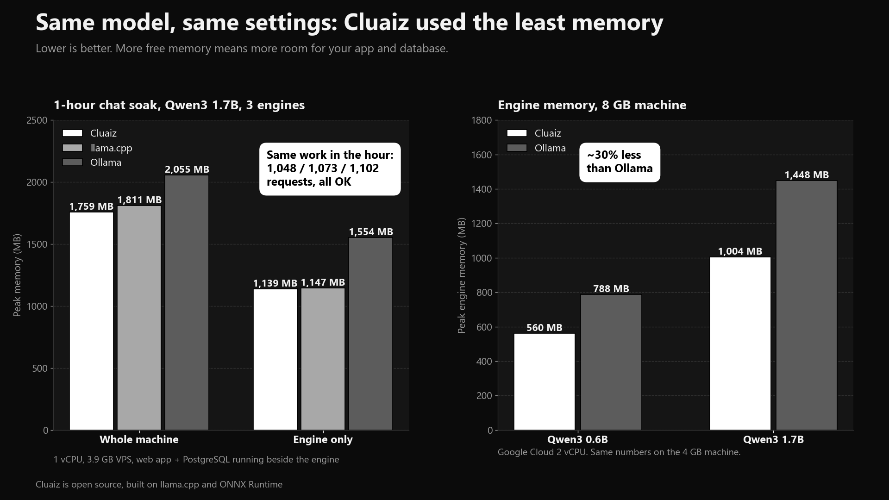
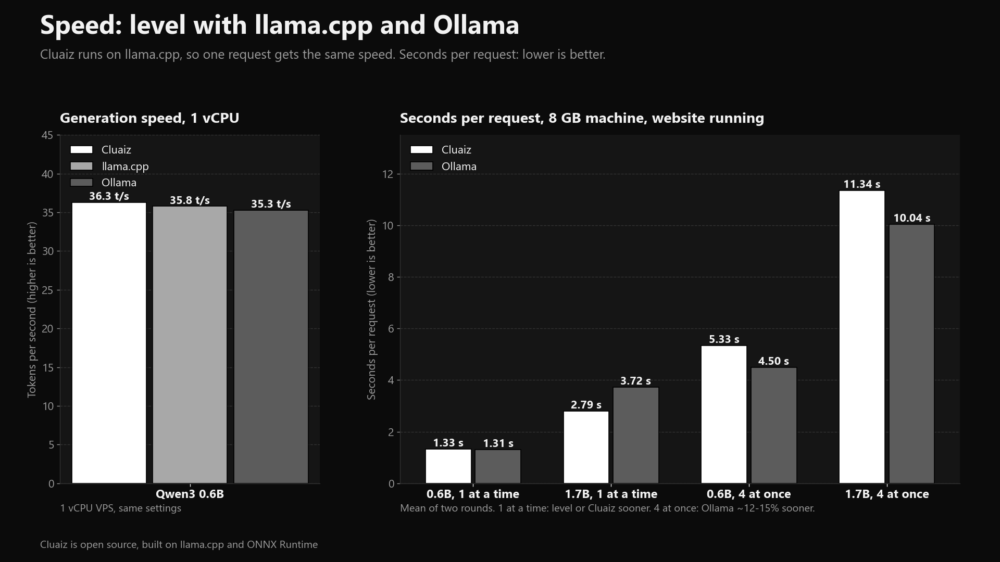
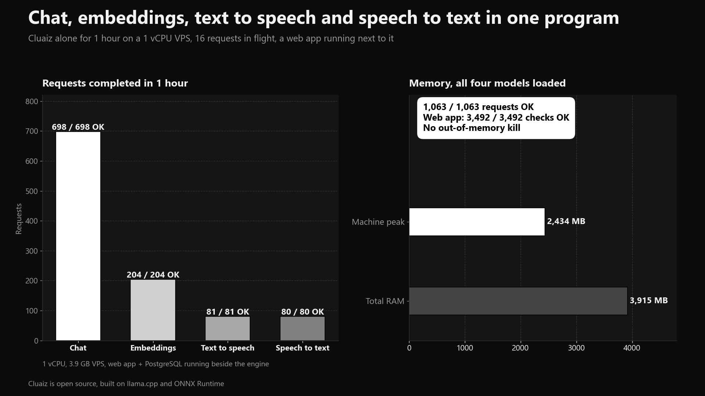
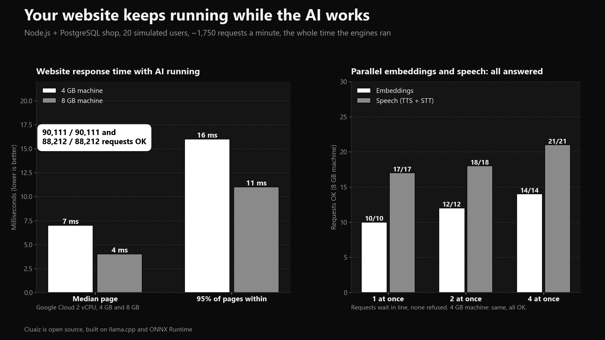
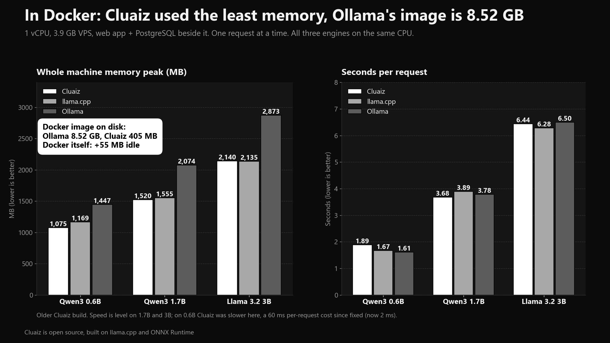
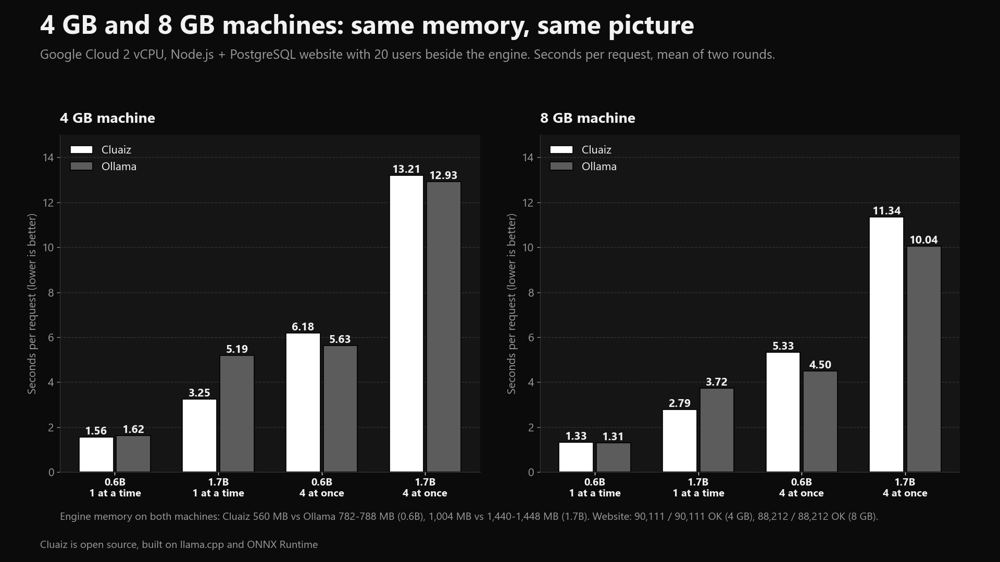
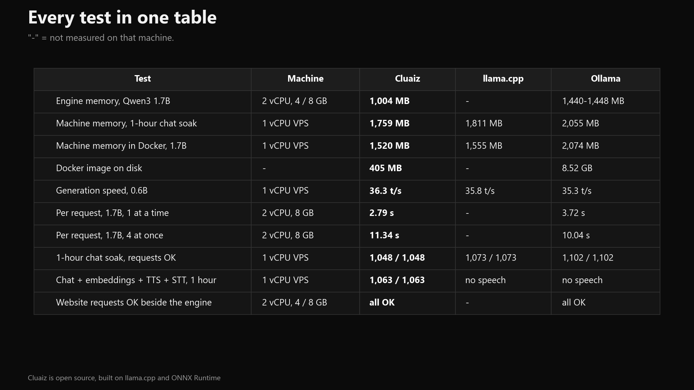
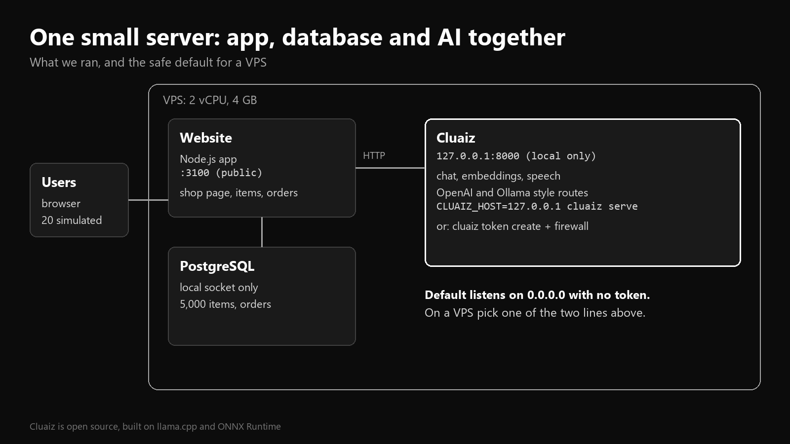

# Against Ollama, LM Studio and llama.cpp as servers, and next to a running website

## Answer

- **L4, Ollama 0.40.16, same GGUF bytes (run 10):** generation equal where the placement is equal (Qwen3 4B 82.9
  vs 81.9, Gemma 3 12B 30.4 vs 30.6, Mistral 24B 17.1 vs 17.4 t/s). Gemma 4 31B: Ollama kept it fully on the GPU
  (12.8 t/s), Cluaiz's planner split it (8.9 t/s).
- **1 vCPU / 3.8 GB VPS (run 16):** Ollama generated 14-23% slower than Cluaiz and could not load Llama 3.2 3B.
- **Next to a Node.js website with 20 users, 4 GB and 8 GB machines (run 40):** all chat OK; one at a time Cluaiz
  equal (0.6B) or faster (1.7B), 4 at once Ollama about 15% faster (0.6B); Cluaiz about 30% less memory.
- **Lower CPU priority next to a website (run 66):** website p95 19.3 ms with no change, 10.7 ms with `nice`,
  10.1 ms with `CPUWeight` (alone 7.0 ms); model speed unchanged.
- **Three tools on the L4 (run 12):** the three bugs of run 11 fixed, speed unchanged.

```mermaid
xychart-beta
    title "Generation t/s on the L4, same GGUF file (run 10)"
    x-axis ["Qwen3 4B", "Gemma 3 12B", "Mistral 24B", "Gemma 4 31B"]
    y-axis "tokens/s" 0 --> 90
    bar [82.9, 30.4, 17.1, 8.9]
    bar [81.9, 30.6, 17.4, 12.8]
```



Bars: Cluaiz first, Ollama second.

Below: every current run of this test type, newest first, in full.

<a id="run-66"></a>

## Run 66 (2026-11-24)

Question from Reddit readers: if the engine runs with `nice -n 19` or systemd `CPUWeight=10`, does the website
next to it answer faster, and how much slower does the model get? Run 26 never tried it.

**Answer on this machine:** yes. The website's 95th percentile fell from 19.3 / 19.2 ms (no change, before and
after) to 10.7 ms with `nice -n 19` and 10.1 ms with `CPUWeight=10`, and its slowest check from 110 / 319 ms
to 16 / 20 ms. The model did not get measurably slower: 2.70 tokens/s and 6.78-6.80 generation t/s in every
arm. The engine still used 97.8-97.9% of the CPU; the website needs so little that giving it the CPU first
costs the model nothing that shows in these numbers.

#### Setup

| | |
|---|---|
| Machine | Google Cloud VM `cluaiz-32gb` (g2-standard-8): Intel Xeon @ 2.20 GHz, 8 vCPU (4 cores x 2 threads), 31 GB, Debian 13, kernel 6.12.117 (`results/main/machine.txt`) |
| One CPU | **A pinned single core on a bigger VM, not a real 1 vCPU VPS.** Everything below ran on cpu 2 only (cgroup cpuset `AllowedCPUs=2`); its hyperthread sibling cpu 6 was not reserved and the other 7 vCPU were free for the system. Checked per arm in `scope_check.txt` (`cpuset.cpus.effective: 2`, column PSR = 2) |
| On cpu 2 | the engine (systemd scope, memory limit 3,515 MB as run 26's manifest, no swap); PostgreSQL 17 (`systemctl set-property --runtime postgresql@17-main.service AllowedCPUs=2`); the harness as a system service (`run66.service`): run 26's load client `workloads.py`, the website `neighbour_app.py` and the once-a-second checker in `sampler.py` |
| GPU | off: the Engine was built CPU only (`--no-default-features`, no CUDA library); the log says "GPU offload not available, models run on the CPU", 28 of 28 blocks in RAM. `CUDA_VISIBLE_DEVICES` empty |
| Engine | Cluaiz 0.1.0 pre-release, `cargo build -p cmd --release --no-default-features` on the VM at `961a673f` (llama.cpp fork `96b0cfb2d`), SHA-256 `de29e2e7...` in each `manifest.json`. Engine code is the same as run 63's `9dfd4f46` (only `test/` changed in between) |
| Other engines | official llama.cpp `b12428` (Ubuntu x64 CPU release), Ollama 0.40.16 (`num_gpu 0`, `CUDA_VISIBLE_DEVICES` empty) |
| Model and settings | Qwen3 1.7B Q4_K_M (`unsloth/Qwen3-1.7B-GGUF`, sha256 `b139949c...`), 1 thread, context 4096, Q8_0 KV cache, one slot, temperature 0, thinking off: run 26's settings |
| Load | run 26's Cluaiz soak: W1 ticket labels as JSON, 32 requests in flight (all engines; run 26 used 16 for llama.cpp and Ollama), run 26's own `w1_tickets.json` (same md5), 1,200 s per arm plus the drain of the last 32 requests (about 70 s) |
| Website | `neighbour_app.py` with PostgreSQL: each `GET /health` does one indexed read and one write; schema and 5,000 rows as `webapp/server.js`. Checked once a second; the checker gives up at 5 s |
| Arms, in order | website alone (2 min, no engine); A1 no change; B `nice -n 19`; C `CPUWeight=10` on the engine scope (website and PostgreSQL at the default 100); A2 no change again; then llama.cpp and Ollama with `nice -n 19` |
| Priority switch | `engines.sh` `ENGINE_PRIORITY` (none / nice / cpuweight), `run26.sh --priority`, default unchanged. Proof per arm in `scope_check.txt`: B shows NI 19 on every engine thread, C shows `CPUWeight=10` and `cpu.weight: 10` |

Why the harness is a system service: on a VPS the website is a service too. The engine scope, PostgreSQL and the
website then sit side by side in `system.slice`. On this machine `system.slice` had no cpu controller of its
own (`cpu_stat.log`: `cpuset memory pids`), so all of them shared one CPU group and `nice` worked between them.
`CPUWeight=10` turned the cpu controller on for `system.slice` only while the C scope existed (seen in C's
`scope_check.txt`); it was off again at A2's start, so A2 and the nice arms after C were not changed by C.

#### Results

`python3 summarize_run66.py results/main` (and `results/extra` for the llama.cpp and Ollama rows). Website
columns cover only each arm's soak phase.

| Arm | Engine | Priority | Website checks | Median ms | p95 ms | Max ms | Over 5 s | Answers OK | Tokens/s (usage) | s per request | Median gen t/s (engine log) | Usage chunk | Machine memory peak MB | Engine anon peak MB | Engine CPU avg % | Steal % |
|---|---|---|---:|---:|---:|---:|---:|---|---:|---:|---:|---|---:|---:|---:|---:|
| website alone | - | - | 119 | 6.5 | 7.0 | 24.6 | 0 | - | - | - | - | - | 1156 | - | - | 0.00 |
| A1 | cluaiz | none | 1256 | 15.0 | 19.3 | 110.2 | 0 | 555 / 555 | 2.70 | 2.30 | 6.78 (n=555) | 555 / 555 | 2422 | 1138 | 97.9 | 0.00 |
| A2 | cluaiz | none | 1255 | 15.1 | 19.2 | 318.6 | 0 | 555 / 555 | 2.70 | 2.29 | 6.79 (n=555) | 555 / 555 | 2426 | 1173 | 97.8 | 0.00 |
| B | cluaiz | nice | 1266 | 9.0 | 10.7 | 16.4 | 0 | 556 / 556 | 2.71 | 2.29 | 6.79 (n=556) | 556 / 556 | 2319 | 1057 | 97.9 | 0.00 |
| C | cluaiz | cpuweight | 1264 | 6.7 | 10.1 | 20.1 | 0 | 556 / 556 | 2.71 | 2.29 | 6.80 (n=556) | 556 / 556 | 2360 | 1083 | 97.8 | 0.00 |
| website alone (before L, O) | - | - | 119 | 6.6 | 6.9 | 24.9 | 0 | - | - | - | - | - | 1219 | - | - | 0.00 |
| L | llama | nice | 1272 | 9.0 | 10.0 | 29.5 | 0 | 498 / 498 | 5.00 | 2.57 | 6.44 (n=498) | 498 / 498 | 2422 | 1142 | 97.9 | 0.00 |
| O | ollama | nice | 1271 | 9.1 | 10.6 | 305.5 | 0 | 501 / 501 | 5.03 | 2.55 | 6.51 (n=501) | 501 / 501 | 2816 | 1565 | 97.9 | 0.00 |

Columns: "Over 5 s" counts checks that took 5 s or more or did not return HTTP 200. Tokens/s = completion
tokens from the usage chunk of every answer / soak wall time. Seconds per request = wall time / answers (one
slot, so this is the time per answer, not the wait in the queue, which was 67-72 s at 32 in flight). Generation
t/s is the median of llama.cpp's own per-request timing line in the engine log (Ollama's runner prints the same llama.cpp line). Machine
memory is the whole 31 GB VM (about 1.1 GB used before the test); engine anonymous memory is the engine alone.
Steal is cpu 2's steal ticks over all its ticks in the arm.

llama.cpp and Ollama were run only with `nice -n 19` (the plan: only if B or C helped). Their website p95
(10.0 and 10.6 ms) is at the level of Cluaiz under nice (10.7 ms); there is no no-priority arm for them, so
their own drop is not measured. Ollama had one slow check (305 ms) in the arm; still 0 over 5 s.

Their tokens/s are not comparable with Cluaiz: the answers differ in length. Median completion tokens per
answer, from the usage chunk: Cluaiz 6 (`{"label": "bug"}` on one line), llama.cpp 14 (`{\n  "label": ...\n}`,
pretty-printed). Generation speed per token was close: 6.78-6.80 t/s Cluaiz, 6.44 llama.cpp, 6.51 Ollama
(engine logs), and seconds per answer 2.29-2.30 against 2.57 and 2.55, at 32 in flight (run 26 soaked these two
at 16).

#### What this does not prove

- **A real 1 vCPU VPS.** This is one pinned hyperthread of an 8 vCPU VM. Run 26 on a real 1 vCPU VPS saw a
  website p95 of 173 ms with no priority change; here it was 19 ms. The VPS had a host CPU cap (run 26
  summary) and a different CPU, kernel and scheduler setup, so the size of the drop there is unknown.
- **Other cgroup layouts.** If the website runs from a login session (user.slice) or in Docker, the root cgroup
  splits the CPU by slice first, and `nice` on the engine may not reach across; `CPUWeight` then needs to be
  set on the right parent. Not tested.
- **A busier website.** One check a second is a very light website. A website that needs much CPU would take
  more from the engine under `nice` and the model cost would show.
- **Length.** 20 minutes per arm, not run 26's 1 hour. A1 and A2 agree (p95 19.3 / 19.2 ms), so the machine
  state did not drift during the run.
- Steal was 0.00% in every arm, so no host took CPU back; that is not true of every VPS.

#### Files

- `run66.sh` (the arms), `setup66.sh` (VM setup), `build66.sh` (Engine build), `check_scope.sh` (per-arm
  scope proof), `summarize_run66.py` (the table). The harness is `test/cloud/remote/vps26/` at this commit.
- `results/main/`: `run66.log`, `cpu_stat.log`, `machine.txt`, `baseline/`, and one folder per arm with
  run 26's files (`resources.csv` per second, `requests_native_*.jsonl` per answer, `steps_*.jsonl`,
  `manifest.json`, engine log, `scope_check.txt`) and the arm's console output (`*.out`).
- `results/smoke/`: a 60 s nice arm used to check the setup; not a result.
- `results/extra/`: the llama.cpp and Ollama nice arms (with their own 2-minute website-alone baseline).

#### Exact commands (on the VM, as root)

```
bash setup66.sh                          # PostgreSQL, model, llama.cpp b12428, Ollama 0.40.16
bash build66.sh                          # as the VM user: Engine at the bundled HEAD, CPU only
systemd-run --unit=run66 -p AllowedCPUs=2 --setenv=HOME=/root --setenv=CUDA_VISIBLE_DEVICES= \
  --setenv=CLUAIZ_COMMIT=961a673f bash /root/r66/run66.sh /root/results-run66
systemd-run --unit=run66x -p AllowedCPUs=2 --setenv=HOME=/root --setenv=CUDA_VISIBLE_DEVICES= \
  --setenv=CLUAIZ_COMMIT=961a673f "--setenv=ARMS=L:llama:nice O:ollama:nice" \
  bash /root/r66/run66.sh /root/results-run66-extra
```

`HOME` must be set: without it `ollama serve` did not start under systemd and the first smoke run stopped at
run 26's Ollama model sync.

Logs, raw results and scripts: [`test/cloud/runs/2026-11-24-run66-cpu-priority-website/`](../cloud/runs/2026-11-24-run66-cpu-priority-website/)

<a id="run-40"></a>

## Run 40 (2026-11-22)

Run 26's checks again with the current Cluaiz build (`b8ef5f64`, sha256 `18c120a3...` in each `manifest.json`),
engines interleaved (Cluaiz, llama.cpp, Ollama, then the same again) so both rounds see the same CPU state.
Scripts: `test/cloud/remote/vps26/` (`run40.sh`, `gcp_setup.sh`, `webapp/`, `compare40.py`). Per-machine
tables: `gcp-4gb/tables.md`, `gcp-8gb/tables.md`, `hostinger-vps-partial/tables.md`. Large files are gzipped.

| | `gcp-4gb` | `gcp-8gb` |
|---|---|---|
| Machine | Google Cloud `e2-custom-2-4096`: 2 vCPU (Xeon 2.20 GHz), 3,908 MB | `e2-standard-2`: 2 vCPU, 7,934 MB |
| OS | Ubuntu 24.04.5, kernel 7.0.0-1017-gcp | same |
| CPU steal | 0.0-2.1% per block (`cpu_stat.log`): no host cap | 0.0% |
| Next to the engine | `webapp/server.js` (Node.js 18, PostgreSQL 16: shop page, product API, order API) with 20 simulated users (`webapp/web_users.js`), about 1,750 requests a minute, for the whole run | same |
| Engines | Cluaiz 0.1.0 pre-release at `b8ef5f64`; Ollama 0.40.16; llama.cpp `b12428` **did not start** (below) | same |
| Settings | 2 threads, context 4096, Q8_0 KV cache, one slot, temperature 0, Qwen3 Q4_K_M | same |
| Load | 90-second steps at 1 and 4 requests at once, two rounds; then Cluaiz W4 / W5 at 1, 2, 4 | same |

**llama.cpp is missing from the GCP results.** `llama-server` exited with `libgomp.so.1: cannot open shared
object file` on the fresh image (the run 26 VPS had it from build-essential), so both llama.cpp blocks show
`FAILED TO START`. `gcp_setup.sh` now installs `libgomp1`. The VMs were deleted after the copy.

#### W1 chat, seconds per request (median), both rounds

| Machine | Model | At once | Cluaiz r1 / r2 | Ollama r1 / r2 |
|---|---|---:|---|---|
| 8 GB | Qwen3 0.6B | 1 | 1.35 / 1.32 | 1.32 / 1.31 |
| 8 GB | Qwen3 0.6B | 4 | 5.39 / 5.27 | 4.48 / 4.52 |
| 8 GB | Qwen3 1.7B | 1 | 2.81 / 2.77 | 3.71 / 3.73 |
| 8 GB | Qwen3 1.7B | 4 | 11.39 / 11.28 | 9.93 / 10.15 |
| 4 GB | Qwen3 0.6B | 1 | 1.58 / 1.54 | 1.64 / 1.59 |
| 4 GB | Qwen3 0.6B | 4 | 6.24 / 6.12 | 5.43 / 5.82 |
| 4 GB | Qwen3 1.7B | 1 | 3.28 / 3.22 | 4.52 / 5.85 |
| 4 GB | Qwen3 1.7B | 4 | 13.25 / 13.17 | 12.44 / 13.42 |

Every chat request returned OK on both machines (`tables.md`, column OK). The label accuracy was level
(0.6B 0.27-0.31, 1.7B 0.79-0.88 for both engines).

Read with care:
- One request at a time, Cluaiz was level on 0.6B and faster on 1.7B. With 4 at once, Ollama was faster
  on 0.6B (about 15% on 8 GB) and on 1.7B on 8 GB (about 12%); on 4 GB the 1.7B step was level.
- Answer lengths: both engines answer with one short JSON object (examples: Cluaiz `{"label": "bug"}`,
  Ollama `{\n  "label": "bug"\n}` or `{"label": "outage"}`). The token counts are not comparable: for the
  same text `{\n  "label": "outage"\n}` Cluaiz reports 10 completion tokens and llama.cpp 15 (Hostinger
  data), and Ollama reports 12-15. So the `Gen t/s` column is not a speed comparison; seconds per request is.
- Part of the 1.7B single-request gap may be shorter answers: Cluaiz's 1.7B answers were mostly the compact
  form. Not separated in this run.

#### Memory (engine anonymous memory, peak per model)

| Machine | Model | Cluaiz | Ollama |
|---|---|---:|---:|
| 8 GB | Qwen3 0.6B | 534-560 MB | 788 MB |
| 8 GB | Qwen3 1.7B | 1,004 MB | 1,448 MB |
| 4 GB | Qwen3 0.6B | 560 MB | 782-788 MB |
| 4 GB | Qwen3 1.7B | 1,004 MB | 1,440-1,444 MB |

Cluaiz used about 30% less memory for the same model and settings, in every block.

#### The website next to the engines

| Machine | Requests | OK | Median | 95th percentile | Slowest |
|---|---:|---:|---:|---:|---:|
| 8 GB | 88,212 | 88,212 | 4 ms | 11 ms | 163 ms |
| 4 GB | 90,111 | 90,111 | 7 ms | 16 ms | 407 ms |

No website request failed or passed 5 s in any step, with either engine (`tables.md`, last column).

#### W4 embeddings and W5 speech (Cluaiz): run 26's refusals are gone

| Machine | Workload | 1 at once | 2 at once | 4 at once | HTTP 429 |
|---|---|---|---|---|---:|
| 8 GB | W4 embeddings | 10 / 10 | 12 / 12 | 14 / 14 | 0 |
| 8 GB | W5 speech (TTS + STT) | 17 / 17 | 18 / 18 | 21 / 21 | 0 |
| 4 GB | W4 embeddings | 9 / 9 | 11 / 11 | 13 / 13 | 0 |
| 4 GB | W5 speech | 15 / 15 | 16 / 16 | 19 / 19 | 0 |

In run 26 (build before `fe21984c`) embeddings refused 1,179 of 1,252 requests at 2 at once and speech 101
of 304 at 4 at once. Now the requests wait in line: the median time grows with the queue (8 GB W4: 9.3 s,
17.8 s, 35.5 s), and none is refused.

#### Hostinger VPS, before the stop (`hostinger-vps-partial/`)

The first attempt ran on the run 26 VPS (1 vCPU) with 2-minute steps and run26's default 1-hour soak after
each model. The host's CPU credits ran out during llama.cpp's 0.6B soak (steal 0.6% in the Cluaiz block,
38.6% after; Hostinger: sustained use above about 60% for about 3 hours empties the credits), so the run was
stopped. Comparable rows (full CPU, before the cap), Qwen3 0.6B: Cluaiz 0.625 s and llama.cpp 0.629 s per
request at 1 at once; 2.53 s and 2.33 s at 4 at once; first token 0.343 s and 0.315 s. Cluaiz's 1-hour soaks
at full CPU: 5,564 / 5,564 (0.6B) and 2,726 / 2,726 (1.7B) OK. The preflight log showed `2 ms total` per
request (run 26's build spent about 60 ms there, fixed in `ef6a7113`).

#### Not proven

- llama.cpp on the GCP machines (did not start; rerun with `libgomp1`).
- Docker: not run.
- Why Ollama is faster at 4 at once with the same one slot: traced in README.md (Angle 2) to llama-server's
  RAM prompt cache, which reused whole earlier prompts because the test repeats its tickets; not yet
  measured with prompts that do not repeat.

This page puts together everything measured about running Cluaiz on a small Linux server (1 or 2 vCPU,
4 or 8 GB, no GPU), often next to a website and its database, against llama.cpp and Ollama. It covers
seven runs from 2026-11-16 to 2026-11-22. Every number comes from a run folder in `test/cloud/runs/`;
the source is named in each table. Market facts come from the competitor study in
`competitor-repos/.agent/compare/` (code read at the commits named there). Run 40's own numbers and
method: [run 40](#run-40).

| Run | Date | Machine | What it measured |
|---|---|---|---|
| [15](speed-vs-llamacpp.md#run-15) | 2026-11-16 | Hostinger VPS: 1 vCPU (AMD EPYC 9354P), 3.8 GB | raw speed, Cluaiz `bench` against `llama-bench`, same settings |
| [16](vs-ollama-and-load.md#run-16) | 2026-11-16 | same VPS | raw speed with Ollama added; Ollama model loading |
| [19](release-and-platforms.md#run-19) | 2026-11-16 | same VPS, a website beside it | 9 chat models, speech, bursts, agent, flows, per-second memory |
| [26](vs-ollama-and-load.md) | 2026-11-20/21 | same VPS, web app + PostgreSQL | ramps 1-32 at once, 1-hour soaks, native and Docker; a host CPU cap fell between engines |
| [38](vs-ollama-and-load.md) | 2026-11-21 | Windows laptop | rechecks of run 26's two bugs on the fixed code |
| [40](vs-ollama-and-load.md#run-40) | 2026-11-21/22 | Google Cloud 2 vCPU, 4 GB and 8 GB; Node.js website with 20 users | Cluaiz and Ollama interleaved, two rounds; embeddings and speech at 1, 2, 4 at once |
| [40, VPS part](../cloud/runs/2026-11-22-run40-cluaiz-ollama-website/hostinger-vps-partial/tables.md.txt) | 2026-11-21 | the run 15 VPS | first attempt of run 40, stopped when the host's CPU credits ran out |

#### The short answer

**Where Cluaiz is ahead, with proof:**

| Point | Numbers | Source |
|---|---|---|
| Less memory for the same model and settings | engine memory: Qwen3 0.6B 534-560 MB against Ollama 782-788 MB; Qwen3 1.7B 1,004 MB against 1,440-1,448 MB (about 30% less, every block, both machines) | run 40 |
| Lowest machine memory in a 1-hour chat soak, with twice the queue | Cluaiz 1,759 MB with 32 requests in flight; llama.cpp 1,811 MB and Ollama 2,055 MB with 16 | run 26 (all three under the same CPU cap) |
| No failed chat request in any run | run 40: every step OK on both machines; run 26 soak: 1,048 / 1,048; run 40 VPS soaks: 5,564 / 5,564 and 2,726 / 2,726 | runs 26, 40 |
| The website next to it is not affected | 88,212 / 88,212 and 90,111 / 90,111 requests OK, 95th percentile 11 and 16 ms | run 40 |
| Chat, embeddings, text to speech and speech to text in one process, under load | 1,063 / 1,063 requests in one hour (698 chat, 204 embeddings, 81 TTS, 80 STT), machine peak 2,434 MB of 3,915 | run 26 |
| Many embedding and speech requests at once are queued, not refused | 0 HTTP 429 at 1, 2 and 4 at once on both machines (run 26's build refused 1,179 of 1,252 embeddings at 2 at once) | runs 26, 38, 40 |
| Loads where Ollama did not | Llama 3.2 3B with F16 cache on 3.8 GB: Cluaiz completed, Ollama's runner was killed at 1.6 GB free | run 16 |

**Where Cluaiz is level:**

| Point | Numbers | Source |
|---|---|---|
| Raw speed against official llama.cpp | same settings, 1 thread: prompt and generation within the run-to-run spread on Q1_0 and Q4_K_M (Llama 3.2 3B: 21.17 / 8.16 t/s against 21.80 / 7.60) | run 15 |
| One chat request at a time, small model | Qwen3 0.6B: Cluaiz 0.625 s, llama.cpp 0.629 s (full CPU); Cluaiz 1.32-1.35 s, Ollama 1.31-1.32 s (8 GB) | runs 40, 40 VPS |
| Answer quality | right label: Qwen3 0.6B 0.27-0.31 and 1.7B 0.79-0.88 for both engines; valid JSON in every step | runs 26, 40 |

**Where Cluaiz is behind or unproven:**

| Point | Numbers | Source |
|---|---|---|
| 4 requests at once | Ollama faster on 8 GB: 0.6B 4.48-4.52 s against 5.27-5.39 s (about 15%), 1.7B 9.93-10.15 s against 11.28-11.39 s (about 12%); llama.cpp faster on the VPS 0.6B: 2.33 s against 2.53 s | runs 40, 40 VPS |
| One quantization slower than llama.cpp | Ternary-Bonsai Q2_0: 13-20% slower | run 16 |
| Time to first token, single request | Cluaiz 0.343 s against llama.cpp 0.315 s (0.6B, full CPU) | run 40 VPS |
| CLI timeouts on a busy 1 vCPU | agent probe and `flow run` timed out | run 19 |
| Not measured yet | llama.cpp on the Google machines (it did not start), Docker since run 26, Mac, more than 4 at once since run 26 | run 40 |

In one line: on a small server, Cluaiz runs chat at the same speed as llama.cpp and Ollama one request
at a time, uses about 30% less memory than Ollama, never failed a request, kept the website next to it
untouched, and runs embeddings and speech in the same process. With several requests at once it is
about 12-15% slower than Ollama today.

#### Angle 1: raw speed, same settings

`cluaiz bench` against `llama-bench` and Ollama, 1 thread, prompt 512, generation 128, 3 runs, on the
1 vCPU VPS (runs 15 and 16). Prompt / generation in tokens per second.

| Model | KV cache | Cluaiz | llama.cpp `b12428` | Ollama 0.40.16 |
|---|---|---|---|---|
| Bonsai 4B Q1_0 | F16 | 7.82 / 6.49 | 7.77 / 6.56 | 7.27 / 4.99 |
| Bonsai 4B Q1_0 | Q8_0 | 6.75 / 5.79 | 6.71 / 5.99 | 6.64 / 4.50 |
| Llama 3.2 3B Q4_K_M | F16 | 21.17 / 8.16 | 21.80 / 7.60 | did not load |
| Llama 3.2 3B Q4_K_M | Q8_0 | 17.10 / 7.86 | 16.71 / 7.73 | 18.84 / 6.74 |
| Ternary-Bonsai-2-4B Q2_0 | F16 | 5.51 / 4.25 | 6.54 / 4.86 | 5.77 / 4.32 |

Reading: Cluaiz runs llama.cpp inside, so the same model at the same settings runs at the same speed;
that is the design, and the public claim is "same speed", never "faster". Ollama generated slower on
these two models. The Q2_0 row is the one case where Cluaiz was clearly behind llama.cpp.

#### Angle 2: chat under real load

W1: classify a support ticket into one label, answer as JSON (`remote/vps26/workloads.py`). Median
seconds per request, the measure a user feels. Run 40 ran each engine twice, interleaved, so both saw
the same machine state (CPU steal 0.0-2.1% on Google Cloud).

| Machine | Model | At once | Cluaiz r1 / r2 | Ollama r1 / r2 | llama.cpp |
|---|---|---:|---|---|---|
| GCP 8 GB, 2 vCPU | Qwen3 0.6B | 1 | 1.35 / 1.32 | 1.32 / 1.31 | did not start |
| GCP 8 GB | Qwen3 0.6B | 4 | 5.39 / 5.27 | 4.48 / 4.52 | did not start |
| GCP 8 GB | Qwen3 1.7B | 1 | 2.81 / 2.77 | 3.71 / 3.73 | did not start |
| GCP 8 GB | Qwen3 1.7B | 4 | 11.39 / 11.28 | 9.93 / 10.15 | did not start |
| GCP 4 GB, 2 vCPU | Qwen3 0.6B | 1 | 1.58 / 1.54 | 1.64 / 1.59 | did not start |
| GCP 4 GB | Qwen3 0.6B | 4 | 6.24 / 6.12 | 5.43 / 5.82 | did not start |
| GCP 4 GB | Qwen3 1.7B | 1 | 3.28 / 3.22 | 4.52 / 5.85 | did not start |
| GCP 4 GB | Qwen3 1.7B | 4 | 13.25 / 13.17 | 12.44 / 13.42 | did not start |
| VPS 1 vCPU, full CPU | Qwen3 0.6B | 1 | 0.625 | not reached | 0.629 |
| VPS 1 vCPU, full CPU | Qwen3 0.6B | 4 | 2.53 | not reached | 2.33 |

Time to first token, median, single request: GCP 8 GB 0.6B Cluaiz 0.71-0.73 s, Ollama 0.74-0.77 s;
VPS 0.6B Cluaiz 0.343 s, llama.cpp 0.315 s.

Reading:
- One request at a time the engines are level on 0.6B. On 1.7B Cluaiz finished each request sooner
  (2.8 s against 3.7 s on 8 GB). Part of that may be shorter answers: Cluaiz's 1.7B answers were mostly
  the compact `{"label": "bug"}`, Ollama's sometimes spread over three lines. Not separated in this run.
- With 4 at once, Ollama was faster. Both run one slot, so the requests queue. Where the time goes
  (8 GB, round 1, Qwen3 0.6B, medians from `requests_native_*.jsonl`, first request of a step left out):

  | Engine | At once | Answer | First token | After first token | Total | Requests in 90 s |
  |---|---:|---|---:|---:|---:|---:|
  | Cluaiz | 1 | 23 characters | 0.723 s | 0.618 s | 1.342 s | 64 |
  | Cluaiz | 4 | 23 characters | 4.765 s | 0.625 s | 5.387 s | 71 |
  | Ollama | 1 | 23 characters | 0.729 s | 0.627 s | 1.312 s | 70 |
  | Ollama | 4 | 23 characters | 3.815 s | 0.639 s | 4.484 s | 83 |

  The model work is the same: one request at a time, the same 23-character answer took the same time to
  its first token and the same time after it on both engines. With 4 clients and one slot a request waits
  for the other three, so the total is about four times the time the slot is busy per request. For
  Cluaiz 5.387 s is 4.0 times 1.342 s: the slot is busy for the whole request. For Ollama 4.484 s is 3.4
  times 1.312 s: the slot is busy for about 0.19 s less per request than one request on its own takes.
  The engine logs show where the difference is: the prompt cache. Ollama 0.40.16 runs llama-server, which
  logs each task; Cluaiz logs llama.cpp's timings per answer. Medians over round 1 on the 8 GB machine:

  | Engine | Model | Prompt tokens reused from the cache | Prompt tokens computed | Prompt time | Generation |
  |---|---|---:|---:|---:|---:|
  | Cluaiz | Qwen3 0.6B | 34 of 67 | 32 | 685 ms | 10 tokens, 613 ms |
  | Ollama | Qwen3 0.6B | 50 | 12 | 379 ms | 15 tokens, 812 ms |
  | Cluaiz | Qwen3 1.7B | 34 of 67 | 32 | 1,734 ms | 7 tokens, 852 ms |
  | Ollama | Qwen3 1.7B | 49 | 15 | 1,137 ms | 14 tokens, 1,884 ms |

  Prompt speed per token is the same (about 48 tokens a second on 0.6B), and the slot is never idle in
  Cluaiz's log (the next request starts about 6 ms after the previous one ends). Ollama computes fewer
  prompt tokens because llama-server keeps earlier prompts in a RAM prompt cache (on by default; its log
  says "prompt cache is enabled, size limit: 8192 MiB") and the test sends its 200 tickets again in every
  step. When a ticket comes back, the whole prompt is already computed: Ollama reused the whole prompt in
  94 of 219 requests on the 8 GB machine, official llama.cpp in 3,019 of 6,350 on the Hostinger VPS
  ("need to evaluate at least 1 token ... n_past was set to"). Cluaiz compares a new prompt only with the
  last one, so it reuses the shared instruction (34 tokens in 173 of 200 requests) and never a whole
  earlier prompt. One request at a time Cluaiz's shorter answers make up for it; in a queue every request
  pays the extra prompt work.

  So part of Ollama's lead comes from the test repeating its prompts, which real traffic does less, and
  part is a feature Cluaiz lacks: a cache of several earlier prompts, which helps whenever a request shares
  a long prefix with any recent request (several users with the same system prompt, retries).
- The same 23 characters were 10 completion tokens in Cluaiz and 15 in Ollama (and 15 in llama.cpp in the
  Hostinger data) while taking the same time. Cluaiz's count is not a reporting slip: its engine log
  agrees (`prompt 66 tokens ... context 76`, so 10 tokens were generated). The engines produced different
  token sequences for the same text; both constrain the answer with a JSON grammar, which can pick
  shorter or longer tokens for the same characters. Not checked token by token.
- The 4 GB machine was slower than the 8 GB one for both engines (same CPU type), which points at memory
  pressure or the 20-user website taking a larger share; not separated.

#### Angle 3: memory

| Measure | Cluaiz | llama.cpp | Ollama | Source |
|---|---:|---:|---:|---|
| Engine memory, Qwen3 0.6B (GCP 8 GB) | 534-560 MB | - | 788 MB | run 40 |
| Engine memory, Qwen3 1.7B (GCP 8 GB) | 1,004 MB | - | 1,448 MB | run 40 |
| Engine memory, Qwen3 0.6B (VPS, full CPU) | 559 MB | 678 MB | - | run 40 VPS |
| Engine memory, Qwen3 1.7B (VPS) | 1,002 MB | 1,145 MB | - | run 40 VPS |
| Machine peak, 1-hour chat soak, Qwen3 1.7B | 1,759 MB (32 in flight) | 1,811 MB (16) | 2,055 MB (16) | run 26 |
| Engine anonymous memory peak, same soak | 1,139 MB | 1,147 MB | 1,554 MB | run 26 |
| Llama 3.2 3B, F16 cache, 3.8 GB machine | loaded and ran | ran | runner killed (1.6 GB free) | run 16 |

Reading: against llama.cpp the difference is small (about 50-140 MB); against Ollama it is about 30%.
On a 4 GB server that shares memory with a database, 450 MB is the difference between a second model or
a bigger context fitting or not.

#### Angle 4: reliability

| Measure | Cluaiz | llama.cpp | Ollama | Source |
|---|---|---|---|---|
| Failed chat requests, all W1 steps | 0 | 0 | 0 | runs 26, 40 |
| 1-hour chat soak | 1,048 / 1,048 | 1,073 / 1,073 | 1,102 / 1,102 | run 26 |
| Mixed load, 1 hour (Cluaiz with speech; Ollama without) | 1,063 / 1,063 | - | 15 embedding timeouts (native), 15 (Docker) | run 26 |
| Embeddings, 2 at once | run 26 build: 1,179 of 1,252 refused; fixed build: 0 refused | - | - | runs 26, 40 |
| Speech, 4 at once | run 26 build: 101 of 304 refused; fixed build: 0 refused | - | - | runs 26, 40 |
| OOM kills | none | none | Llama 3.2 3B F16 runner killed | runs 16, 26 |
| CLI under a busy 1 vCPU | agent probe and `flow run` timed out | - | - | run 19 |

#### Angle 5: the app next to the engine

The point of a small server is that it already runs something. Each run kept an app beside the engine.

| Run | App | Checks | Result |
|---|---|---|---|
| 19 | website container | every check | all answered |
| 26 | Python web app + PostgreSQL, one check a second | mixed soak 3,492; chat soaks about 3,500 each | Cluaiz mixed 3,492 / 3,492; Cluaiz chat soak 3,559 / 3,560 (one 5 s timeout); llama.cpp and Ollama 0 failures |
| 40 | Node.js shop (page, product API, order API) + PostgreSQL, 20 simulated users, about 1,750 requests a minute | 88,212 (8 GB), 90,111 (4 GB) | all OK; median 4 and 7 ms, 95th percentile 11 and 16 ms, slowest 163 and 407 ms |

With either engine busy, no website request in run 40 failed or passed 5 s.

#### Angle 6: embeddings and speech at once (Cluaiz only)

| Machine | Workload | 1 at once | 2 at once | 4 at once | HTTP 429 | Median seconds (1 / 2 / 4) |
|---|---|---|---|---|---:|---|
| GCP 8 GB | W4 embeddings | 10 / 10 | 12 / 12 | 14 / 14 | 0 | 9.3 / 17.8 / 35.5 |
| GCP 8 GB | W5 speech | 17 / 17 | 18 / 18 | 21 / 21 | 0 | 5.1 / 10.5 / 17.1 |
| GCP 4 GB | W4 embeddings | 9 / 9 | 11 / 11 | 13 / 13 | 0 | 10.2 / 19.5 / 38.4 |
| GCP 4 GB | W5 speech | 15 / 15 | 16 / 16 | 19 / 19 | 0 | 6.0 / 12.2 / 21.4 |

The time doubles with each doubling of requests: they wait in line (up to 120 s) instead of being
refused. llama.cpp and Ollama were not given speech steps in this harness. Their code has speech routes
now (`llama-server` `/v1/audio/transcriptions` and `/v1/audio/speech`; Ollama through its MLX runner;
competitor study, `players/llama-cpp.md`, `players/ollama.md`), so "only Cluaiz does speech" is not a
claim we make; "chat, embeddings and speech in one process on a 4 GB CPU server, measured" is.

#### Angle 7: answer quality and token counts

| Measure | Cluaiz | Ollama | llama.cpp | Source |
|---|---|---|---|---|
| Right label, Qwen3 0.6B | 0.28-0.31 | 0.27-0.30 | 0.28-0.29 | runs 40, 40 VPS |
| Right label, Qwen3 1.7B | 0.83-0.86 | 0.79-0.88 | 0.84 | runs 40, 40 VPS |
| Valid JSON | every step | every step | every step | runs 26, 40 |
| Reported completion tokens for `{\n  "label": "outage"\n}` | 10 | 12-15 | 15 | runs 40, 40 VPS |

The model, not the engine, decides the quality: 0.6B picked the right label about 3 times in 10, 1.7B
about 8 in 10, on every engine. Token counts are not comparable between engines (the same text is
counted as 10 or 15), so tokens per second is no fair speed measure here; seconds per request is.

#### Angle 8: what each product gives beyond chat

From the competitor study (`compare/angles/README.md`, `compare/CONCLUSION.md`; "yes" = found in code).
Only rows that matter on a small server.

| Capability | Cluaiz | Ollama | llama.cpp | LocalAI | AnythingLLM / Open WebUI |
|---|---|---|---|---|---|
| Runs the models itself | yes, one process (llama.cpp + ONNX) | yes | yes | yes, process per backend | no, needs a runner beside it |
| Speech routes | yes, measured here | yes (MLX runner) | yes | yes | yes |
| Memory | yes, user-confirmed | no | no | yes (dev builds) | yes |
| MCP client | yes | no | web UI proxy | yes | yes |
| Plugins with run-time limits | WASM, fuel and memory limits | no | no | add-ons unsandboxed | ? |
| OS sandbox for agent commands | yes on `main` (Linux, macOS; Windows opt-in), not in v0.1.0 (run 41) | no | no | add-on (Linux) | no / ? |
| Automation, flows | yes, built, not released | no | no | jobs (dev) | flows / automations |
| Ollama-style API | yes (`/api/chat`, `/api/generate`, `/api/embed`, `/api/tags`, ...; run 36) | native | no | ? | - |
| Multi-user | no | no | no | yes | yes |

Reading: no single feature is unique. The combination in one process (models, speech, memory, tools,
an agent with a sandbox, one permission system) is rare; LocalAI dev builds come closest
(`compare/CONCLUSION.md` section 3). On a small server that matters because every extra service
(a runner, a vector database, a speech server, a workflow runner) takes memory and upkeep.

#### Where Cluaiz sits

| If you need | Best fit today | Why |
|---|---|---|
| One model, one API, nothing else, already set up | Ollama or llama.cpp | familiar, fewer moving parts; Ollama was faster with 4 requests at once |
| Chat plus embeddings plus speech on a 4 GB server beside an app | Cluaiz | measured in one process with the website untouched, about 30% less memory than Ollama |
| Agent commands that must not read your secrets | Cluaiz on `main`, Codex, Jan | OS sandbox with real-machine checks (runs 27, 28, 41) |
| Many users, teams, image generation | Open WebUI, AnythingLLM, LocalAI | Cluaiz has no multi-user and no image generation |
| Heavy concurrency on a big machine | not measured for Cluaiz | only up to 32 in flight on 1 vCPU (run 26) |

#### What went wrong in the tests themselves

| Problem | Effect | Fix |
|---|---|---|
| Hostinger KVM 1 runs on CPU credits: sustained high use for about 3 hours drops it to 40% | run 26 compared Cluaiz at full CPU with the others capped (an early "2.6x faster" summary was wrong); run 40's VPS attempt hit the cap during llama.cpp's soak | engines interleaved; steal time logged per block (`cpu_stat.log`); dedicated-CPU machines (Google `e2-standard`) |
| `run26.sh` adds a 1-hour soak after each model by default | run 40's first attempt took about 2 hours per engine block | `run40.sh` passes `--soak-secs 0` unless asked |
| Fresh Ubuntu image without `libgomp1` | llama.cpp did not start on Google Cloud | `gcp_setup.sh` installs it |
| Token counts differ per engine | tokens per second misleads | compare seconds per request; answer texts saved |

#### Not proven yet

- llama.cpp on the Google machines; Docker since run 26; more than 4 requests at once since run 26.
- How much of Ollama's lead with 4 at once is left with prompts that do not repeat (Angle 2: llama-server's
  RAM prompt cache reused whole earlier prompts because the test repeats its 200 tickets).
- Metal GPU speed on real Apple hardware after `07cf30fa` (the October M5 Air run,
  `test/mac/runs/2026-10-28-m5-air-16gb/`, ran on the CPU because the engine did not use Metal then).
- Bigger models (3B and up) under the website load on 4 GB.

#### Rerun

Prepare a fresh Ubuntu 24.04 VM with `test/cloud/remote/vps26/gcp_setup.sh` (needs the bundle described
at its top), then:

```bash
CLUAIZ_COMMIT=<sha> ROUNDS="1 2" STEP_SECS=90 WEB_USERS=20 bash /root/vps26/run40.sh /root/results-run40
python3 test/cloud/remote/vps26/compare40.py /root/results-run40 > tables.md
```

#### Charts

Greyscale charts drawn from the numbers above (scripts `run40_charts.py` and `run40_charts2.py` in the run folder):

















Logs, raw results and scripts: [`test/cloud/runs/2026-11-22-run40-cluaiz-ollama-website/`](../cloud/runs/2026-11-22-run40-cluaiz-ollama-website/)

<a id="run-16"></a>

## Run 16 (2026-11-16)

| | |
|---|---|
| Machine | Same VPS as run 15: 1 vCPU (AMD EPYC 9354P, AVX-512), 3.8 GB RAM, no GPU, Ubuntu 24.04 |
| Cluaiz | v0.1.0 re-published release (tag `eb11d47d`), `cluaiz bench`; binary sha256 `bf85de0e…` |
| llama.cpp | official ggml-org prebuilt `b12428`, `llama-bench` |
| Ollama | official release 0.40.16 (`ollama-linux-amd64.tar.zst`), run standalone on its own port and model folder |
| Script | [`vps_run16_ollama.sh`](../cloud/remote/vps_run16_ollama.sh) |

Settings: 1 thread, CPU only, prompt 512, generation 128, 3 runs. Ollama has no bench tool: `/api/generate`
with a raw prompt of 514 tokens and `num_predict` 128, one warm-up and 3 measured runs, t/s from Ollama's own
`prompt_eval` and `eval` timings; `num_thread` 1, `num_gpu` 0, `num_ctx` 4096, flash attention on.

Prompt / generation t/s. Cluaiz and llama.cpp rows for Bonsai 4B and Llama 3.2 3B are from run 15 (same
machine, same day).

| Model | Mode, KV | Cluaiz | llama.cpp | Ollama |
|---|---|---|---|---|
| Bonsai 4B Q1_0 | cpu, F16 | 7.82 / 6.49 | 7.77 / 6.56 | 7.27 / 4.99 |
| Bonsai 4B Q1_0 | auto, Q8_0 | 6.75 / 5.79 | 6.71 / 5.99 | 6.64 / 4.50 |
| Llama 3.2 3B Q4_K_M | cpu, F16 | 21.17 / 8.16 | 21.80 / 7.60 | did not load (see below) |
| Llama 3.2 3B Q4_K_M | auto, Q8_0 | 17.10 / 7.86 | 16.71 / 7.73 | 18.84 / 6.74 |
| Ternary-Bonsai-2-4B Q2_0 | cpu, F16 | 5.51 / 4.25 | 6.54 / 4.86 | 5.77 / 4.32 |
| Ternary-Bonsai-2-4B Q2_0 | auto | 5.37 / 4.23 (F16) | 6.75 / 5.04 (F16) | 5.82 / 4.11 (Q8_0) |

#### Findings

- The pull fix works on the release: `:Q2_0` now takes `Ternary-Bonsai-2-4B-Q2_0.gguf` (run 15 took PQ2_0).
- Ternary-Bonsai-2-4B Q2_0: Cluaiz is 13-20% slower than official llama.cpp b12428 (prompt and generation),
  and about equal to Ollama. On the same machine Q1_0 and Q4_K_M are equal to llama.cpp, so this looks
  specific to the Q2_0 CPU code in the llama.cpp version Cluaiz bundles; not checked yet.
- Ollama generates 14-23% slower than Cluaiz on Bonsai 4B and Llama 3.2 3B (about equal on Ternary-Bonsai);
  its prompt speed is within -7% to +10% of Cluaiz.
- Ollama could not load Llama 3.2 3B in the F16 run: its llama-server was killed by the kernel for memory
  (`signal: killed`, 1.6 GB free) because the previous model was still loaded and Ollama loads weights into
  RAM (`--load-mode none` on the CPU). Cluaiz memory-maps the file and ran it. The website container on this
  VPS kept running.
- In auto, Cluaiz's planner chose F16 KV for Ternary-Bonsai and Q8_0 for the other two; the Ollama auto runs
  used Q8_0 for all three.

Logs, raw results and scripts: [`test/cloud/runs/2026-11-16-run16-vps-ollama/`](../cloud/runs/2026-11-16-run16-vps-ollama/)

<a id="run-12"></a>

## Run 12 (2026-11-15)

v0.1.0 was published again from `c3b1b123`. This run repeats only what the three fixes touch; the rest of
[run 11](vs-ollama-and-load.md) stands. The VM and isolated home are the same as in run 11,
and the GPU driver packs are unchanged. Script: [`run12.sh`](../cloud/remote/run12.sh).

| Check | Run 11 | Run 12 |
|---|---|---|
| `cluaiz pull ggml-org/gpt-oss-20b-GGUF` without a tag (non-interactive) | took `eagle3-gpt-oss-20b-Q8_0.gguf` (0.9 GB) | took `gpt-oss-20b-MXFP4.gguf` (12.1 GB) |
| gpt-oss-20b placements | 0 / 4 (control tokens in every answer) | **4 / 4** |
| Qwen3.5-9B auto, gpu | 2 / 2 | 2 / 2 |
| Features | 22 / 24 | **24 / 24** |

#### gpt-oss-20b against llama.cpp (prompt / generation t/s)

| Mode | Cluaiz | llama-bench |
|---|---|---|
| auto | 2604 / 81.8 | 2923 / 81.9 |
| gpu | 2790 / 81.8 | 2923 / 81.6 |
| split | 262 / 16.0 | 305 / 16.4 |
| cpu | 21 / 8.8 | 24 / 9.3 |

Qwen3.5-9B (auto / gpu): 2323 / 43.8 and 2319 / 43.8 vs llama-bench 2486 / 43.8 and 2462 / 43.8. These
match run 11, so reading plain answers with the parser did not change speed.

#### The answers that failed in run 11

| Model | Check | Run 11 | Run 12 |
|---|---|---|---|
| gpt-oss-20b | thinking | `<\|start\|>assistant<\|channel\|>final<\|message\|>No.` | `No.` (reasoning kept apart) |
| gpt-oss-20b | answer after the tool result | its reasoning ("We have a conversation...") | "Temperature: 18 °C, Sky: cloudy" |
| Phi-4-mini | answer after the tool result | "I will need to call the tool again" | "18°C with cloudy skies" |

The check "answer after the tool result" now also fails on control tokens and on reasoning text in the
answer.

#### Compare row for gpt-oss-20b (Cluaiz only)

Cold request 69.6 s, prompt 2651 t/s, generation 81.1 t/s, GPU memory 12.4 GB; replies are plain text. Ollama
(78.5 t/s) and LM Studio (62.2 t/s) are the run 11 rows on the same file. A Cluaiz request now generated
157-227 tokens with `max_tokens` 64: gpt-oss reasons even with thinking off, and its reasoning is not counted
in `max_tokens`, as for every model.

Logs, raw results and scripts: [`test/cloud/runs/2026-11-15-run12-l4/`](../cloud/runs/2026-11-15-run12-l4/)

<a id="run-10"></a>

## Run 10 (2026-11-15)

Both tools as a user gets them, each with its own defaults, on the same VM, the same GGUF files and the
same prompt. Script: [`ollama_compare.py`](../cloud/runs/2026-11-15-run10-ollama/ollama_compare.py).

| | |
|---|---|
| Cluaiz | release v0.1.0 (`14ae569f`) by `install.sh`, chat API `/v1/chat/completions` |
| Ollama | 0.40.16 by its `install.sh`, chat API `/api/chat`; each model imported with `ollama create` from the file Cluaiz downloaded (same bytes) |
| GPU VM | `g2-standard-8`, NVIDIA L4 23 GB, driver 620.70, Debian 13, context 16384 for both |
| CPU VM | `n2-standard-8`, Xeon 2.8 GHz 8 vCPU, 31 GB, Ubuntu 24.04, context 4096 for both |
| Request | run.py's prompt (random number + ~535 tokens), 64 new tokens, thinking off; 1 cold request (includes loading the model) + 3 warm |
| Order | one tool at a time; the other is stopped, so the whole GPU is free |

Raw rows: `l4/ollama-l4/raw.jsonl`, `cpu/ollama-cpu/raw.jsonl` (also the `ollama ps` lines); Cluaiz server logs beside them.

#### NVIDIA L4 (warm requests averaged)

| Model (Q4_K_M) | Tool | Placement | Prompt t/s | Generation t/s | GPU memory | Cold request |
|---|---|---|---|---|---|---|
| Qwen3 4B | Cluaiz | full GPU | 4541 | 82.9 | 5.1 GB | 15.3 s |
| | Ollama | 100% GPU | 5437 | 81.9 | 5.0 GB | 89.6 s (load 47.8 s) |
| Gemma 3 12B | Cluaiz | full GPU | 1485 | 30.4 | 13.6 GB | 42.6 s |
| | Ollama | 100% GPU | 1430 | 30.6 | 8.9 GB | 49.9 s |
| Mistral Small 3.2 24B | Cluaiz | full GPU | 910 (527 tokens) | 17.1 | 16.0 GB | 82.9 s |
| | Ollama | 100% GPU | 1964 (1085 tokens) | 17.4 | 16.0 GB | 85.9 s |
| Gemma 4 31B (18.7 GB) | Cluaiz | GPU + RAM (planner) | 439 | 8.9 | 20.4 GB | 109.0 s |
| | Ollama | 100% GPU | 530 | **12.8** | 19.9 GB | 159.6 s |

#### CPU only (warm requests averaged)

| Model (Q4_K_M) | Tool | Prompt t/s | Generation t/s | Cold request |
|---|---|---|---|---|
| Qwen3 4B | Cluaiz | 57.2 | 10.4 | 32.4 s |
| | Ollama | 57.3 | 10.2 | 17.8 s |
| Gemma 3 12B | Cluaiz | 19.9 | 4.2 | 84.3 s |
| | Ollama | 20.2 | 4.3 | 44.0 s |

#### What it shows

1. **Generation speed is the same** whenever both put the model in the same place (within 2%, GPU and CPU):
   both run llama.cpp underneath.
2. **Gemma 4 31B:** Ollama puts the whole model on the L4 and generates 12.8 t/s; Cluaiz's planner keeps
   3 of 60 blocks in RAM and generates 8.9 t/s (the same gap as run 9). Cluaiz needs a planner fix here.
3. **Gemma 3 12B uses 4.7 GB more GPU memory in Cluaiz** at the same context (13.6 vs 8.9 GB).
4. **Cold request on the CPU:** Ollama loads and answers the first request about twice as fast (18 vs 32 s,
   44 vs 84 s). On the GPU Cluaiz's first request was as fast or faster (Ollama's first Qwen3 load after the
   import took 48 s).
5. **Mistral prompt numbers are not comparable:** each Ollama request processed 1085 prompt tokens (the
   model's long system prompt every time); Cluaiz processed 1085 on the cold request and 527 afterwards
   (the system prompt stays cached). Prompt t/s grows with the batch, so the two rows measure different work.
6. Qwen3 4B prompt: Ollama 5437 vs Cluaiz 4541 t/s on the L4 (Ollama ~20% faster); equal on the CPU.

Not compared here: speech, embeddings and Ollama's own model library builds; only the shared GGUF chat path.

Logs, raw results and scripts: [`test/cloud/runs/2026-11-15-run10-ollama/`](../cloud/runs/2026-11-15-run10-ollama/)

## All logs

| Run | Folder |
|---|---|
| 66 | [`2026-11-24-run66-cpu-priority-website`](../cloud/runs/2026-11-24-run66-cpu-priority-website/) |
| 40 | [`2026-11-22-run40-cluaiz-ollama-website`](../cloud/runs/2026-11-22-run40-cluaiz-ollama-website/) |
| 16 | [`2026-11-16-run16-vps-ollama`](../cloud/runs/2026-11-16-run16-vps-ollama/) |
| 12 | [`2026-11-15-run12-l4`](../cloud/runs/2026-11-15-run12-l4/) |
| 10 | [`2026-11-15-run10-ollama`](../cloud/runs/2026-11-15-run10-ollama/) |
