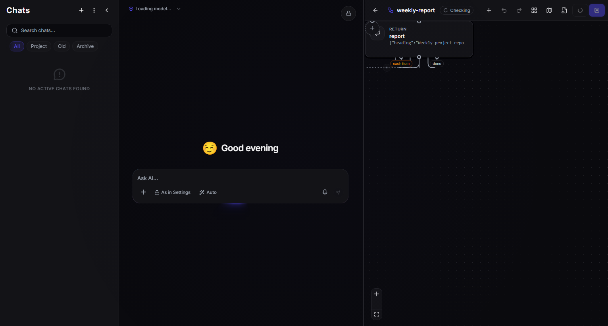
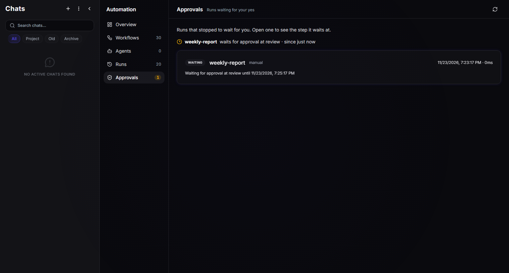
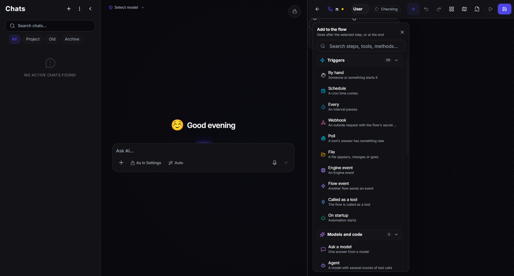
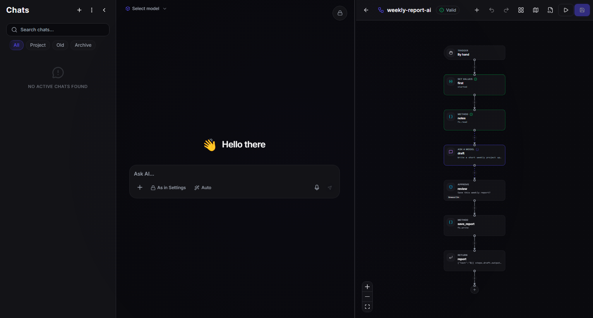

# Workflows (automation)

## Answer

| Area | Latest result | Run |
|---|---|---|
| Workflow suite on Linux | no written summary kept; raw output in the log folder | 74 |
| Engine workflow logic and triggers | logic suite 7 / 7; the startup / restart / webhook suite reached only an 18 s startup timeout | 56 |
| Workflow acceptance test (App) | see the run section below | 51 |

Below: every current run of this test type, newest first, in full.

## Run 74 (2026-11-25)

No written summary was kept for this run; the raw output is in its log folder.

Logs, raw results and scripts: [`test/cloud/runs/2026-11-25-run74-workflow-suite-linux/`](../cloud/runs/2026-11-25-run74-workflow-suite-linux/)

## Run 56 (2026-11-24)

Windows 11 laptop, Ryzen 7 7435HS, 23.69 GiB RAM, RTX 3050 4 GB. Existing debug `target/debug/deps/cluaiz.exe`, SHA-256 `9A91A8A73339F3F6A90503B45968AE21D09C8A0848BD423427E8B69DB00A5F19`, without a rebuild; exact binary source commit is unknown. A fresh `output/run56-workflow-home` and port 8013 were used. The owner's port 8000 server and `~/.cluaiz` were not touched. The home has a chat model registry entry pointing to an earlier isolated test fixture, and the math plugin was installed only into this test home.

`runner.py` started and stopped the Engine, then ran the adapted `engine-check.cjs`. It recorded seven scenario checks, **7/7 passed** (`raw/engine-result-1795486158344.json`, `raw/console.log`, `raw/engine.log`). The scenarios cover:

| Scenario | Result |
|---|---|
| Method call, switch, parallel, repeat, wait, child flow, return, rerun from child | pass; the first run and rerun succeeded with matching output |
| Explicit fail step | pass; run failed with the expected error text |
| Emit, flow event and Engine event triggers | pass; receiver got value 42 |
| Poll trigger | pass |
| File-created trigger | pass |
| Schedule trigger | pass |
| Every trigger | pass |

The math plugin install was first rejected by automatic approval review as an unauthorized download/install action. The owner's earlier release-test instruction explicitly listed plugin and MCP install checks, and Run 53 had already used the same command in an isolated home. After those facts were supplied, automatic review approved the same command; `raw/plugin_install.txt` records the isolated install. No install code or owner settings were changed.

The adapted `runtime-check.cjs full` was attempted to check startup, a waiting run across restart, webhook secret rejection, workflow-as-tool, WebAssembly Code, Tool, Ask and Agent. **None of those checks ran.** Its Engine-start readiness wait was 18 seconds and timed out before the Engine reported ready (`raw/runtime-result-1795486314725.json`, `raw/runtime-engine.log`). The readiness wait was raised to 90 seconds in the test script after this harness failure, but that change was not rerun. Free GPU memory was 447 MiB at inspection and 385 MiB at the later check on this shared laptop, so a forced GPU/model run would not give a clean result. This setup failure is excluded from the 7/7 workflow count.

The exact 30-flow collection mentioned in the release-test request was not found as saved flow files in this workspace and was not run here. Approval steps, webhook, tool-trigger, Code, Tool, Ask, Agent, startup recovery, in-flight restart, App Studio and all advanced field combinations remain outside Run 56's live evidence. Previous Runs 51-53 contain evidence for some of those paths on other setups. This run changed only test scripts and documentation, not Engine source.

The saved raw files were checked for the isolated session token, username and loopback IP. The plugin-install transcript's username was redacted before commit. The test script was syntax-checked with `node --check`, and the Python runner compiled. No performance claim is made from the trigger timings on a shared machine.

Logs, raw results and scripts: [`test/cloud/runs/2026-11-24-run56-workflow-engine/`](../cloud/runs/2026-11-24-run56-workflow-engine/)

## Run 51 (2026-11-23)

23 November 2026. Cluaiz App web build from the local checkout at `51a1a2c`, served by Vite on port 1430. Live tests used the existing release Engine binary, SHA-256 `69F2378367CC88951A18A6E9EBC1268F77FD7B45D247FD157D920F621B6A8744`. The Engine checkout was at `955c815c`, and the binary was not rebuilt for this test. The test Engine used a fresh workspace home and `127.0.0.2:8011` because another process owned the wildcard listener on port 8011. Browser setup pinned requests to this isolated host, including startup fallbacks. Port 8000 was blocked in the browser.

#### What ran through the App

| Scenario | Observed result |
| --- | --- |
| New canvas | Added Return from the palette, used Undo and Redo, saved and started the flow. Run `run_5e919e59a94e` succeeded. Ten trigger choices, fifteen built-in step choices and the separate Installed tools and Engine methods sections were displayed. [Browser evidence](../cloud/runs/2026-11-23-run51-workflow-app/browser-result-1795442573396.json) |
| Import and reopen | Imported [weekly-report.flow.yaml](../cloud/runs/2026-11-23-run51-workflow-app/weekly-report.flow.yaml) and reopened it in Studio. The App started the run and fetched real step records. [Import evidence](../cloud/runs/2026-11-23-run51-workflow-app/browser-result-1795441807185.json), [completed browser test](../cloud/runs/2026-11-23-run51-workflow-app/browser-result-1795442003619.json) |
| Approve and reject | Engine approval produced all three sample updates in `run_f05e4119872e`. Rejection produced `approval_rejected` in `run_d7c255bec207`. Both runs started from the App. Decisions went through the Engine API because the App page offered no decision control. [Browser evidence](../cloud/runs/2026-11-23-run51-workflow-app/browser-result-1795442003619.json), [Approvals screenshot](assets/workflows/run51-02-approvals.png) |
| Actual notes-to-file workflow | The App started [weekly-report-ai.flow.yaml](../cloud/runs/2026-11-23-run51-workflow-app/weekly-report-ai.flow.yaml). The Engine read the notes and the local Qwen3.5 0.8B model drafted the report. No output file existed before approval. After approval via the Engine API, run `run_cb580e6491a4` succeeded and the file matched the draft byte for byte. [Result](../cloud/runs/2026-11-23-run51-workflow-app/browser-result-1795442787270.json), [written report](../cloud/runs/2026-11-23-run51-workflow-app/report.md.txt) |

The AI example uses a `weekly-report/notes.txt` input in the current workspace and writes `weekly-report/report.md`. The folder must already exist, the editor must confirm its permissions, and a chat model must be selected. The browser test registers Qwen3.5 0.8B from an existing isolated test fixture and writes its identifier into the saved test copy. The first run with only inferred per-file paths failed at `fs.write` with `needs roots`. Adding permission for the existing report folder allowed the write. [Permission failure](../cloud/runs/2026-11-23-run51-workflow-app/browser-result-1795442696440.json)

#### Live Engine coverage

**17 of 17 step kinds** ran in at least one scenario. The browser report covered Set, If, For each, Approve and Return. The Engine cases exercised Method, Switch, Parallel, Repeat, Wait, Run another flow, Emit and Fail, plus real WebAssembly Code, an installed Tool, a real local Ask and an Agent that called the installed math tool. The failure case was expected and checked for its error. Rerun from a selected step returned the same result. [Logic cases](../cloud/runs/2026-11-23-run51-workflow-app/engine-result-1795442053803.json), [runtime cases](../cloud/runs/2026-11-23-run51-workflow-app/runtime-result-1795442513507.json)

**10 of 10 trigger kinds** fired in the live environment. Manual fired from the App. Schedule, Every, Poll, File, Engine event and Flow event fired in the Engine suite. Startup, Webhook and Called as a tool fired in the runtime suite. The webhook rejected requests without its secret with HTTP 401 and accepted valid requests with HTTP 202. The tool trigger was listed and invoked using MCP. A run that was waiting before restart resumed, preserved its first completed step and returned `{"survived":true}`. [Logic and triggers](../cloud/runs/2026-11-23-run51-workflow-app/engine-result-1795442053803.json), [runtime and restart](../cloud/runs/2026-11-23-run51-workflow-app/runtime-result-1795442513507.json)

Focused existing tests also ran. `node --test test/automation_flow_model.test.cjs test/cep_flows.test.cjs` reported `12 tests, 12 passed, 0 failed`. `cargo test -p cluaiz-automation --offline` reported 71, 1, 6, 19 and 20 passed in the five groups, with no failures. Several core tests use a simulated host. The browser and live cases above used the actual Engine.

#### App gaps reproduced

1. A workflow can reach an approval and appear on the Approvals page while offering zero Approve or Reject controls on that page. The Engine accepted both decisions through its API. The run returned `waiting` while its review step returned `running`. [Approval evidence](../cloud/runs/2026-11-23-run51-workflow-app/browser-result-1795442003619.json)
2. Saving an edit to a disabled workflow changed `enabled` from `false` to `true`. This was reproduced on the App-created test flow. [Save evidence](../cloud/runs/2026-11-23-run51-workflow-app/browser-result-1795442573396.json)
3. A flow using the inferred path of a new output file showed Valid, read its input and obtained approval, then got `needs roots` while writing. Declaring the existing output folder made the same workflow succeed. [Failed write](../cloud/runs/2026-11-23-run51-workflow-app/browser-result-1795442696440.json), [successful write](../cloud/runs/2026-11-23-run51-workflow-app/browser-result-1795442787270.json)

This run covers the App in Chrome, selected paths for every Engine step and trigger, and the installed math plugin. Native Tauri, calling the workflow from the App's Chat, other installed tools, and all combinations of advanced fields remain outside the live evidence. Product source changes were outside this test pass.

Screenshots:

Logs, raw results and scripts: [`test/cloud/runs/2026-11-23-run51-workflow-app/`](../cloud/runs/2026-11-23-run51-workflow-app/)

## All logs

| Run | Folder |
|---|---|
| 74 | [`2026-11-25-run74-workflow-suite-linux`](../cloud/runs/2026-11-25-run74-workflow-suite-linux/) |
| 56 | [`2026-11-24-run56-workflow-engine`](../cloud/runs/2026-11-24-run56-workflow-engine/) |
| 51 | [`2026-11-23-run51-workflow-app`](../cloud/runs/2026-11-23-run51-workflow-app/) |
