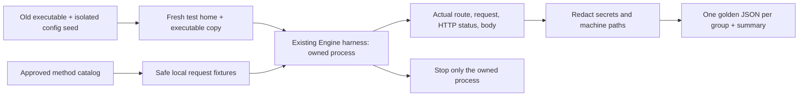

# Wave B: old-route baselines (B0)

- **Purpose:** Record actual old HTTP responses before moving Wave B handlers into CEP. These snapshots preserve old defects; they do not certify the old APIs as correct.
- **Scope:** File/workspace, system/storage, model management, tools, audio and ingest routes from the approved CEP method catalog.
- **Runtime:** Python 3.11+ and the existing `test/context-runtime/harness.py` Engine owner. Process cleanup currently uses that harness's Windows implementation.
- **Isolation:** A fresh explicit home, a copied executable and a separate caller-supplied port. No new build, branch or checkout. Never ports 8000/8011, the personal home, an existing destination home, or someone else's running server.



## Run

From the Engine repository, supply real paths and a dedicated test port:

```powershell
python test/cep/wave_b/golden_capture.py `
  --exe <old-cluaiz.exe> `
  --seed-home <existing-isolated-test-home> `
  --home <fresh-isolated-test-home> `
  --port <wave-b-test-port> `
  --output <fresh-output-directory>
```

The seed's selected configuration files are copied and checked for changes afterwards. Weights stay external; B0 does not load or remove them. Tool file mutations use a locally created skill fixture. Invalid install IDs are rejected before a network installation; no real package install is requested. Filesystem writes, rename, copy, delete and storage cleanup affect only test fixtures. The interactive folder picker is skipped.

## Reading the evidence

- `golden/<group>.json`: actual requests and responses. Runtime values such as memory usage, timestamps and hardware measurements are observations, not stable equality assertions.
- `golden/summary.json`: executable/catalog SHA-256, route coverage, omitted successful cases, unexpected outcomes, source-config integrity and process cleanup.
- `<test_home>`, `<workspace>`, `<model:ID>` and `<missing_id>` replace machine-specific paths/IDs. Credentials and hostname are redacted.
- `observations` records known old error mappings, including invalid install IDs reported as HTTP 500 and model inspection errors returned with HTTP 200. CEP must use its approved error contract rather than copy these defects.
- The executable is frozen by SHA-256. Its source revision is explicitly **unverified** because B0 does not rebuild Claude's shared working tree.

## What B0 does not prove

It does not exercise successful model loading/removal, real tool-hub installations, speech inference or the native folder picker. Speech success requires a suitable installed model in the isolated registry. It does not compare CEP results yet; the skeleton and each migrated group must exist first. Standard OpenAI/Ollama routes and App behavior are outside this capture.

New baselines require a fresh output directory; the script refuses to overwrite existing golden JSON files. Logs and the fresh home remain available for inspection. Do not commit executable copies, logs, test-home credentials or Python bytecode.

## B1: isolated Rust path contracts

`roots_contract.rs` imports the production `api/src/cep/roots.rs` directly. Its isolated Cargo workspace builds the CEP core and filesystem tests, without linking the inference runtime or sharing the API build target:

```powershell
cargo test --offline --manifest-path test/cep/wave_b/Cargo.toml --target-dir target/cep-wave-b-contracts --test roots_contract
```

The tests use real temporary directories, Unicode files, missing write parents, traversal, and an actual symbolic link. Windows symlink creation must be permitted; lack of that permission fails rather than silently skipping the test. These tests cover canonicalization and its interaction with real principal roots. They do not certify HTTP integration, folder-picker UI, the entire file-method registry or the shared attachment migration. That acceptance follows the core handoff.

`fs_methods_contract.rs` also imports the production file/workspace method modules, registers all ten with the real CEP dispatcher, and exercises actual file operations and errors. It uses the real `ToolsEngine` workspace owner. Its small host fixture supplies only the workspace state field; it excludes `EngineHost`, HTTP authentication, native transport and the App. No inference or filesystem response is simulated. The owner-only folder picker is tested only by a denied non-owner call, so no dialog is opened unattended.

```powershell
cargo test --offline --manifest-path test/cep/wave_b/Cargo.toml --target-dir target/cep-wave-b-contracts
```

The method tests cover schema rejection before side effects, text/binary round trips, recursive copy/list/delete, scope denial, real symlink escape denial, workspace synchronization, discovery metadata and comparison with the old B0 filesystem snapshots. The golden comparison preserves domain content and renamed list fields; it intentionally excludes modification timestamps. Passing these isolated contracts does not complete route cutover or verify the unfinished full API integration. The first build includes real agent/model-metadata dependencies, but does not build the inference runtime/CUDA.

## B1: live HTTP journey (requires route cutover)

`fs_http_journey.py` reuses the existing Engine process owner and B0 isolation helpers. It runs the file/workspace flow against a copied built executable in a fresh home and requires the old filesystem/workspace routes to return 404. Old folder-picker detection uses GET, so it cannot open the POST-only native dialog. It writes actual results to `<fresh-home>/fs-http-report.json` and stops only its own process.

```powershell
python test/cep/wave_b/fs_http_journey.py --exe <built-CEP-executable> --seed-home <isolated-seed-home> --home <fresh-home> --port <wave-b-port>
```

Preparing or syntax-checking this journey is not a live pass. Run it only after the core builds and the old routes are removed; the old executable is expected to fail. This owner-token HTTP journey does not replace the principal/scope/approval contracts above or certify the transport's authentication implementation.

## B1 evidence, 25 October 2026

- Cutover: `3064d7c`, retired ten old file/workspace route-operations and both legacy filesystem handlers. Standard attachment consumers use the same `cep::roots` resolver as CEP methods. Client `x-caller`/approval headers do not change the standard route's owner identity, per the shared handoff contract.
- Actual executable build: `cargo build --offline --release -p cmd`, exit 0. Executable SHA-256: `53000e323b6ce58ef0ccc06df5c385f9335556950b0140e3c20a7d2af83e2f91`.
- HTTP journey on the separate test port: 49 checks, `passed: true`, `owned_process_stopped: true`, `seed_config_unchanged: true`. Report: `target/cep-wave-b-baseline/fs-http-final/fs-http-report.json` (local ignored evidence).
- Isolated Rust contracts: 10 method tests and 9 path tests pass. The actual API library run passes 21 tests, with 1 existing opt-in test ignored. Affected document/media targets pass 6 tests with 10 opt-in real-model/artifact tests ignored; those model runs are not verified by this step.
- Existing compiler warnings remain. The native picker was not opened; scoped caller behavior is covered at the dispatcher boundary, not as a scoped HTTP-token implementation. App migration and other method groups are separate phases.

## B1 review corrections

`f0d1053` addresses the peer review: RFC 3339 modification times; partial listings with `truncated`/`skipped`; one approval for a directory-copy tree with symlink escape checks; a separate real API router test; and a distinct `os_permission_denied` error type. Four regression cases failed before the correction (`b1-review-before.log`). Afterwards the isolated suite passed 14 method tests and 10 path tests (`b1-review-after.log`). The real router test also passed in the B2 API run below.

The rebuilt binary passed all 49 existing filesystem HTTP checks again (`target/cep-wave-b-baseline/fs-http-reviewed/fs-http-report.json`). This HTTP journey uses an owner principal; the approval and scoped-root cases run through the real dispatcher in the isolated Rust suite. Symlink delete/rename semantics remain a founder decision; they were not changed by this review.

## B2 system, storage and CLI journey

`system_http_journey.py` reuses the same isolation helpers and Engine harness. It plans a dynamically selected installed GGUF model from real headers without loading weights, checks saved settings remain unchanged, and exercises the actual built CLI. Temporary-media status and cleanup are checked against actual fixture bytes. Both an RPC failure and HTTP 401 must produce nonzero CLI exits. The optional authentication setting is enabled only in the newly created test home, never in the seed or personal home.

```powershell
python test/cep/wave_b/system_http_journey.py --exe <built-CEP-executable> --seed-home <isolated-seed-home> --home <fresh-home> --port <wave-b-port>
```

Actual commands run on 25 October 2026, from the Engine repository:

```text
cargo test --release --offline -p cluaiz-api --lib --test cep_fs_contract --test cep_system_contract -- --test-threads=1
test result: ok. 23 passed; 0 failed; 1 ignored
test result: ok. 1 passed; 0 failed; 0 ignored
test result: ok. 3 passed; 0 failed; 0 ignored

cargo test --release --offline -p cluaiz-api --test document_contract --test embedding_contract --test media_contract --test media_resource_contract --test video_contract --test artifact_acceptance -- --test-threads=1
6 passed; 0 failed; 10 ignored (sum of six targets)

cargo build --release --offline -p cmd
Finished `release` profile [optimized] target(s) in 1m 38s

python test/cep/wave_b/system_http_journey.py --exe target/release/cluaiz.exe --seed-home C:/Users/Aryan/AppData/Local/cluaiz-test/installhome --home target/cep-wave-b-baseline/b2-http-final --port 8012
28 checks; passed: true; owned_process_stopped: true; seed_config_unchanged: true
```

Local ignored evidence is in `target/cep-wave-b-baseline/b2-{core-tests,media-tests,build,http,quality,stubs,walkthrough}.log`. HTTP report: `b2-http-final/system-http-report.json`. Frozen executable SHA-256: `31e39ae4b9ce79357f0da21e5d53abfbb66a9c2183912f5aa73e65a80a314008`. The seed configuration hashes matched after both HTTP journeys.

### B2 walkthrough

Line numbers below come from the required `walkthrough_diff.sh` output, recorded before the B2 commit:

- `api/src/cep/methods/system.rs`: `register` L21 adds live telemetry; L27 adds loaded-process status; L42 adds planning. `live` L58 and `processes` L70 preserve their existing domain fields without the old status wrapper. `PlanRequest::apply` L116 validates overrides on a cloned settings value. `chat_input_contract` L150 and `plan_execution` L184 move the existing planner logic, use shared root checks before probing, and return typed errors. These functions do not load a model. Existing planner tests moved with the implementation.
- `api/src/cep/methods/storage.rs`: `register` L14 declares read-only status and destructive write cleanup; `scan` L38 counts actual files/bytes and reports I/O failures; `clean` L72 removes only the configured temporary-media directory and propagates deletion/recreation failures. Tests cover nested usage, missing/invalid roots, repeated cleanup and an actual Windows locked file.
- `cmd/src/cli/server.rs`: `cep` L28 reuses existing auth/port request construction, checks the RPC envelope, and propagates transport/RPC errors. The existing `ps` and storage entry points now call this one helper. The old command names remain the same.
- `api/src/handlers/embeddings.rs` L55: only the shared predicate visibility changes to `pub(crate)` so the moved planner can reuse it. No second embedding predicate was created.
- Old live/planning/process/storage handlers and their five routes are removed in the same cutover. Health and command execution stay for Wave A. Existing media test callers mechanically switch from the retired route to CEP; the large-body planner negative now expects a typed schema error under CEP's shared body budget.
- `api/tests/cep_system_contract.rs`: L14 checks real router telemetry/retired routes; L52 checks invalid/missing models and unchanged settings; L85 checks scoped roots and write-scope denial through the dispatcher. The Python journey adds actual executable and CLI coverage.

Request flow: CLI → existing authenticated request builder → `POST /v1/cep` → typed method/scope checks → existing planner or temporary-media implementation → domain result or typed error → CLI display/nonzero failure. No separate planner, model runtime or authentication mechanism was added.

### Review notes and remaining limits

The quality scan's five signals were reviewed: the large diff is chiefly moved planner logic plus deleted handlers, not a second planner; all added `unwrap` calls are inside test modules; `apply` is the moved settings validator; `cep` helpers belong to the production CLI and separate test transports; each `register` belongs to one method group. No stub patterns were found in the B2 method/CLI/journey files. Whitespace checks pass. Existing compiler warnings remain.

- Engineer: the API tests, affected media tests, real CLI and both HTTP journeys above passed; no inference benchmark is claimed.
- Security: root/write-scope denial is tested at the dispatcher, and the CLI rejects an actual 401. Scoped HTTP token issuance remains outside this proof.
- SDLC: B2 matches P3.2, keeps one planner, and retires its old routes. Founder walkthrough review is pending.
- User: existing CLI command names work on this Windows machine; Linux/macOS execution was not run. App callers of retired routes need the separately planned migration.
- Founder/business: this consolidates existing status/planning/storage control; it adds no new model support or extension installer.
- Market/community: no competitor or performance comparison is made by this test evidence.
- Over-engineering: existing settings, registry, planner, auth builder and test harness are reused.
- Rules: the founder's same-checkout/main instruction overrides the original separate-worktree setup. Foreign agent changes are excluded from B's commits.

Not verified here: optional real-model inference/artifact cases, ONNX positive planning in this live seed, native folder-picker UI, scoped HTTP credentials, or App integration. Storage cleanup reports failures but is not transactional: an error can occur after some entries were removed. This step does not complete the remaining Wave B model/tool/audio/ingest/documentation groups. Founder review status: `WAITING_FOR_REVIEW`.
