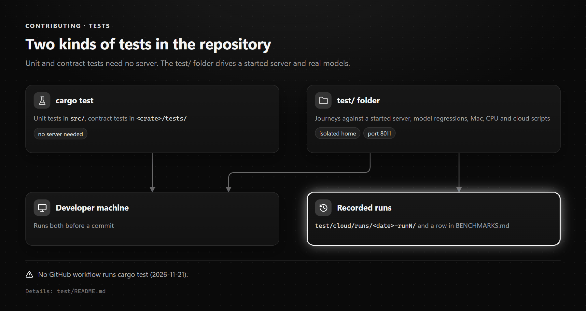

<!-- name: test/cep/wave_b
description: Tests of the fs, workspace, system, storage, models and tools CEP methods. -->

# CEP file, system, model and tool tests (`test/cep/wave_b/`)



Tests for the `fs.*`, `workspace.*`, `system.*`, `storage.*`, `models.*` and `tools.*` CEP methods. Two kinds:

| Kind | Files | Needs |
|---|---|---|
| Rust contracts (no CUDA build) | `roots_contract.rs`, `fs_methods_contract.rs`, `isolated_home.rs` | `cargo` only |
| Live journeys against a built Engine | `fs_http_journey.py`, `system_http_journey.py`, `models_http_journey.py`, `tools_http_journey.py`, helper `journey_home.py` | a built `cluaiz.exe`, an isolated seed home |

Python here is test tooling only; nothing in the Engine imports it.

## Rust contracts

`audio_task.rs` is a task client over the real CEP router for audio acceptance (no audio or inference answer is made up); `api/tests/cep_audio_contract.rs` and `api/tests/media_contract.rs` include it by path.

`roots_contract.rs` imports the production `api/src/cep/roots.rs`. `fs_methods_contract.rs` imports the production file and workspace method modules, registers them with the real CEP dispatcher, and runs real file operations in temporary folders. This Cargo workspace builds the CEP core and these modules without the inference runtime.

```powershell
cargo test --offline --manifest-path test/cep/wave_b/Cargo.toml --target-dir target/cep-wave-b-contracts
```

Covered: schema rejection before any side effect, text and binary round trips, recursive copy / list / delete, scope denial, a real symbolic link that leaves the roots, drive-relative and root-relative paths, missing write parents, workspace synchronization, and discovery metadata. Windows must allow creating symbolic links; otherwise the link tests fail instead of skipping.

`folder_picker_contract.rs` exercises the production picker helper's return and unwind paths. Its Windows desktop check is opt-in because it opens and cancels two real folder dialogs. It checks foreground HWND, removal of the temporary topmost style, cancellation/reopening, and isolation from a same-title dialog on another thread:

```powershell
cargo test --offline --manifest-path test/cep/wave_b/Cargo.toml --target-dir target/cep-wave-b-contracts --test folder_picker_contract -- --ignored --test-threads=1 --nocapture
```

## Live journeys

Each journey copies the config of an isolated seed home into a fresh home (`journey_home.py`: never weights, `session.token` or live tool state), starts a copy of the executable there on the given port, calls the methods over `POST /v1/cep`, and stops it. Ports 8000 and 8011 and the owner's `~/.cluaiz` are refused.

```powershell
python test/cep/wave_b/fs_http_journey.py     --exe target/release/cluaiz.exe --seed-home <isolated test home> --home <fresh folder> --port 8012
python test/cep/wave_b/system_http_journey.py --exe target/release/cluaiz.exe --seed-home <isolated test home> --home <fresh folder> --port 8012
python test/cep/wave_b/models_http_journey.py --exe target/release/cluaiz.exe --seed-home <isolated test home> --home <fresh folder> --port 8012 [--check-load]
python test/cep/wave_b/tools_http_journey.py  --exe target/release/cluaiz.exe --seed-home <isolated test home> --home <fresh folder> --port 8012
```

`--check-load` also loads a small installed GGUF on the CPU and removes a hard-linked copy of it. Each journey writes `<home>/<group>-http-report.json` with every check.

Not covered by the HTTP journeys: interactive folder picking (only a denied non-owner call is tested), third-party native plugin execution, other operating systems. The opt-in native picker test above does not prove the browser-to-Engine HTTP journey.

## Results on 2026-11-21 (Windows 11)

`cargo test --offline --manifest-path test/cep/wave_b/Cargo.toml --target-dir target/cep-wave-b-contracts`:

| Test file | Result |
|---|---|
| `roots_contract.rs` | 10 passed |
| `folder_picker_contract.rs` | 2 passed, 1 ignored (the desktop dialog check) |
| `fs_methods_contract.rs` | 13 passed (after the two stale assertions were updated, 2026-11-21) |

Two assertions were older than the code and were updated:

- `test_discovery_has_all_ten_methods_and_scope_metadata` now checks the seven `workspace` methods by
  name (it expected 2; `rpc.discover` returns `forget`, `get`, `index`, `item`, `memory`, `remember`, `set`).
- `test_workspace_set_reuses_existing_agent_workspace_owner` compares paths without Windows' `\\?\`
  prefix (`plain()`): the reply shows the plain path, while the Engine keeps the canonical form inside
  (`current_workspace_dir`, `ToolsEngine::workspace_dir`). The test checks that both name the same folder.

The live journeys were not run on 2026-11-21.

## Pending

| Item | Why it matters | Needs |
|---|---|---|
| No passing CI run yet | `.github/workflows/rust-tests.yml` runs these contracts since 2026-11-21; its first three runs failed here because `rfd` pulled in `wayland-sys`, which needs libwayland-client on the Ubuntu runner. `Cargo.toml` now turns on `wayland-sys`'s `dlopen` feature, as `api/Cargo.toml` does | one green run of the workflow after the push |
| Live journeys have no recorded run | the HTTP path of these methods has no checked-in result | one run saved under `test/cloud/runs/` |
