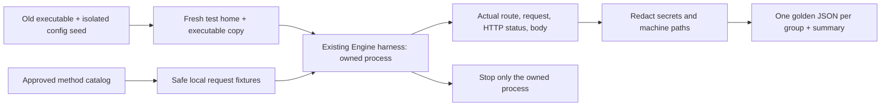

# Wave B: old-route baselines (B0)

- **Purpose:** Record actual old HTTP responses before moving Wave B handlers into CEP. These snapshots preserve old defects; they do not certify the old APIs as correct.
- **Scope:** File/workspace, system/storage, model management, tools, audio and ingest routes from the approved CEP method catalog.
- **Runtime:** Python 3.11+ and the existing `test/context-runtime/harness.py` Engine owner. Process cleanup currently uses that harness's Windows implementation.
- **Isolation:** A fresh explicit home, a copied executable and a separate caller-supplied port. No new build, branch or checkout. Never ports 8000/8011, the personal home, an existing destination home, or someone else's running server.



## Run

From the Engine repository, supply real paths and a dedicated test port:

```powershell
python test/cep/wave_b/golden_capture.py `
  --exe <old-cluaiz.exe> `
  --seed-home <existing-isolated-test-home> `
  --home <fresh-isolated-test-home> `
  --port <wave-b-test-port> `
  --output <fresh-output-directory>
```

The seed's selected configuration files are copied and checked for changes afterwards. Weights stay external; B0 does not load or remove them. Tool file mutations use a locally created skill fixture. Invalid install IDs are rejected before a network installation; no real package install is requested. Filesystem writes, rename, copy, delete and storage cleanup affect only test fixtures. The interactive folder picker is skipped.

## Reading the evidence

- `golden/<group>.json`: actual requests and responses. Runtime values such as memory usage, timestamps and hardware measurements are observations, not stable equality assertions.
- `golden/summary.json`: executable/catalog SHA-256, route coverage, omitted successful cases, unexpected outcomes, source-config integrity and process cleanup.
- `<test_home>`, `<workspace>`, `<model:ID>` and `<missing_id>` replace machine-specific paths/IDs. Credentials and hostname are redacted.
- `observations` records known old error mappings, including invalid install IDs reported as HTTP 500 and model inspection errors returned with HTTP 200. CEP must use its approved error contract rather than copy these defects.
- The executable is frozen by SHA-256. Its source revision is explicitly **unverified** because B0 does not rebuild Claude's shared working tree.

## What B0 does not prove

It does not exercise successful model loading/removal, real tool-hub installations, speech inference or the native folder picker. Speech success requires a suitable installed model in the isolated registry. It does not compare CEP results yet; the skeleton and each migrated group must exist first. Standard OpenAI/Ollama routes and App behavior are outside this capture.

New baselines require a fresh output directory; the script refuses to overwrite existing golden JSON files. Logs and the fresh home remain available for inspection. Do not commit executable copies, logs, test-home credentials or Python bytecode.

## B1: isolated Rust path contracts

`roots_contract.rs` imports the production `api/src/cep/roots.rs` directly. Its isolated Cargo workspace builds the CEP core and filesystem tests, without linking the inference runtime or sharing the API build target:

```powershell
cargo test --offline --manifest-path test/cep/wave_b/Cargo.toml --target-dir target/cep-wave-b-contracts --test roots_contract
```

The tests use real temporary directories, Unicode files, missing write parents, traversal, and an actual symbolic link. Windows symlink creation must be permitted; lack of that permission fails rather than silently skipping the test. These tests cover canonicalization and its interaction with real principal roots. They do not certify HTTP integration, folder-picker UI, the entire file-method registry or the shared attachment migration. That acceptance follows the core handoff.

`fs_methods_contract.rs` also imports the production file/workspace method modules, registers all ten with the real CEP dispatcher, and exercises actual file operations and errors. It uses the real `ToolsEngine` workspace owner. Its small host fixture supplies only the workspace state field; it excludes `EngineHost`, HTTP authentication, native transport and the App. No inference or filesystem response is simulated. The owner-only folder picker is tested only by a denied non-owner call, so no dialog is opened unattended.

```powershell
cargo test --offline --manifest-path test/cep/wave_b/Cargo.toml --target-dir target/cep-wave-b-contracts
```

The method tests cover schema rejection before side effects, text/binary round trips, recursive copy/list/delete, scope denial, real symlink escape denial, workspace synchronization, discovery metadata and comparison with the old B0 filesystem snapshots. The golden comparison preserves domain content and renamed list fields; it intentionally excludes modification timestamps. Passing these isolated contracts does not complete route cutover or verify the unfinished full API integration. The first build includes real agent/model-metadata dependencies, but does not build the inference runtime/CUDA.
