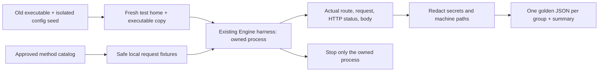

# Wave B: old-route baselines (B0)

- **Purpose:** Record actual old HTTP responses before moving Wave B handlers into CEP. These snapshots preserve old defects; they do not certify the old APIs as correct.
- **Scope:** File/workspace, system/storage, model management, tools, audio and ingest routes from the approved CEP method catalog.
- **Runtime:** Python 3.11+ and the existing `test/context-runtime/harness.py` Engine owner. Process cleanup currently uses that harness's Windows implementation.
- **Isolation:** A fresh explicit home, a copied executable and a separate caller-supplied port. No new build, branch or checkout. Never ports 8000/8011, the personal home, an existing destination home, or someone else's running server.



## Run

From the Engine repository, supply real paths and a dedicated test port:

```powershell
python test/cep/wave_b/golden_capture.py `
  --exe <old-cluaiz.exe> `
  --seed-home <existing-isolated-test-home> `
  --home <fresh-isolated-test-home> `
  --port <wave-b-test-port> `
  --output <fresh-output-directory>
```

The seed's selected configuration files are copied and checked for changes afterwards. Weights stay external; B0 does not load or remove them. Tool file mutations use a locally created skill fixture. Invalid install IDs are rejected before a network installation; no real package install is requested. Filesystem writes, rename, copy, delete and storage cleanup affect only test fixtures. The interactive folder picker is skipped.

## Reading the evidence

- `golden/<group>.json`: actual requests and responses. Runtime values such as memory usage, timestamps and hardware measurements are observations, not stable equality assertions.
- `golden/summary.json`: executable/catalog SHA-256, route coverage, omitted successful cases, unexpected outcomes, source-config integrity and process cleanup.
- `<test_home>`, `<workspace>`, `<model:ID>` and `<missing_id>` replace machine-specific paths/IDs. Credentials and hostname are redacted.
- `observations` records known old error mappings, including invalid install IDs reported as HTTP 500 and model inspection errors returned with HTTP 200. CEP must use its approved error contract rather than copy these defects.
- The executable is frozen by SHA-256. Its source revision is explicitly **unverified** because B0 does not rebuild Claude's shared working tree.

## What B0 does not prove

It does not exercise successful model loading/removal, real tool-hub installations, speech inference or the native folder picker. Speech success requires a suitable installed model in the isolated registry. It does not compare CEP results yet; the skeleton and each migrated group must exist first. Standard OpenAI/Ollama routes and App behavior are outside this capture.

New baselines require a fresh output directory; the script refuses to overwrite existing golden JSON files. Logs and the fresh home remain available for inspection. Do not commit executable copies, logs, test-home credentials or Python bytecode.

## B1: isolated Rust path contracts

`roots_contract.rs` imports the production `api/src/cep/roots.rs` directly. Its isolated Cargo workspace builds the CEP core and filesystem tests, without linking the inference runtime or sharing the API build target:

```powershell
cargo test --offline --manifest-path test/cep/wave_b/Cargo.toml --target-dir target/cep-wave-b-contracts --test roots_contract
```

The tests use real temporary directories, Unicode files, missing write parents, traversal, and an actual symbolic link. Windows symlink creation must be permitted; lack of that permission fails rather than silently skipping the test. These tests cover canonicalization and its interaction with real principal roots. They do not certify HTTP integration, folder-picker UI, the entire file-method registry or the shared attachment migration. That acceptance follows the core handoff.

`fs_methods_contract.rs` also imports the production file/workspace method modules, registers all ten with the real CEP dispatcher, and exercises actual file operations and errors. It uses the real `ToolsEngine` workspace owner. Its small host fixture supplies only the workspace state field; it excludes `EngineHost`, HTTP authentication, native transport and the App. No inference or filesystem response is simulated. The owner-only folder picker is tested only by a denied non-owner call, so no dialog is opened unattended.

```powershell
cargo test --offline --manifest-path test/cep/wave_b/Cargo.toml --target-dir target/cep-wave-b-contracts
```

The method tests cover schema rejection before side effects, text/binary round trips, recursive copy/list/delete, scope denial, real symlink escape denial, workspace synchronization, discovery metadata and comparison with the old B0 filesystem snapshots. The golden comparison preserves domain content and renamed list fields; it intentionally excludes modification timestamps. Passing these isolated contracts does not complete route cutover or verify the unfinished full API integration. The first build includes real agent/model-metadata dependencies, but does not build the inference runtime/CUDA.

## B1: live HTTP journey (requires route cutover)

`fs_http_journey.py` reuses the existing Engine process owner and B0 isolation helpers. It runs the file/workspace flow against a copied built executable in a fresh home and requires the old filesystem/workspace routes to return 404. Old folder-picker detection uses GET, so it cannot open the POST-only native dialog. It writes actual results to `<fresh-home>/fs-http-report.json` and stops only its own process.

```powershell
python test/cep/wave_b/fs_http_journey.py --exe <built-CEP-executable> --seed-home <isolated-seed-home> --home <fresh-home> --port <wave-b-port>
```

Preparing or syntax-checking this journey is not a live pass. Run it only after the core builds and the old routes are removed; the old executable is expected to fail. This owner-token HTTP journey does not replace the principal/scope/approval contracts above or certify the transport's authentication implementation.

## B1 evidence, 25 October 2026

- Cutover: `3064d7c`, retired ten old file/workspace route-operations and both legacy filesystem handlers. Standard attachment consumers use the same `cep::roots` resolver as CEP methods. Client `x-caller`/approval headers do not change the standard route's owner identity, per the shared handoff contract.
- Actual executable build: `cargo build --offline --release -p cmd`, exit 0. Executable SHA-256: `53000e323b6ce58ef0ccc06df5c385f9335556950b0140e3c20a7d2af83e2f91`.
- HTTP journey on the separate test port: 49 checks, `passed: true`, `owned_process_stopped: true`, `seed_config_unchanged: true`. Report: `target/cep-wave-b-baseline/fs-http-final/fs-http-report.json` (local ignored evidence).
- Isolated Rust contracts: 10 method tests and 9 path tests pass. The actual API library run passes 21 tests, with 1 existing opt-in test ignored. Affected document/media targets pass 6 tests with 10 opt-in real-model/artifact tests ignored; those model runs are not verified by this step.
- Existing compiler warnings remain. The native picker was not opened; scoped caller behavior is covered at the dispatcher boundary, not as a scoped HTTP-token implementation. App migration and other method groups are separate phases.

## B1 review corrections

`f0d1053` addresses the peer review: RFC 3339 modification times; partial listings with `truncated`/`skipped`; one approval for a directory-copy tree with symlink escape checks; a separate real API router test; and a distinct `os_permission_denied` error type. Four regression cases failed before the correction (`b1-review-before.log`). Afterwards the isolated suite passed 14 method tests and 10 path tests (`b1-review-after.log`). The real router test also passed in the B2 API run below.

The rebuilt binary passed all 49 existing filesystem HTTP checks again (`target/cep-wave-b-baseline/fs-http-reviewed/fs-http-report.json`). This HTTP journey uses an owner principal; the approval and scoped-root cases run through the real dispatcher in the isolated Rust suite. Symlink delete/rename semantics remain a founder decision; they were not changed by this review.

## B2 system, storage and CLI journey

`system_http_journey.py` reuses the same isolation helpers and Engine harness. It plans a dynamically selected installed GGUF model from real headers without loading weights, checks saved settings remain unchanged, and exercises the actual built CLI. Temporary-media status and cleanup are checked against actual fixture bytes. Both an RPC failure and HTTP 401 must produce nonzero CLI exits. The optional authentication setting is enabled only in the newly created test home, never in the seed or personal home.

```powershell
python test/cep/wave_b/system_http_journey.py --exe <built-CEP-executable> --seed-home <isolated-seed-home> --home <fresh-home> --port <wave-b-port>
```

Actual commands run on 25 October 2026, from the Engine repository:

```text
cargo test --release --offline -p cluaiz-api --lib --test cep_fs_contract --test cep_system_contract -- --test-threads=1
test result: ok. 23 passed; 0 failed; 1 ignored
test result: ok. 1 passed; 0 failed; 0 ignored
test result: ok. 3 passed; 0 failed; 0 ignored

cargo test --release --offline -p cluaiz-api --test document_contract --test embedding_contract --test media_contract --test media_resource_contract --test video_contract --test artifact_acceptance -- --test-threads=1
6 passed; 0 failed; 10 ignored (sum of six targets)

cargo build --release --offline -p cmd
Finished `release` profile [optimized] target(s) in 1m 38s

python test/cep/wave_b/system_http_journey.py --exe target/release/cluaiz.exe --seed-home C:/Users/Aryan/AppData/Local/cluaiz-test/installhome --home target/cep-wave-b-baseline/b2-http-final --port 8012
28 checks; passed: true; owned_process_stopped: true; seed_config_unchanged: true
```

Local ignored evidence is in `target/cep-wave-b-baseline/b2-{core-tests,media-tests,build,http,quality,stubs,walkthrough}.log`. HTTP report: `b2-http-final/system-http-report.json`. Frozen executable SHA-256: `31e39ae4b9ce79357f0da21e5d53abfbb66a9c2183912f5aa73e65a80a314008`. The seed configuration hashes matched after both HTTP journeys.

### B2 walkthrough

Line numbers below come from the required `walkthrough_diff.sh` output, recorded before the B2 commit:

- `api/src/cep/methods/system.rs`: `register` L21 adds live telemetry; L27 adds loaded-process status; L42 adds planning. `live` L58 and `processes` L70 preserve their existing domain fields without the old status wrapper. `PlanRequest::apply` L116 validates overrides on a cloned settings value. `chat_input_contract` L150 and `plan_execution` L184 move the existing planner logic, use shared root checks before probing, and return typed errors. These functions do not load a model. Existing planner tests moved with the implementation.
- `api/src/cep/methods/storage.rs`: `register` L14 declares read-only status and destructive write cleanup; `scan` L38 counts actual files/bytes and reports I/O failures; `clean` L72 removes only the configured temporary-media directory and propagates deletion/recreation failures. Tests cover nested usage, missing/invalid roots, repeated cleanup and an actual Windows locked file.
- `cmd/src/cli/server.rs`: `cep` L28 reuses existing auth/port request construction, checks the RPC envelope, and propagates transport/RPC errors. The existing `ps` and storage entry points now call this one helper. The old command names remain the same.
- `api/src/handlers/embeddings.rs` L55: only the shared predicate visibility changes to `pub(crate)` so the moved planner can reuse it. No second embedding predicate was created.
- Old live/planning/process/storage handlers and their five routes are removed in the same cutover. Health and command execution stay for Wave A. Existing media test callers mechanically switch from the retired route to CEP; the large-body planner negative now expects a typed schema error under CEP's shared body budget.
- `api/tests/cep_system_contract.rs`: L14 checks real router telemetry/retired routes; L52 checks invalid/missing models and unchanged settings; L85 checks scoped roots and write-scope denial through the dispatcher. The Python journey adds actual executable and CLI coverage.

Request flow: CLI → existing authenticated request builder → `POST /v1/cep` → typed method/scope checks → existing planner or temporary-media implementation → domain result or typed error → CLI display/nonzero failure. No separate planner, model runtime or authentication mechanism was added.

### Review notes and remaining limits

The quality scan's five signals were reviewed: the large diff is chiefly moved planner logic plus deleted handlers, not a second planner; all added `unwrap` calls are inside test modules; `apply` is the moved settings validator; `cep` helpers belong to the production CLI and separate test transports; each `register` belongs to one method group. No stub patterns were found in the B2 method/CLI/journey files. Whitespace checks pass. Existing compiler warnings remain.

- Engineer: the API tests, affected media tests, real CLI and both HTTP journeys above passed; no inference benchmark is claimed.
- Security: root/write-scope denial is tested at the dispatcher, and the CLI rejects an actual 401. Scoped HTTP token issuance remains outside this proof.
- SDLC: B2 matches P3.2, keeps one planner, and retires its old routes. Founder walkthrough review is pending.
- User: existing CLI command names work on this Windows machine; Linux/macOS execution was not run. App callers of retired routes need the separately planned migration.
- Founder/business: this consolidates existing status/planning/storage control; it adds no new model support or extension installer.
- Market/community: no competitor or performance comparison is made by this test evidence.
- Over-engineering: existing settings, registry, planner, auth builder and test harness are reused.
- Rules: the founder's same-checkout/main instruction overrides the original separate-worktree setup. Foreign agent changes are excluded from B's commits.

Not verified here: optional real-model inference/artifact cases, ONNX positive planning in this live seed, native folder-picker UI, scoped HTTP credentials, or App integration. Storage cleanup reports failures but is not transactional: an error can occur after some entries were removed. This step does not complete the remaining Wave B model/tool/audio/ingest/documentation groups. Founder review status: `WAITING_FOR_REVIEW`.

## B3 model controls

`models.list`, `models.inspect`, `models.load`, `models.remove` and `models.download` now use the CEP method registry. The six retired model paths merge two old listing routes into one method and replace the remaining load/inspect/remove/download routes. The OpenAI `/v1/models` and Ollama `/api/tags` response adapters remain. All three listings use the existing `cluaiz_models::registry::InstalledStateRegistry::load`; there is no second registry reader/parser or new model runtime.

`models.list` returns a sorted domain array, supports the catalog's category filter, retains entry metadata/experimental-family flags, and exposes `format`/`size`. `models.inspect` reads an installed GGUF primary file, or a file inside that package, using the existing GGUF parser. The result contains the parser's metadata, integer arrays, speech languages and tensor table; large metadata arrays remain summaries as in that parser. ONNX graph inspection is not added by this method. IDs containing `..`, slash, backslash or NUL are rejected before lookup. Optional file paths cannot escape their package, including through a symlink. Selected canonical paths also pass the principal's roots check.

`models.load` reuses `EngineHost::ensure_loaded`, returns measured `loaded_ms`, and reports real load errors. Explicit eager loading of non-GGUF packages returns `not_implemented`; their existing task-specific standard APIs are unchanged. `models.remove` checks the installed directory, unloads an active GGUF package before deleting it, and reuses `ModelDownloader::uninstall` for directory/registry removal. This is not a new transactional model lifecycle or concurrency guarantee.

`models.download` is declared as a task method but immediately returns `-32007 not_implemented`; it creates no fake successful task. **Known exception:** `/api/pull` still reports fake queued work. B3's explicit instruction defers that body until the founder's O6 decision; P3.4 is therefore not fully accepted, and this report does not claim that all fake responses are removed.

### B3 proof, 25 October 2026

```text
cargo test --offline --manifest-path test/cep/wave_b/Cargo.toml --target-dir target/cep-wave-b-contracts
14 passed; 0 failed; 0 ignored (filesystem methods)
10 passed; 0 failed; 0 ignored (paths)

# CLUAIZ_HOME points to target/cep-wave-b-baseline/b3-api-home
cargo test --release --offline -p cluaiz-api --lib --test cep_models_contract --test cep_system_contract --test cep_fs_contract -- --test-threads=1
23 passed; 0 failed; 1 ignored (library)
1 passed; 0 failed; 0 ignored (filesystem router)
1 passed; 0 failed; 0 ignored (model contract)
3 passed; 0 failed; 0 ignored (system contract)

cargo build --release --offline -p cmd
Finished `release` profile [optimized] target(s) in 2m 11s

python test/cep/wave_b/models_http_journey.py --exe target/release/cluaiz.exe --seed-home C:/Users/Aryan/AppData/Local/cluaiz-test/installhome --home target/cep-wave-b-baseline/b3-http-loaded-remove --port 8012 --check-load
49 checks; real_model_load_completed: true; passed: true
owned_process_stopped: true; seed_config_unchanged: true
```

The model contract uses an actual router, dispatcher, disposable registry and existing GGUF/ONNX metadata fixture writers. These small packages certify metadata/removal/validation behavior, not inference. It checks category/schema errors, missing IDs, all four path-like ID forms, an actual escaping file symlink, roots denial, unimplemented download/non-GGUF eager load, retired routes and actual removal without affecting the other package.

The live journey compares actual installed IDs against both standard listings, reads a real GGUF header, and loads a real model on CPU with context 512 and two threads in a copied test settings file. For loaded-package removal it creates an owned hard link to the existing weight, allocating no second weight copy, loads that test package, verifies removing an unrelated fixture keeps it loaded, and then verifies removing the loaded test package unloads it first. The original weight remains present with its original size; only the owned directory/link is removed. The observed load duration in this run was 2573 ms; this single observation is not a performance benchmark. No generation or model download was run.

Executable SHA-256: `d9ff1ca698a8bea9ead4a155d924651ea8a1c087a7d9dbfb9a2bee4adb8b2dd0`. Local ignored report: `target/cep-wave-b-baseline/b3-http-loaded-remove/models-http-report.json`. Logs: `b3-review-recheck.log`, `b3-api-isolated-final.log`, `b3-build.log`, `b3-http-loaded-remove.log` in the same baseline folder. The executable was frozen before the later test-only symlink assertion; Wave A also develops in this shared checkout, so the hash identifies the tested executable rather than claiming a clean single-commit build.

### B3 walkthrough and limits

Required diff-helper line numbers for `api/src/cep/methods/models.rs`: `register` L54 declares the five methods/scopes and reuses the existing load/uninstall implementations; `validate_id` L148 rejects path-like IDs; `worker` L158 keeps blocking registry/probe/delete work off the async thread; `list` L170 adapts the shared domain registry; `selected` L207 resolves the installed entry/file and checks roots; `inspect` L260 projects the existing parser's real header/tensor values. Old model handler functions and six route lines are removed together. The standard list/pull functions stay in `handlers/models.rs`.

The exact-commit quality scan's generic-name signals (`as_str`, `entry`, `inspect`, `list`, `register`, `worker`) are scoped adapters/registry conventions, not duplicate parsers, loaders or installers; `entry` builds disposable test packages. The filesystem worker takes workspace/params and the model worker supports different domain return types; neither duplicates model logic. Other signals are the large cutover/test diff and test-only unwrap calls. No new unsafe code or production unwrap was added. Stub-pattern scanning found no hits; that heuristic does not detect the known `/api/pull` fake described above.

Engineer/security: actual router/root/error/native-load/removal checks above passed. SDLC: B3 cutover is `51713f0`; founder review pending. User: Windows was exercised, Linux/macOS were not. Founder/market: no new model-family support, downloader or performance claim. Over-engineering: existing registry, parser, host, uninstaller, fixture writers and process harness are reused.

Commit-boundary exception: during the shared-router staging race, three changed lines belonging to A (the health handler switch and system-command route deletion) also landed in `51713f0`. A's next commit `977b43e` supplies the matching health/system.exec files. A guarded amendment stopped before changing anything because HEAD had already moved to A's commit; A's history was not rewritten. The founder and status board were informed. No clean separation claim is made for these three lines. The resulting combined worktree was clean; A's other files remained its own commits. Future shared-router commits must wait for an explicit handoff through the status board instead of relying on a pre-commit diff alone.

Remaining: O6 `/api/pull`, a shared downloadable task implementation, explicit non-GGUF eager loading, App callers, and the later Wave B tools/audio/ingest/docs groups. The native loaded-removal test covers one GGUF package; ONNX resident removal and concurrent lifecycle races are not certified. Founder walkthrough review remains `WAITING_FOR_REVIEW`.

## B4 tool controls

Thirteen `tools.*` methods replace the old skills/plugins/MCP/component/tool-control wrappers: installed listing, matcher discovery, install/remove, cache inspection/cleanup, settings, package files, opening a file, and execution. This removes twenty distinct old paths (twenty-five method/path operations), including the remaining dynamic execute route handed to B by A. The `/mcp` protocol frontend stays. No old control aliases remain for these operations.

The existing installer, registry, matcher, cached function discovery and unified executor are reused. A supplied the public visibility of the existing `listed_functions` helper in its separate `8c11f49`; B does not duplicate it or include that agent file in its commit. The B3 model test now shares the disposable-home fixture with the B4 test instead of copying its environment guard.

### B4 proof, 25 October 2026

```text
# CLUAIZ_HOME points to target/cep-wave-b-baseline/b4-api-home
cargo test --release --offline -p cluaiz-api --test cep_tools_contract --test cep_models_contract -- --test-threads=1
test_models_registry_inspect_remove_validation_and_retired_routes ... ok
test result: ok. 1 passed; 0 failed; 0 ignored
test_tools_install_task_files_settings_cache_execution_and_boundaries ... ok
test result: ok. 1 passed; 0 failed; 0 ignored

cargo build --release --offline -p cmd -p cluaiz-ffi
Finished `release` profile [optimized] target(s) in 2m 29s

python test/cep/wave_b/tools_http_journey.py --exe target/release/cluaiz.exe --seed-home C:/Users/Aryan/AppData/Local/cluaiz-test/installhome --home target/cep-wave-b-baseline/b4-http-after-bootstrap --port 8012
47 checks; passed: true; owned_process_stopped: true
registry_stopped: true; seed_config_unchanged: true; local_registry_requests: 8
```

The Rust contract uses the real router and a real locally served registry/ZIP. It exercises successful task installation and failed download, actual extraction/removal, all-kind metadata listing, known function schemas, thirteen-method discovery, matcher output, UTF-8 file read/write, a real skill call, settings validation before mutation, disabled-tool denial, actual cache bytes, malformed IDs across ten methods, relative-path and escaping-symlink rejection, scoped-root and owner-only denial, retired routes and an escaping cache symlink. Outside fixture data remains unchanged after tool removal. It does not open an editor or claim to execute a native plugin/MCP package.

The live journey repeats the skill install → task result → listing/settings/files/cache/call → removal flow against the built executable. Its archive and registry are local test fixtures; the existing installer performs actual HTTP download, ZIP extraction and registry updates. Invalid install IDs produce no fixture-registry requests. A declared local failed bundle produces a failed task result, not success. Twenty retired paths return 404.

Executable SHA-256: `26cb0842ec8ce4807a9de4d7d616bcd83f93929781f81a5e851299ade470e9f6`. Local ignored report: `target/cep-wave-b-baseline/b4-http-after-bootstrap/tools-http-report.json`. Build/router-test/review logs are `b4-build.log`, `b4-tools-tests.log`, `b4-walkthrough.log`, `b4-quality.log`, `b4-stubs.log` in the same baseline folder. The release build also compiles A's native library; B4 tool calls through that library were not separately exercised here.

The first executable journey failed before any successful check (`b4-http.log`): the CLI bootstrap fetches/writes its master `package.json`, replacing the fixture URL configured before startup. The saved test-home config and `cmd/src/core/bootstrapper.rs` confirmed this. Only the harness was corrected to set `web.tools.manifest_url` in the disposable home after startup; no production bootstrap change was made. The subsequent forty-seven-check run passed. The CLI's existing registry-reset behavior is not claimed fixed by B4.

### B4 walkthrough

Required diff-helper line numbers, before the B4 commit:

- `api/src/cep/methods/tools.rs` L12: register the thirteen typed methods, their scopes/examples and task/owner/export policy. The empty stub becomes the group entry; implementation lives in `tools/` to keep each file below the size limit.
- `tools/common.rs`: L50 validates names; L81 reuses installed entries; L90 resolves registered/fallback package folders; L101 resolves the installer's actual primary location; L121 constrains relative package files; L143 schedules blocking filesystem/registry work. Invalid names are rejected before download or filesystem mutation.
- `tools/catalog.rs`: L41 adapts installed entries/functions without starting servers; L72 moves the existing matcher; L86/L91 project/read settings; L99 validates a patch, updates one registry snapshot and saves once. Disabling MCP stops its retained process after persistence.
- `tools/files.rs`: L35/L53 read or write actual UTF-8 content; writes keep the old fixed `SKILL.md`/`package.json` targets. L70/L94 launch an owner-requested OS editor with a separate canonical argument and reap the child. L127 projects the package tree iteratively, skips symlinks and reports partial output; L154 counts immediate cache entries/bytes.
- `tools/lifecycle.rs`: L29 uses a real CEP task around the existing installer; L50 removes through the existing uninstaller; L61 preauthorizes selected cache roots; L104/L120 return cache data or clear through the existing implementation; L134 validates the selected installed tool and calls the existing executor. Missing skill instructions cannot become the executor's old fallback success text.
- Old six handler files and their module/route declarations are deleted with this cutover. The existing model contract only swaps its duplicate environment guard for `test/cep/wave_b/isolated_home.rs`; it was rerun. The new tool contract and HTTP journey hold the behavioral evidence above.

Flow: client → CEP schema/scope checks → kind/name and canonical package checks → existing domain installer/registry/matcher/executor or package asset operation → domain result/typed error. Install returns a task first; its final result comes from `tasks.result`. The editor path is owner-only and not exported through MCP; settings/file mutation export rules follow the catalog.

### B4 review and remaining limits

The pre-commit quality scan had thirteen signals. The exact-commit scan has nineteen because newly tracked helpers now enter its repository-wide name counts: a large migration/test diff, the editor-launch path, and seventeen generic names. The editor program is fixed, receives a canonical separate argument and requires the owner; no shell command is interpolated. `as_str`, `cache`, `directory`, `discover`, `entry`, `file`, `files`, `install`, `list`, `ok`, `open`, `path`, `read`, `register`, `settings`, `unavailable` and `write` are scoped adapters, package authorization/error helpers or test fixtures. These signals do not identify a second installer/parser/matcher/executor; those domain implementations are reused. The shared test-home guard removes actual duplication. Stub scanning finds no patterns in the retained B4 files. Existing compiler warnings remain; the B4-unused route import was removed.

- Engineer: router contracts and the actual executable journey above pass; source files stay below 800 lines.
- Security: kind/name/path/symlink/root/owner denials are exercised. This is not a new sandbox or a proof against concurrent filesystem replacement.
- SDLC: approved P3.6 migration, explicit file ownership, actual tests, and this walkthrough. Founder review remains pending.
- User: skill flow was exercised on Windows; positive editor UI and Linux/macOS were not run.
- Founder/market: this consolidates existing tools, rather than claiming new model/extension/native-package support or performance gains.
- Over-engineering: existing domain implementations and the test process harness are reused; modules separate catalog/files/lifecycle concerns.
- Rules: A's function visibility change stays in A's commit. B's shared files contain only the inspected tool cutover; commit uses the reviewed staged snapshot, not a later working-file reread.

Not certified: third-party plugin native execution, real retained MCP process execution/removal, mid-install cancellation/rollback, concurrent lifecycle races, positive editor interaction, or App callers of the retired routes. Cancellation is checked before/after the existing installer, which has no mid-operation abort/rollback interface. Existing cache cleanup is shallow and can partially delete before an I/O failure. Later Wave B work is audio, ingest and B7 docs; O6 model download/pull remains separate.

Founder review status: `WAITING_FOR_REVIEW`. Review questions: common.rs L50—why is a path-like name rejected before installation? common.rs L121—what happens if an asset symlink points outside its package? lifecycle.rs L29—where does the client get a failed installation's actual error after receiving its task ID?
