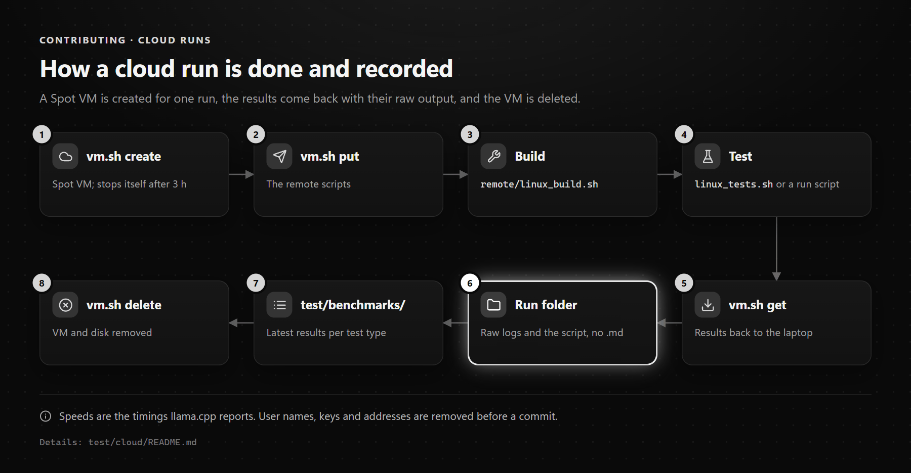
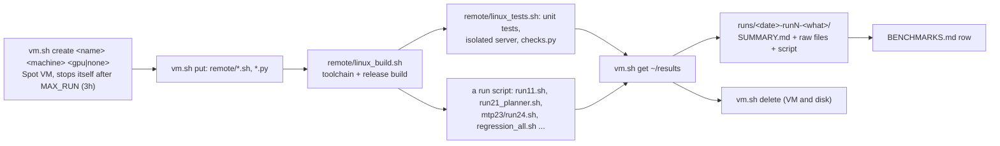

# Component: `test/cloud/` (machine runs and their record)

## Technical specification

- **Purpose:** run the Engine on machines other than the developer's (Google Cloud GPU and CPU VMs, a
  1 vCPU VPS, the dev laptop for same-settings comparisons) and keep every result with its raw output.
  Speed, memory and platform claims in READMEs and docs point to a run here.
- **Platform support:** the helper `vm.sh` needs `gcloud` (Bash; Git Bash on Windows). Remote scripts
  run on Ubuntu / Debian VMs; some runs were on Windows (runs 17, 20, 22, 27, 29-31).

## Flow of one run

`vm.sh` creates Spot VMs (`--provisioning-model=SPOT --instance-termination-action=STOP
--max-run-duration`), tries the zones in `ZONES` in order and remembers the zone per VM. A stopped VM
keeps its disk with the build and the models, so `start` continues; `delete` removes both.

## Files

| Path | What it is |
|---|---|
| `vm.sh` | create / start / stop / ssh / put / get / delete / list for Spot VMs |
| `BENCHMARKS.md` | one row per run (platform table), then chat speed and voice/embedding tables |
| `runs/<date>-runN-<what>/` | one folder per run: `SUMMARY.md`, raw output, the script used |
| `remote/linux_build.sh`, `linux_tests.sh` | standard build and test on a fresh Ubuntu Deep Learning VM |
| `remote/checks.py` | every chat model (short and long prompt), speech round trip, embeddings, GGUF speech, mixed rounds |
| `remote/regression_tests.sh`, `regression_all.sh` | `test/engine_regression/run.py` on a VM, one model at a time so a stopped Spot VM keeps finished reports |
| `remote/release_tests.sh` | a GitHub release on a clean VM through the one-command install |
| `remote/compare3.py` | Cluaiz, Ollama and LM Studio on one VM with the same GGUF files and prompt |
| `remote/run11.sh`, `run12.sh`, `features11.py` | runs 11-12 on the L4 VM |
| `remote/run21_planner.sh`, `multiturn_cache.py`, `vram_hog.py` | run 21: planner release check, cache reuse past a sliding window, another process taking VRAM during a load |
| `remote/moe_cache_*.sh` | run 13: official llama.cpp's MoE GPU cache and its tuner |
| `remote/ssd_test.sh`, `ssd_same_settings.sh` | a model bigger than RAM + VRAM; Cluaiz against official llama.cpp with the same settings |
| `remote/vps_cpu_same_settings.sh`, `vps_run16_ollama.sh`, `vps_run18_features.sh`, `vps19/` | runs 15-19 on a 1 vCPU / 4 GB VPS without a GPU |
| `remote/mtp23/` | runs 23-24: MTP off, on and Auto in every placement |
| `remote/models*.txt` | model lists the scripts pull |

## Rules for a run

- An isolated server: `CLUAIZ_HOME` in a temp folder, port 8011. Never a developer's own home or 8000.
- Speeds are llama.cpp's own timings (the `llama.cpp timings` log line or `engine.timings` in the
  response), not counted by the client.
- A comparison with another tool uses the same machine, GGUF file, context, placement and prompt, and
  says which settings differ.
- Raw output is saved to files while the test runs; the summary is written from those files.
- Usernames, keys and the VPS address are removed (`<user>`, `<key>`, `<vps>`) before a commit.
- `SUMMARY.md` ends with what the run does not prove.

## Decisions and why

| Decision | Why | Alternative not taken |
|---|---|---|
| Spot VMs that stop themselves | GPU VMs cost money per hour; a forgotten VM stops after `MAX_RUN` | on-demand VMs |
| One model per step in long scripts (`regression_all.sh`) | a Spot reclaim mid-run would lose all results; finished models keep their reports | one long loop |
| Every run in its own folder with its script | a later reader can rerun it or check what exactly was measured | one shared results file |

## Pending

| Item | Why it matters | Needs |
|---|---|---|
| Runs 2, 6, 14 and 26 have no row in `BENCHMARKS.md` | run 6 has a folder (`2026-11-09-run6-cpu-os-matrix/RESULTS.md`), run 14 a script (`ssd_same_settings.sh`) but no folder, run 26 a folder not yet committed, run 2 nothing | rows, or a note that the run was dropped |
| `remote/vram_hog.py` and `remote/mtp23/vram_hog.py` are identical | two copies drift | keep one; `mtp23/run23.sh` and `run24.sh` call `$HERE/vram_hog.py`, so first check how `mtp23/` is copied to the VM |
| The Mac run is in `test/mac/runs/`, not here | runs are in two places | move it, or link it from `BENCHMARKS.md` |
| A CPU-only run on an 8 GB VM for the Auto thinking ceiling | the slow-machine path is unit-tested only (runs 30-31 were on a GPU) | the planned VM run |
