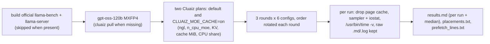

# Component: `test/cloud/remote/ssd_prefetch/` (expert prefetch speed proof, written, not run)

## Technical specification

- **Purpose:** measure whether the llama.cpp fork's MoE expert prefetch (`CLUAIZ_EXPERT_PREFETCH`,
  `engine/llama/README.md`) together with the MoE GPU cache forced on (`CLUAIZ_MOE_CACHE=on`,
  `engine/plan/README.md`) makes generation faster for a model larger than RAM, against official
  ggml-org llama.cpp on the same machine, file and placement. Method: section 5 of
  `.agent/plans/engine/ssd-streaming/01-research-and-architecture.md` (git-ignored plan folder).
- **Status:** the script has not been run. Nothing in this folder is a measurement.
- **Platform:** the L4 VM of runs 11, 13 and 14 (GCP `g2-standard-8`: L4 22.5 GB, 4 cores / 8 threads,
  31 GB RAM), Ubuntu or Debian with CUDA. Linux only (`/proc/diskstats`, `drop_caches`).

## Flow



## Configurations

| Config | Tool | Placement and flags |
|---|---|---|
| `L-mmap` | llama-bench | the Cluaiz default plan's `-ngl` / `-ncmoe` / KV type, plain mmap |
| `L-dio` | llama-bench | the same with `-lm dio` (skipped if this llama-bench has no `dio` load mode) |
| `L-cache` | llama-bench, or llama-server if llama-bench has no `--moe-cache-mib` | the forced-cache plan's `-ngl` / `-ncmoe`, `--moe-cache-mib` and `--moe-cache-cpu-share` of that plan |
| `C-plan` | `cluaiz bench` | default plan (a model read from disk gets no MoE cache, so the prefetch never runs) |
| `C-cache` | `cluaiz bench` | `CLUAIZ_MOE_CACHE=on CLUAIZ_EXPERT_PREFETCH=off` |
| `C-pf` | `cluaiz bench` | `CLUAIZ_MOE_CACHE=on CLUAIZ_EXPERT_PREFETCH=on` |

Every run: page cache dropped first, `-t 4 -p 512 -n 128,400 -r 1` (`REPS` changes `-r`), flash attention
auto. Pairs to compare: `C-plan` with `L-mmap`, `C-cache` with `L-cache`, `C-pf` with the best of
`L-mmap` / `L-cache` / `C-plan`.

Recorded per run: prompt and generation t/s (each tool's own table), peak RSS (`/usr/bin/time -v`), peak
VRAM and lowest free RAM (sampler, 1 s), page cache size, disk read MB/s from `/proc/diskstats` of the
partition holding the model (mean over the run), `iostat -x` (queue depth), the placement and MoE cache
size each Cluaiz run really used (`placements.txt`) and the prefetch counters (`prefetch_lines.txt`).

## Commands

On the dev machine (Git Bash, Engine root), with the local commits that hold the switch and the prefetch
(fork `a2d0fbed9` with Engine `f25d2f6f`, the switch `47d5d9aa`, the log filter `27654fce` that lets the
plan parser read llama.cpp's `MoE cache size` line). They are not pushed, so the VM gets a source tarball:

```bash
tar -czf /tmp/cluaiz-src.tgz --exclude=./target --exclude=.git .
test/cloud/vm.sh create l4-prefetch g2-standard-8 nvidia-l4
test/cloud/vm.sh put l4-prefetch /tmp/cluaiz-src.tgz cluaiz-src.tgz
test/cloud/vm.sh put l4-prefetch test/cloud/remote/linux_build.sh linux_build.sh
test/cloud/vm.sh put l4-prefetch test/cloud/remote/ssd_prefetch/run_prefetch.sh run_prefetch.sh
test/cloud/vm.sh ssh l4-prefetch "bash linux_build.sh ~/cluaiz-src.tgz 89"     # release build, CUDA for the L4
test/cloud/vm.sh ssh l4-prefetch "CLUAIZ=~/cluaiz/target/release/cluaiz nohup bash run_prefetch.sh ~/results-ssd-prefetch > run.log 2>&1 &"
```

Back on the dev machine: `test/cloud/vm.sh get l4-prefetch results-ssd-prefetch test/cloud/runs/<date>-runN-ssd-prefetch/`,
write `SUMMARY.md` from the raw files, add a `BENCHMARKS.md` row, `test/cloud/vm.sh delete l4-prefetch`.
The `vm.sh create` arguments follow `vm.sh`'s usage line (`<name> <machine> <gpu-type|none>`); the GPU type
`nvidia-l4` is not written in any earlier run record, so check it against the GCP accelerator list first.

## Proposed pass bar (the owner decides the final numbers)

From section 5.5 of the plan:

| Check | Pass |
|---|---|
| `C-plan` against `L-mmap`, `C-cache` against `L-cache` | generation within ±3% (median of 3) |
| `C-pf` against the best of `L-mmap`, `L-cache`, `C-plan` | generation >= 1.2x, median of 3, the ranges of the rounds do not overlap |
| Mechanism | disk MB/s and queue depth higher with `C-pf` than `C-cache`, disk bytes per token not higher |
| Safety | no crash, no OOM, peak RSS within the plan's RAM budget |

A result that does not pass is recorded as such; Auto stays off and nothing public changes.

## Decisions and why

| Decision | Why | Alternative not taken |
|---|---|---|
| llama-bench gets the placement Cluaiz planned | the comparison is the same placement, as in run 14 (`ssd_same_settings.sh`) | llama.cpp's `--fit` (a different placement; measured in run 13) |
| One run per config per round, page cache dropped before each, order rotated | section 5.3: a warm page cache or a fixed order would favour whichever runs later | `-r 3` in one process (the 2nd and 3rd repetitions read from a warm cache) |
| llama-server fallback for `L-cache` | the pinned fork's `tools/llama-bench/llama-bench.cpp` has no `--moe-cache-mib` (grep, 2026-11-22); llama-server has it (run 13 used it). Its numbers come from one request, not llama-bench's method, so they are marked `llama-server` in the table | leave the cache baseline out |
| Each Cluaiz run plans again; `placements.txt` keeps what it used | a manual placement in Cluaiz turns the MoE cache off (planner rule), so the cache runs must use the planner | pinning `--n-cpu-moe` (no cache then) |
| Resumable (`<tag>.done`) | Spot VMs stop; finished runs are kept | one uninterrupted loop |

## What was checked without a run

- `bash -n run_prefetch.sh`: no syntax error.
- The plan parser on a real `cluaiz serve -vv` log of OLMoE (2026-11-22, laptop) printed
  `-1 16 4096 f16 1642 0.8` (ngl, n_cpu_moe, n_ctx, KV, cache MiB, CPU share), matching that log.
- The summary step on hand-made tables in the llama-bench, `cluaiz bench` and llama-server formats (fake
  numbers, format only): each row and the medians were filled.

Not checked: the build, the pull, `drop_caches`, the sampler, iostat, llama-server's flags on the official
build, `-lm dio` on the official build, the time the whole run takes (expected to fit in `vm.sh`'s 3 h
`MAX_RUN`; not measured).

## Failure and recovery

- No plan read, or the forced plan has no cache (less than 256 MiB of VRAM left): the script stops with a
  message pointing to `plans.log`.
- A Spot stop: start the VM and run the same command; finished runs are skipped.
- A run that fails: its exit code is in `<tag>.time`, its stderr in `<tag>.log`; the summary leaves its cells
  empty.

## Pending

| Item | Why it matters | Needs |
|---|---|---|
| The run itself | no number exists yet | the owner's yes and the VM cost |
| Windows laptop run (run 20 case) | the reported 52 MB/s was on Windows; this script is Linux only | a Windows version with `typeperf` and an owner-approved standby-list tool |
| Final pass numbers | the bar above is proposed | the owner |
| `L-cache` through llama-bench | a different method from the other rows when llama-server is used | a llama-bench with `--moe-cache-mib`, if upstream adds one |
