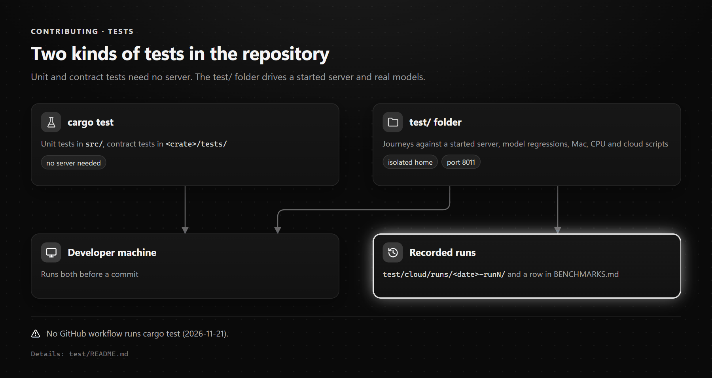
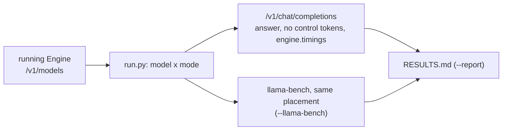

# Component: `test/engine_regression/` (every chat model x placement, against llama-bench)



## What it does

`run.py` takes every installed GGUF chat model from a running Engine (`/v1/models`, category `chat`),
runs each placement mode (`auto`, `gpu`, `split`, `cpu`) through the real chat API and checks that the
request succeeds, the answer is not empty, and no chat-template control token (`<|...|>`) leaks into
the answer or the reasoning. It records llama.cpp's own timings from the response (`engine.timings`).
With `--llama-bench` it runs official llama.cpp's `llama-bench` with the same placement and settings
and flags a model whose generation speed is below `--min-ratio` (0.85) of llama-bench.



Modes that cannot fit are skipped by measured sizes: any mode when the file is bigger than free RAM +
free VRAM (unless `--allow-big`), `cpu` when it is bigger than free RAM.

## Run

Defaults (since 2026-11-21): `--api http://127.0.0.1:8011`, and the token and models from
`$CLUAIZ_HOME`; without `CLUAIZ_HOME` (or `--token-file` and `--models-dir`) the script stops, so it
never tests a developer's own Engine on port 8000 or `~/.cluaiz`.

```bash
CLUAIZ_HOME=<test home> CLUAIZ_PORT=8011 target/release/cluaiz.exe serve
python test/engine_regression/run.py --api http://127.0.0.1:8011 \
    --token-file <test home>/session.token --models-dir <test home>/models \
    --modes auto,gpu,split,cpu --runs 3 \
    --llama-bench target/llama-ref/bin/Release/llama-bench.exe --report test/engine_regression/RESULTS.md
```

Exit code 0 when every check passed, 1 otherwise. Options: `--only`, `--skip`, `--runs` (the first run
is the cold one), `--max-tokens` (64), `--allow-big`, `--min-ratio`.

## Results

[`RESULTS.md`](RESULTS.md): the dev laptop, 2026-10-12. Cloud regression runs use the same script
through `test/cloud/remote/regression_tests.sh` (runs 5 and 9 in `test/cloud/BENCHMARKS.md`).

## Pending

| Item | Why it matters | Needs |
|---|---|---|
| `RESULTS.md` is from 2026-10-12 | the laptop numbers predate a month of changes | a rerun with `--report` |
