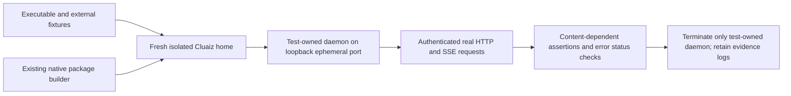

# Component: Media release acceptance

## Technical specification

- **Purpose:** exercise attachment APIs through an actual separately supplied CLI executable. This complements library and in-process router tests; it does not replace App or installer acceptance.
- **Owner:** `artifact_acceptance.rs` is registered as the `artifact_acceptance` integration target in `api/Cargo.toml`. It adds no production command or startup dependency.
- **Platform:** the process launcher suppresses a background console on Windows. Runtime model/provider compatibility still depends on the supplied executable/package; results apply only to the actual target exercised.
- **Fixtures:** real external model weights and a speech sample with independent reference text. Small PNG, PDF and DOCX fixtures reuse existing image/document builders; the scanned PDF contains raster pixels rather than an embedded answer layer. Encoded video is externally supplied.

## Flow



## Running the actual-executable test

Supply these environment variables before running:

| Variable | Required value |
|---|---|
| `CLUAIZ_HOME`, `CLUAIZ_MEDIA_TEST_HOME` | Same fresh absolute directory, which must not exist yet |
| `CLUAIZ_ARTIFACT_EXE` | Newly built main CLI executable |
| `CLUAIZ_ARTIFACT_BUILDER` | Built `cluaiz-builder` executable |
| `CLUAIZ_NATIVE_MEDIA_TEST_PACKAGE` | Reviewed matching-platform native OCR/PDF/video package |
| `CLUAIZ_MEDIA_MODEL` | Actual image/audio-capable GGUF, with its matching projector in the package directory |
| `CLUAIZ_ONNX_TTS_MODEL`, `CLUAIZ_ONNX_STT_MODEL` | Supported actual speech model primary files |
| `CLUAIZ_ONNX_TEXT_MODEL`, `CLUAIZ_ONNX_IMAGE_MODEL` | Supported actual text/image embedding primary files with processor assets |
| `CLUAIZ_ARTIFACT_AUDIO`, `CLUAIZ_MEDIA_EXPECTED` | Encoded spoken WAV file and a nonempty independently known transcript substring |
| `CLUAIZ_VIDEO_TEST_FIXTURES` | Directory containing the actual `red-blue-audio.mp4` fixture described in `video_spike/README.md` |
| `CLUAIZ_ARTIFACT_TEXT_DIMS`, `CLUAIZ_ARTIFACT_IMAGE_DIMS` | Expected output dimensions of those selected graphs |

```text
cargo test -p cluaiz-api --test artifact_acceptance real_final_executable_attachments_and_onnx_apis --release --no-default-features --offline -- --ignored --nocapture
```

## Chat-planner-only acceptance

`real_chat_planner_only_selected_models_settings_and_timings` reuses the same daemon/client owner without loading any model or running speech/embedding tasks. Supply fresh `CLUAIZ_HOME`, `CLUAIZ_ARTIFACT_EXE`, and explicit `CLUAIZ_PLANNER_REGISTRY`, `CLUAIZ_PLANNER_SETTINGS`, `CLUAIZ_PLANNER_CHAT_ROOT` paths. Only registered Chat entries directly beneath that root are copied into the test home; weights stay external/read-only. The saved settings and optional sibling hardware profile are copied, without changing their sources.

```text
cargo test -p cluaiz-api --test artifact_acceptance real_chat_planner_only_selected_models_settings_and_timings --release --no-default-features --offline -- --ignored --nocapture
```

The test makes three timed calls per selected Chat ID; checks native/planned contexts, concise modality declarations, saved Auto values, context/batch/buffer overrides, and400/401/422 negative cases; then changes only its own isolated settings to verify manual settings. Raw JSON and `planner-measurements.json` remain in the printed test home. It checks that original registry/settings/token bytes stay unchanged and terminates only its child. Timings describe the supplied executable/machine/current memory state; first process requests and repeats are recorded separately, without claiming a cold OS disk cache or a portable latency guarantee. Filter the test name explicitly to avoid running the separate attachment/inference suite.

All model weights remain outside the test home. The test invokes the existing manifest verifier to stage assets, registers the explicit model files using the existing registry owner, and saves only test settings: CPU/two threads, context4096, 1GiB host reserve, 1MiB encoded/16MiB decoded media ceilings and 512MiB projector workspace estimate. Production memory guards remain active; insufficient RAM or an incompatible package fails the test.

The child inherits the isolated home and uses an ephemeral loopback port. Its bootstrap is deliberately offline, and its process PATH already includes its private bin directory so bootstrap need not alter the user's PATH. Provider/runtime dependencies must already be supplied as required by that executable. No model or driver installation is performed by this harness.

## Assertions and failure handling

### Focused embedding and vision executable acceptance

`embedding_acceptance.rs` reuses the existing daemon/client owner and is filtered as `embedding_acceptance::real_final_executable_embeddings_and_vision` in the same integration target. Supply a fresh isolated `CLUAIZ_HOME`/`CLUAIZ_MEDIA_TEST_HOME`, `CLUAIZ_ARTIFACT_EXE`, `CLUAIZ_GGUF_EMBEDDING_MODEL`, `CLUAIZ_ONNX_TEXT_MODEL`, `CLUAIZ_ONNX_IMAGE_MODEL`, `CLUAIZ_MEDIA_MODEL` and `CLUAIZ_EMBEDDING_TEST_TEXT`. Weights remain external and are never downloaded by this test.

The focused case uses CPU/two threads/context512, the default resource guards, actual text/image vectors, extraction-to-vector dispatch, no-token401, unsupported GGUF media400, repeated native color-image answers and subsequent text recovery. Image-vector sessions finish before loading native chat; this does not certify concurrent large-model residency. The supplied executable is tested as a separate process on an ephemeral loopback port. Cleanup terminates only that owned process; it does not restart the user's engine or prove graceful daemon shutdown. Native-media provider staging and the broader speech/video/document cases belong to the separate existing suite.

~~~text
cargo test -p cluaiz-api --release --offline --test artifact_acceptance embedding_acceptance::real_final_executable_embeddings_and_vision -- --ignored --exact --nocapture --test-threads=1
~~~

### Broader attachment suite assertions

- Before spawning, token-path resolution must point into the selected test home. The user's default session-token bytes are compared without printing them, both after daemon startup and after cleanup.
- HTTP authentication, corrupt extraction, strict agent source denial and body-size rejection must return their actual failure status.
- A separate incomplete ONNX package must return HTTP400 `invalid_model` with required helper names before its deliberately unusable attachment source is read. The valid installed image package is exercised separately.
- Text/scanned PDFs and DOCX must produce their real content. Selected native model answers must identify actual image/video colors and speech/document content, with chat SSE errors treated as failures even under HTTP200.
- Speech synthesis must decode to nonempty non-silent PCM; speech recognition must match the independent sample reference. Text/image vectors must have expected dimensions, finite entries and unit norm.
- Drop terminates and waits for only the test-owned process, including after a failed assertion. This is forced test cleanup, **not** a graceful daemon-shutdown proof. The fresh home and daemon stdout/stderr remain for diagnosis; reuse requires a new home.
- Port selection closes a temporary listener before child startup; another process can win that race, in which case acceptance fails instead of attaching to a configured user server. This test does not establish installer correctness, total native memory bounds, all codecs/models or App rendering/history behavior.

## Other fixture owners

- `video_spike/`: isolated native SDK/ABI and SDK-free provider-package loading tests. These establish decoder behavior separately from model inference.
- `../../api/tests/`: HTTP router fixtures and transport/model-specific acceptance. Existing document fixture construction lives in `../../engine/media/tests/support/` and is imported directly here.
