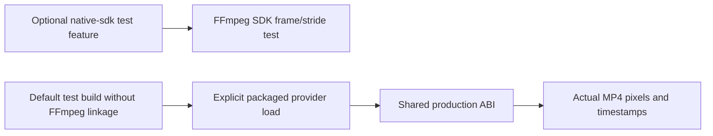

# Component: Native video packaging acceptance

## Technical specification

- **Purpose:** isolated SDK and lazy-package acceptance for the shared native decoder. No test command is added to production CLI binaries.
- **Platform evidence:** genuine H264 frames were checked on Windows x86_64 and Ubuntu 24.04 x86_64 under WSL. Build/source presence alone does not establish a model/API result.
- **Reuse:** the lazy loader compiles the exact production `video/abi.rs` contract. Actual production decoding remains in `engine/media/providers/ffmpeg`.

## Architectural flow



## Interface and files

- **`src/lib.rs`:** `native-sdk` opt-in checks a genuine 34x26 H264 MP4 supplied through `CLUAIZ_VIDEO_SPIKE_FILE`, its odd RGB stride and four presentation timestamps. `FFMPEG_DIR` supplies explicit SDK headers/import libraries. Runtime search setup is allowed for this SDK-only test.
- **`src/lazy_loader.rs`:** default build has no active FFmpeg dependency. Supply `CLUAIZ_VIDEO_TEST_PACKAGE` and `CLUAIZ_VIDEO_TEST_FIXTURES` containing `red-blue-audio.mp4`. The test loads the packaged provider directly, invokes its shared ABI and compares actual frame colors/timestamps.
- **Dependencies:** `anyhow`, `libloading`, and optional `ffmpeg-next` 8.1.0. This is an isolated workspace to keep SDK build requirements outside the engine's default workspace.

## Commands

```text
cargo test --manifest-path test/media_regression/video_spike/Cargo.toml --features native-sdk -- --nocapture
cargo test --manifest-path test/media_regression/video_spike/Cargo.toml -- --ignored --nocapture
```

Run the second command without SDK/library-search environment entries. On Linux the test package's own `$ORIGIN` lookup must find transitive dependencies. On Windows the explicit loader restricts dependencies to the package and system directory.

## Failure and recovery

- **Missing SDK/package:** the relevant build or real load fails. The test does not substitute system FFmpeg or generated pixels.
- **Padded dimensions:** H264 native coded dimensions can exceed visible 34x26. The lazy fixture allows 4096 native pixels while still comparing actual visible dimensions and colors.
- **Scope:** these tests do not certify arbitrary codecs, models, hardware acceleration, a clean installer, native process memory bounds or the App UI. Real model/API acceptance lives in `api/tests/video_contract.rs`.
