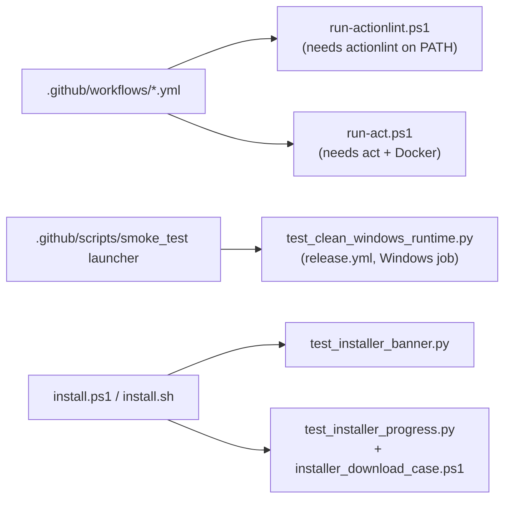

# Component: `test/workflows/` (workflow and installer checks)

Two kinds of scripts: linters that check `.github/workflows/*.yml` before a push (`run-actionlint.ps1`,
`run-act.ps1`), and Python tests of the release launcher and the installer scripts. Only
`test_clean_windows_runtime.py` runs in CI (`.github/workflows/release.yml:119`).



Scripts to test the GitHub Actions workflows on the local machine before pushing them, which saves CI time and
keeps the commit history clean.

## 1. `run-actionlint.ps1`

**What it does:** scans every `.github/workflows/*.yml` file in about a second and reports typos, syntax errors
and invalid workflow structure. It does not need Docker.

**Run (PowerShell):**

```powershell
.\test\workflows\run-actionlint.ps1
```

"0 errors" or "passed" in the output means the workflow files are valid.

---

## 2. `run-act.ps1`

**What it does:** uses `act` and Docker to create a GitHub-like Ubuntu / Windows environment on the local machine
and runs the CI/CD pipeline in it, to confirm that the code really compiles there.

**Run:** start Docker Desktop, then in PowerShell:

```powershell
.\test\workflows\run-act.ps1
```

The first run can download several GB of Docker images, so it takes a while.

## Installer banners and live progress

`python test/workflows/test_installer_banner.py` checks Cog spacing, Windows/shell parity and the existing CLUAIZ wordmark.
`python test/workflows/test_installer_progress.py` exercises the actual downloader against a tiny local HTTP fixture: live percentage, unknown size, redirects, HTTP errors, interrupted bodies and plain logs. It uses available Windows PowerShell/PowerShell7/POSIX shells; `CLUAIZ_TEST_SH` can select a shell. No real Cluaiz installation, GPU pack or user PATH change occurs. Logs go to `.agent/installer-logo-proof`.

## Windows release runtime isolation

`python test/workflows/test_clean_windows_runtime.py` starts real Windows PowerShell child processes through the release smoke-test launcher. It checks removal of developer PATH entries, the executable's working directory, preservation of other environment values, missing arguments and failure exit codes. It changes only the child environment; the user's PATH and installed Engine are untouched. The Windows release job runs it before building the core.

## Results on 2026-11-21 (Windows 11)

| Test | Result | Why |
|---|---|---|
| `test_clean_windows_runtime.py` | 3 tests OK | |
| `test_installer_banner.py` | 2 failures, 1 error | it reads `cmd/src/assets/logos/logo_gallery.rs`, which no longer exists, and expects the two installers' banners to match line for line (6 lines found where 24 were expected) |
| `test_installer_progress.py` | 8 failures (Windows PowerShell 5 and `sh`, every endpoint) | the installers changed after the test was written (`installer_download_case.ps1` cuts `install.ps1` at a `# --- Mascot` marker); not investigated further, because installer code is changed only on the owner's request |
| `run-actionlint.ps1`, `run-act.ps1` | not run here | need `actionlint`, or `act` with Docker |

## Pending

| Item | Why it matters | Needs |
|---|---|---|
| The two installer tests fail against the current installers | they no longer protect the banner or the download progress | update the tests to the current `install.ps1` / `install.sh`, or delete them (installer work needs the owner's go-ahead) |
| Only one of these tests runs in CI | the others run only when someone remembers | add the passing ones to a workflow |
