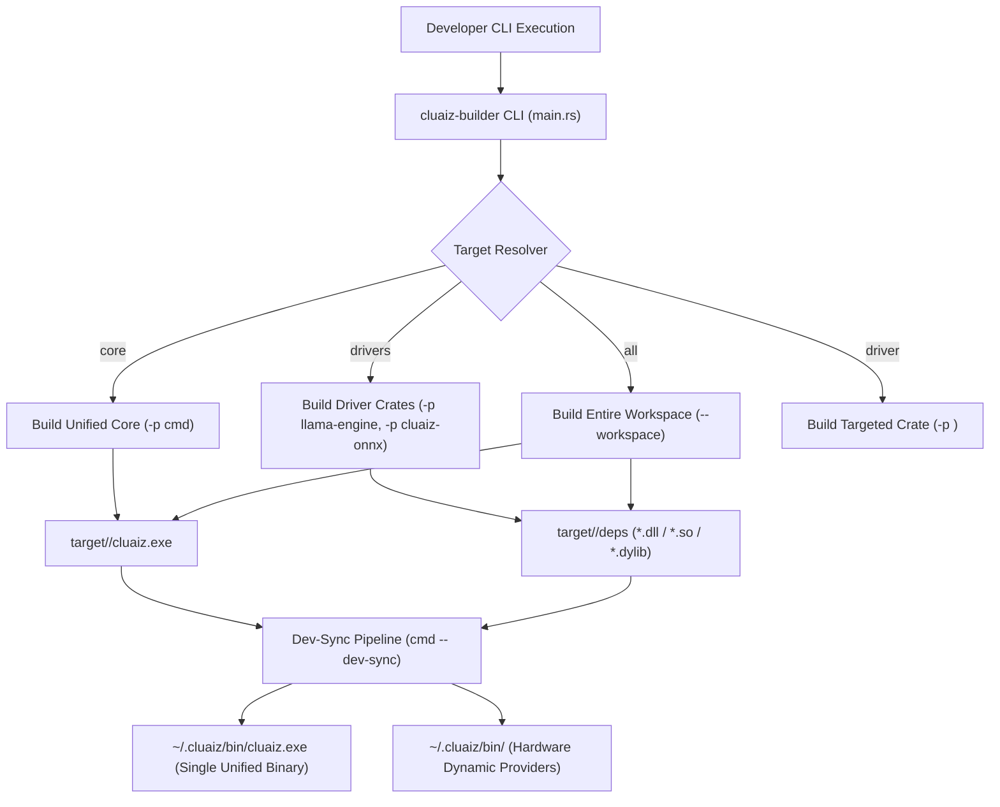

# Component: Cluaiz Modular Builder (`tools/cluaiz-builder`)

## Technical Specification
- **Component Name:** `cluaiz-builder`
- **Location:** `tools/cluaiz-builder/`
- **Purpose:** Orchestrates granular compilation across the single-binary core and hardware-adaptive dynamic drivers without compiling unused dependencies.
- **Platform Support:** Windows (x86_64), Linux (x86_64, aarch64), macOS (Apple Silicon arm64, x86_64).
- **Execution Target:** Generates the unified standalone executable (`bin/cluaiz.exe` / `bin/cluaiz`) and dynamically loaded execution providers (`bin/`, beside the executable).
- **Build Profiles:** `debug` (Rapid iteration, unoptimized) and `release` (LTO, SIMD vectorized, optimized production binary).

---

## Architectural Flow



---

## 🛠️ Build Commands Matrix

The builder gives 1:1 granular control so you compile only what changed:

### 1. Build Unified Core Binary (`core`)
Compiles the unified engine binary containing the CLI, HTTP/RPC daemon, statically linked LLaMA Core, and Base ONNX runtime into a single standalone executable.
```bash
cargo run -p cluaiz-builder -- core --profile <debug|release>
```
- **Output:** `target/<profile>/cluaiz.exe` (Linux/Mac: `target/<profile>/cluaiz`)
- **Key Modules Compiled:** `cmd`, `cluaiz-api`, `cluaiz-security`, `cluaiz-core`, `cluaiz-hw`.

### 2. Build Hardware Adaptive Drivers (`drivers`)
Compiles hardware-accelerated dynamic runtime libraries (CUDA execution providers, DirectML, TensorRT) without rebuilding the core binary.
```bash
cargo run -p cluaiz-builder -- drivers --profile <debug|release>
```
- **Output:** Driver libraries in `target/<profile>/` (`onnxruntime_providers_*.dll`, `DirectML.dll`, etc.).

### 3. Build a Specific Driver in Isolation (`driver <name>`)
Targets a single hardware acceleration engine crate:
```bash
# LLaMA Engine Driver
cargo run -p cluaiz-builder -- driver llama --profile <debug|release>

# ONNX Engine Driver
cargo run -p cluaiz-builder -- driver onnx --profile <debug|release>
```

### 4. Build Entire Workspace (`all`)
Compiles all workspace members (Core + Drivers + CLI + Builder):
```bash
cargo run -p cluaiz-builder -- all --profile <debug|release>
```

---

## 🔄 Deployment & Synchronization (`dev-sync`)

Native OCR/PDF package staging uses `media-assets`:

```bash
cargo run -p cluaiz-builder --release --bin cluaiz-builder -- media-assets --source <verified-native-package> --output <new-staging-directory>
```

Staging reuses the runtime manifest verifier, copies declared library/dependency/traineddata/license files, checks SHA-256 digests and refuses an existing output. It performs no model/provider download. The installer or embedded launcher must deploy the staged directory as `bin/media` inside its selected Cluaiz environment. Current physical native acceptance is Windows x86_64; other-platform packages and a clean-machine installer remain unverified. See the [shared native provider contract](../../engine/media/src/documents/README.md).

Compilation places artifacts inside `target/<profile>/`. To deploy these updates into your active system directory (`~/.cluaiz`), execute the synchronization command via the unified CLI:

### 1. Synchronize Everything (`dev-sync all`)
Deploys both the unified executable and all compiled hardware drivers to their respective locations:
```bash
cargo run -p cmd -- dev-sync all --profile <debug|release>
```

### 2. Synchronize Core Executable (`dev-sync core`)
Copies `target/<profile>/cluaiz.exe` to `~/.cluaiz/bin/cluaiz.exe` and links any ready hardware drivers in `target/<profile>/` into `~/.cluaiz/bin/`:
```bash
cargo run -p cmd -- dev-sync core --profile <debug|release>
```

### 3. Synchronize Specific Driver (`dev-sync driver <name>`)
Deploys a single driver update into `~/.cluaiz/bin/`:
```bash
cargo run -p cmd -- dev-sync driver onnx --profile <debug|release>
cargo run -p cmd -- dev-sync driver llama --profile <debug|release>
```

---

## 📂 Target System Directory Layout (`~/.cluaiz`)

Every file per OS and GPU is listed in [`docs/deployments/install-layout.md`](../../docs/deployments/install-layout.md).

```text
~/.cluaiz/
├── bin/          cluaiz(.exe) and every driver: llama.cpp libraries, CPU and GPU backends,
│                 ONNX Runtime providers, and the NVIDIA libraries the engine downloads (cuDNN, ...)
├── config/       settings.json, permission.json, registries, hardware_profile.json
├── models/       chat/, embedding/, tts/, stt/, ingest/
└── tools/        skills/, plugins/, mcp/
```

---

## Deep File Breakdown

- `src/main.rs`:
  - **Logic:** Command-line entrypoint. Parses target flags (`all`, `core`, `drivers`, `driver <name>`), validates profile (`debug` vs `release`), and constructs atomic Cargo invocations.
  - **Flow:** Resolves target crates, applies local CI hooks if available, and executes `Command::new("cargo")` synchronously.
  - **Why:** Centralizes the build contract so developers and CI workflows use a unified script rather than remembering crate dependencies.

- `src/local_ci.rs`:
  - **Logic:** Local-first continuous integration harness.
  - **Flow:** Inspects host hardware capabilities via `cluaiz_hw::HardwareProber` and appends target-specific feature flags (e.g., `--features cuda` when an NVIDIA GPU is present).
  - **Why:** Guarantees that local driver builds match host silicon capabilities automatically.

---

## Failure & Recovery Matrix

| Failure State | Root Cause | Recovery Mechanism |
| :--- | :--- | :--- |
| **OS Error 32 / Permission Denied** | A running engine daemon holds a file lock on `~/.cluaiz/bin/cluaiz.exe`. | The sync pipeline automatically executes the atomic rename protocol (`copy_with_rename` creates a temporary `.old` file, copies the new binary, and unlinks the old file). |
| **CUDA Driver Not Found** | System lacks NVIDIA GPU or CUDA Toolkit during compilation. | The builder gracefully falls back to CPU SIMD and DirectML targets without breaking the core build. |
| **Missing Artifact during Sync** | Build step was skipped or failed prior to executing `dev-sync`. | Run `cargo run -p cluaiz-builder -- all --profile release` to compile missing targets before syncing. |
